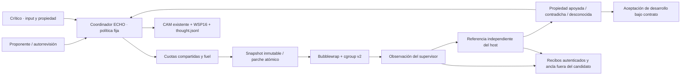

# PCWORLD-1 · arquitectura y contrato de evidencia

`pcworld/` es un adaptador host. No copia el motor de ECHO ni modifica NEXUS-0,
CAM, WSP16 o Q. Los eventos usan relaciones nativas para observación, pregunta,
acción, fallo, evidencia y propuesta. Dominio 9/generador 8 sigue los adaptadores
de investigación existentes; estilos 224–239 y secuencia de un byte permiten
4096 identificadores por episodio. `ext.slot` permanece cero. El identificador
completo del recibo y el índice CAM quedan en metadatos del host. No hay otro
canal que pueda tomar decisiones ni texto del visor que vuelva a la política.

## Frontera obligatoria

PCWorld, `echo4/code_mcp.py`/`CodeMemory.run_check` y `harness/localdev/runner.py`
usan `pcworld.runner.execute`. Se copia únicamente el workspace autorizado;
no se monta su padre ni `.echoai`. El hijo tiene `/usr` de sólo lectura, su
snapshot de sólo lectura, `/proc` y `/dev` aislados, y `/tmp`/`/out` temporales.
Red, PID, usuario y otros namespaces se separan mediante Bubblewrap. Un servicio
transitorio systemd de usuario limita el árbol con cgroup v2. No hay fallback.

El supervisor conserva políticas, referencias, credenciales explícitas del
conector y claves de recibos. Es autoridad confiable dentro de este prototipo;
no se afirma resistencia a un host comprometido. El kernel también es parte
de la base de confianza. No se instalaron herramientas ni se cambiaron reglas
de red del equipo para esta entrega.

Cada resultado incluye bytes de stdout/stderr en base64, vista de texto,
SHA-256, código de salida, causa de terminación, recursos y límites. Capturar
esos bytes prueba una ejecución observada. Un valor se contrasta después con
una implementación de referencia distinta, fuera del candidato. La aceptación
finita exige todas las entradas públicas, todos los contraejemplos retenidos y
los casos adicionales de desarrollo, sin errores ni comprobaciones omitidas.
No acredita corrección universal de Python ni ausencia universal de errores.

Un proceso no terminado, una salida inválida o un fallo sin valor contractual
producen propiedad desconocida. Una salida bien formada que discrepa de la
referencia produce contradicción. Los diagnósticos del worker localdev siguen
siendo no fiables porque comparten proceso con los tests del candidato; su
`PASSED` histórico significa únicamente observación de tests declarados.

## Cuatro brazos y memoria

- **S:** una propuesta y autorrevisión con el historial disponible, dentro del
  mismo presupuesto. Puede proponer un input de prueba y reparar el fallo.
- **I2:** dos propuestas desde el mismo estado inicial y contextos separados,
  con el presupuesto de tokens repartido. El selector usa sólo checks públicos;
  restaurar el workspace también cuenta como herramienta y consume fuel.
- **F:** proponente y crítico con flujo fijo y evidencia compartida.
- **E:** los mismos componentes que F; ATTEND guía una política fija que evita
  pedir otro diagnóstico cuando ya hay una contradicción reproducida. No se
  entrenó Q ni se demostró una mejora basal.

Máximo tres propuestas por contexto; dos consultas al crítico, como máximo una
por identidad de candidato. Las últimas ocho propiedades y contraejemplos
constituyen el contexto de evidencia acotado; el diario conserva el resto. Todos
los brazos parten sin biblioteca aprendida. Los contrastes de transferencia y
las tres ablaciones propuestas siguen pendientes.

La similitud no elimina candidatos. Un contraejemplo se ejecuta nuevamente en
cada versión. La caché exacta se prueba como API, pero no se usa para saltar
ninguna ejecución: el runtime host `/usr` todavía no es hermético. CAM no
certifica una receta nueva ni convierte una afirmación del LLM en un hecho.

## Contabilidad y reproducción

`Budget` reserva de forma atómica en el único supervisor. Fallos y rechazos
consumen fuel; cada especialista usa el mismo saldo. Se cuenta CPU del árbol de
hijos, herramientas, consultas, tokens de entrada/salida y tiempo transcurrido.
El coste CPU del supervisor se informa aparte. La limpieza y escritura del
último recibo añaden tiempo después del deadline de trabajo; no se prometen
límites de pared exactos sin esa sobrecarga. Tampoco se equipara CPU con julios.

Las reservas HTTP requieren contar primero el prompt en el mismo servidor y
reducir la salida máxima al saldo restante. Ese preflight cuenta como herramienta.
La respuesta debe informar consumo y modelo coherentes; si falta consumo se
carga la reserva conservadora, no cero. Por ello `llm_calls` y `tokens` en un
fallo son cantidades **cargadas**, no prueba de que el proveedor completó esa
inferencia. La cancelación local no demuestra cancelación del trabajo remoto.

Recibos y manifestaciones cubren código, contrato, tareas, proveedor, comandos,
entradas y snapshots. La auditoría rehace las propiedades desde los bytes y
reproduce el diario WSP; no vuelve a ejecutar el candidato. Exige las mismas
fuentes del prototipo. Para auditar una tanda antigua hay que recuperar sus
fuentes, no sustituir el manifiesto por el vigente. El ancla HMAC requiere
custodia privada; no se publica su clave junto a una pretendida certificación.

Referencias de implementación: [Bubblewrap](https://github.com/containers/bubblewrap#sandbox-security),
[cgroup v2](https://docs.kernel.org/admin-guide/cgroup-v2.html) y
[protocolo de tokenización de vLLM](https://docs.vllm.ai/en/v0.15.1/api/vllm/entrypoints/serve/tokenize/protocol/).
No se afirma haber desplegado vLLM o reproducido el experimento multiagente de
los artículos de la investigación.
