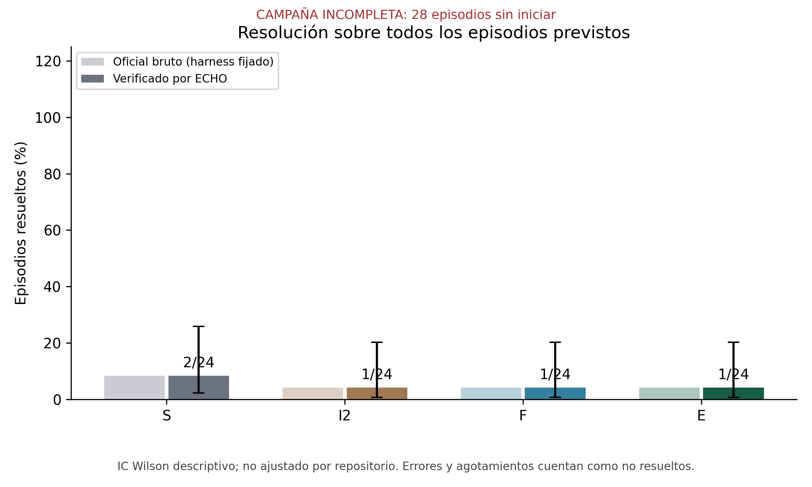
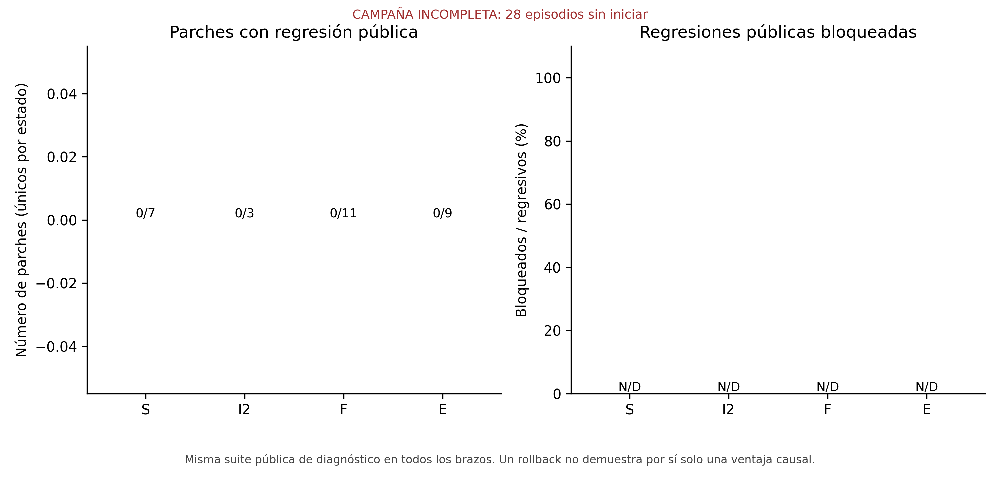
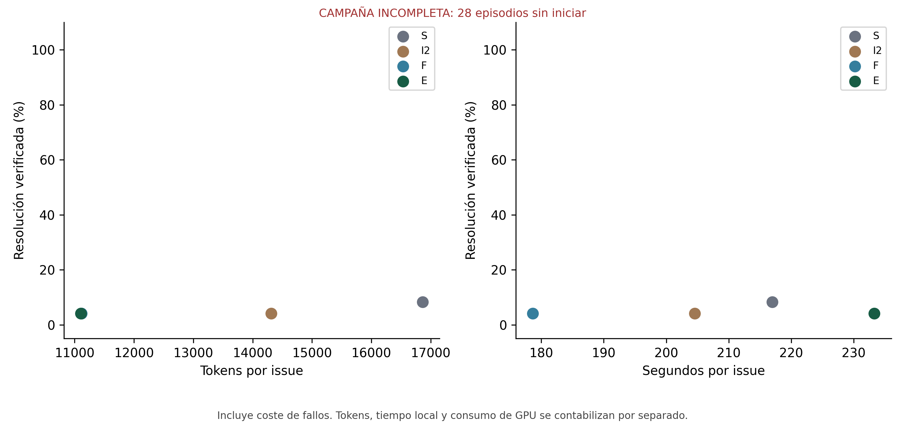
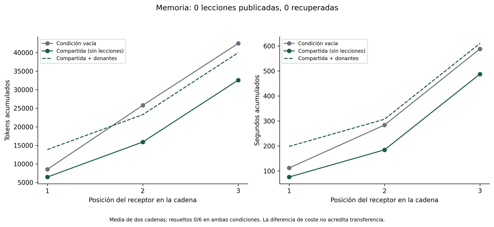
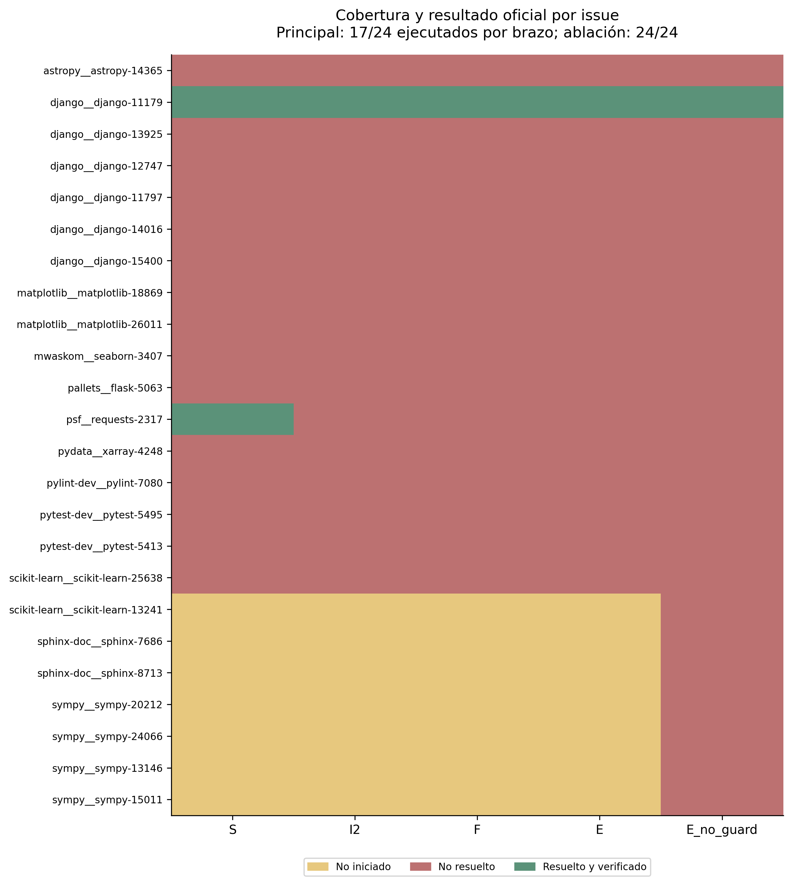
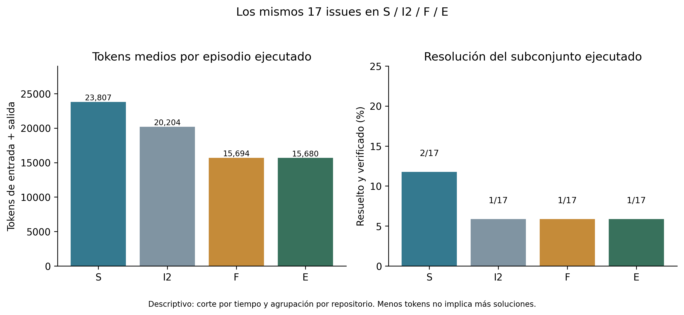
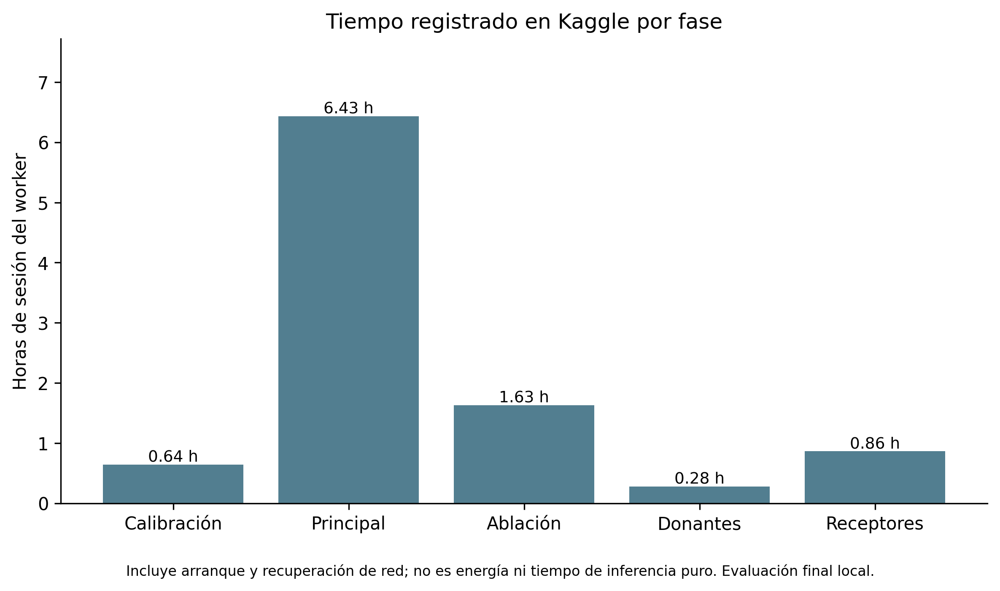

# ECHO-5.1 · conclusiones de la investigación publicada

16 de octubre de 2026. Publicación solicitada por Roger en
[navywakura/echoai](https://github.com/navywakura/echoai).
Cierre de investigación, no certificación de superioridad ni release verde.

## Conclusión científica

**Este andamiaje no compensó suficientemente las limitaciones del modelo y
la interfaz para mejorar la resolución en el experimento SWE-bench realizado.**
En los mismos 17 issues ejecutados, S resolvió 2; I2, F y E resolvieron 1 cada
uno. El panel registrado incluía 24 por brazo y conserva los no iniciados.
E consumió 34,14 % menos tokens totales que S, pero más por solución:
266.562 frente a 202.362. Es contención de gasto observado, no una mejora
simultánea de eficacia y eficiencia por solución.

No inferimos que el scaffolding nunca mejore un modelo ni que el éxito dependa
«100 % de sus pesos». Localización, herramientas, contexto, presupuesto y
políticas influyeron en las trayectorias; no se aisló su contribución total.
La hipótesis de que una parada conservadora reduce oportunidades es compatible
con estos resultados, pero no se ha demostrado como explicación causal única.
Tampoco llamamos casualidad al acierto adicional de S en Requests: fue un
acierto verificado, cuya generalización no puede estimarse con un solo par
discordante y una semilla.

No se demostró aquí un beneficio causal del guardarraíl: los dos eventos
etiquetados inicialmente como regresión correspondían a observaciones inválidas
por imports/colección. Hubo cero regresiones públicas válidamente observadas.
La transferencia tampoco quedó activada: cero lecciones publicadas y recuperadas.
El resultado no respalda las anteriores proclamaciones generales de H1/H2/H4.
Los pilotos sintéticos conservan su evidencia y sus límites particulares.

## Conclusión de ingeniería

La campaña distribuida entre host local y Kaggle conserva 115 episodios
realmente ejecutados, 35 celdas no iniciadas, 150 entregas finales,
18.546 registros/recibos contabilizados y 2.007.488 tokens. Los registros
permiten examinar recuperaciones, presupuestos y procedencia sin usar una
respuesta del modelo como prueba de éxito. La inferencia y la evaluación
reservada permanecieron separadas.

Las siete figuras PNG y PDF se regeneraron idénticas byte a byte en el entorno
registrado. **Eso no significa que volver a inferir con GPU produzca siempre
los mismos parches**, ni reproducibilidad universal entre máquinas. El paquete
público permite verificar hashes y rehacer gráficas; la auditoría HMAC completa
necesita los diarios y autoridades originales, que no publicamos con sus claves.

Se usó hardware local y cuota gratuita de Kaggle, sin compra de GPU para esta
campaña. No se ha elaborado una contabilidad económica integral: no presentamos
«0 euros» como coste total que incluya electricidad, equipo y trabajo.
La integridad criptográfica acredita custodia dentro de su alcance, no la
verdad de interpretaciones ni la ausencia universal de fallos.

## Conclusión estratégica

ECHO-5.5 prioriza agentes interactivos, percepción geométrica y planificación
basada en consecuencias observadas. Allí existen componentes deterministas
capaces de hacer trabajo útil directamente, en vez de limitarse a gestionar
propuestas de código. Esto justifica un experimento nuevo, no garantiza ganarlo.

El Arácnido dispone de planificación BFS condicionada a un modelo finito y de
memoria revisable; no es un A* general. Sus éxitos de navegación en Unity
usan observaciones y coordenadas distintas de las disponibles en ARC.
No extrapolamos un recorrido de 23 movimientos a la resolución de ARC-AGI-3.
La biblioteca deberá identificar candidatos a agente/meta desde observaciones
públicas, abstenerse cuando falten precondiciones y revocar inferencias falsas.

No concluimos que programar sea una batalla perdida ni que todos los agentes
comerciales ganen por fuerza bruta. Cerramos esta línea concreta porque no
mostró la ventaja buscada bajo sus restricciones. Su infraestructura y resultado
negativo sirven para diseñar contrastes más claros y evitar repetir errores.

## Verificación para publicación

La primera verificación local del 16 de octubre registró un error en
`test_registration_after_frontend_death_is_stopped_and_observed`: el runner
se negó a certificar una cancelación de arranque cuya limpieza no había
podido confirmar. La repetición aislada de las dos pruebas de ese módulo
pasó (2/2), sin modificar el código. No se atribuye una causa definitiva a
esa intermitencia ni se borra el intento fallido. El
[registro de publicación](PUBLICATION-VERIFICATION-20261016.json) conserva
los intentos y los hashes de sus logs, además de la comprobación de imágenes.
Una segunda verificación registró además `RACE_DETECTED` al comprobar
metadatos de un directorio durante una prueba de presupuesto de localización.
El comprobador incluye metadatos de ancestros; actividad concurrente en
un directorio temporal compartido es una explicación posible, no una causa
confirmada. La comprobación posterior usa un directorio temporal dedicado,
sin desactivar ni relajar esas defensas.
La pasada con temporales dedicados pasó RepoWorld (199 tests, tres omitidos)
y diseño (13), pero PCWorld registró dos errores: volvió a fallar la
confirmación de cancelación y la ruta temporal larga excedió el límite de
socket Unix en una prueba. PCWorld sí pasó sus 257 tests en el segundo
intento. **Ningún intento completo actual pasó las tres suites juntas.**
No se presenta la combinación de éxitos entre intentos como un gate verde.
Los logs de los tres intentos se adjuntan a la publicación. No se alteró
el código experimental para obtener un verde.
Esta publicación de investigación no promete ausencia universal de fallos.

## Datos y figuras

- [Informe completo: metodología, exposición, resolución y límites](REPOWORLD-SWE-RESULTS-20261016.md).
- [Cierre y custodia](CLOSURE-20261016.md).
- [Paquete público, datos y regeneración](swebench/results-v8-20261016/README.md).
- [Checklist final, incluidas hipótesis abiertas](CLOSURE-CHECKLIST.md).

Los PDF están junto a cada PNG. Los informes intermedios se mantienen como
historia experimental: sus cifras no sustituyen el resultado final ni deben
combinarse entre modelos, versiones o tareas como un único estudio.
