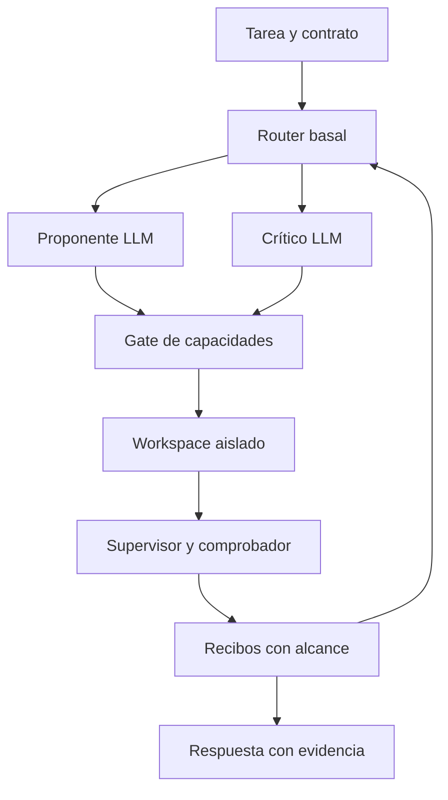

# ECHO-5.1 Investigación y plan de validación para Astra

**Destinatario:** Roger Navarro y el agente de implementación en Codex.  
**Fecha:** 12 de octubre de 2026.  
**Estado:** propuesta de investigación; no es una certificación ni un resultado de ECHO-5.1.  
**Base pública revisada:** `navywakura/echoai`, commit `f6062de0462a523296eb2cbb704472f4faa4a022`.  
**Documento de partida:** `ECHO-5.1-RESEARCH-BRIEF-GPT6.md`.

ECHO-5.1 merece un prototipo experimental. La primera versión debería combinar un proponente, un crítico que produzca contraejemplos ejecutables y un supervisor externo que controle ejecución, evidencia y presupuesto. La aportación científica que hay que demostrar es que el control basal y la memoria de ECHO mejoran resultados o costes frente a controles suficientemente fuertes.

La investigación actual **no permite afirmar que añadir especialistas vaya a superar a un agente único**. Tampoco permite trasladar el verde de ECHO-5 a ejecución general de código. Sí permite definir una arquitectura compatible con sus principios y un experimento capaz de detectar tanto una ventaja real como un resultado negativo.

El alcance inicial recomendado es **un workspace Linux aislado, sin red, con tareas de reparación de Python y consultas de datos**, seguido de exploración de archivos. Un escritorio completo con navegador y GUI quedaría para una fase posterior. El análisis combina revisión estática de fuentes públicas y literatura primaria; no se han ejecutado aquí las suites ni los benchmarks del repositorio. Las pruebas nuevas descritas a continuación son trabajo para Astra.

## 1 Qué conservar y qué corregir del briefing

Conviene conservar los dos relojes, el cortafuegos epistémico, el bus WSP, la trazabilidad y el presupuesto común. Varias afirmaciones del briefing necesitan una formulación más estrecha antes de convertirse en requisitos.

| Punto | Evidencia o problema | Consecuencia para 5.1 |
| --- | --- | --- |
| ECHO-5 en verde | El release declara verde dentro de su contrato. El neocórtex no intervino en los ensayos; el diagnóstico LIF no dirige la política. [R1] | Es una base validada con alcance concreto. No demuestra aún programación mediante LLM ni colaboración en un PC. |
| Ahorro del 49,23 % | Pertenece al currículo eficiente frente al adaptativo anterior. `certified_bound` reduce trabajo un 27,90 % en los 18 independientes y un 34,36 % en las nueve plantillas frente al baseline. [R2] | Corregir la atribución. El currículo sigue costando un 21,16 % más que el aleatorio optimizado. |
| 100 % de composición | El resultado es 9/9 plantillas; hay 12/18 independientes resueltos. [R2] | Publicar denominadores y familias. Evitar presentarlo como composición universal. |
| Gate con 60/60 bloqueos | El examen envió comandos como texto; no los ejecutó. El propio informe declara que no fue ciego. [R3] | Es evidencia del clasificador sobre ese corpus, no una prueba formal del aislamiento. |
| Integración MCP y sandbox | `echo_run_check` llega a `CodeMemory.run_check`, que usa directamente `subprocess.run`; no llama a `harness/localdev/runner.py`. [R4] | Todas las ejecuciones de PCWorld deben pasar por una única frontera obligatoria. |
| Montajes | El runner monta `/usr` y `workspace.parent` en lectura, además de salidas y scratch. No monta literalmente todo el host. [R5] | El montaje del padre puede exponer proyectos o datos hermanos. Dar acceso sólo a un snapshot mínimo y dependencias declaradas. |
| Límites de recursos | `RLIMIT_AS` limita espacio de direcciones; `RLIMIT_CPU`, tiempo de CPU. El timeout de reloj está implementado aparte en el runner. [R5, P14] | Separar memoria virtual, RSS, CPU acumulada y tiempo transcurrido. Medir el árbol de procesos. |
| Recibos criptográficos | Una cadena de hashes detecta alteraciones respecto a su anclaje; no autentica por sí sola una ejecución. Un atacante que controle todo el diario puede recalcular una cadena coherente. [R4] | Proteger al emisor y anclar la cabecera fuera del candidato. No equiparar hash con verdad. |
| Hamming y hashes de errores | Un hash criptográfico no preserva semejanza semántica. La misma excepción puede surgir en programas distintos, y una corrección puede conservar casi toda la estructura del fallo. | Separar identidad exacta, búsqueda por similitud y validez de una inferencia. Eliminar el veto aproximado propuesto. |
| Consulta O(1) | `Cam.nearest` recorre las ranuras; `lookup_key` tiene acceso exacto indexado y una búsqueda de respaldo aproximada; `CodeMemory.recall` recorre registros. [R4, R6] | Medir coste y ocupación. No atribuir O(1) a toda recuperación asociativa. |
| Lección de ROLES-1 | Su menor producción neta frente a orden fijo es un resultado local. No demuestra que todos los agentes homogéneos fallen ni que especialización y memoria sean condiciones necesarias. [R7] | Medir complementariedad y beneficio marginal; no asumir errores ortogonales por asignar roles. |
| B24 | El documento citado pertenece al programa S6 y a su DSL y campañas históricas. [R8] | Reutilizar principios de control y contabilidad, pero abrir un contrato nuevo, por ejemplo `PCWORLD-1`. No reabrir S6. |

`CLAUDE.md` no figura en el árbol público consultado, que se obtuvo completo. Astra deberá leer la versión del workspace local, junto con cualquier `AGENTS.md`, antes de implementar. La especificación NEXUS-0 consultada es histórica: su prohibición de LLM se refiere al experimento basal original y no autoriza a colocar un LLM dentro del bucle rápido. [R9]

## 2 Qué cambia la literatura de 2024 a 2026

La conclusión útil de la literatura es condicional: la colaboración puede ayudar cuando aporta información o búsquedas complementarias que compensan el coste de coordinación. Las cifras publicadas en otros entornos no son predicciones de rendimiento para ECHO.

| Trabajo primario | Hallazgo relevante | Aplicación propuesta y límite |
| --- | --- | --- |
| SWE-agent, 2024 [P1] | La interfaz entre agente y ordenador afecta sustancialmente al trabajo de programación. | Priorizar herramientas pequeñas, errores legibles y snapshots estables. Comparar brazos con la misma interfaz. |
| Agentless, 2024 [P2] | Un proceso sencillo de localización, reparación y validación constituye un control competitivo. | Incluir un flujo fijo fuerte. Ganar sólo a una implementación ReAct débil no justificaría la complejidad basal. |
| Mixture-of-Agents, 2024 [P3] | Agregar propuestas de varios modelos mejora determinados benchmarks de respuestas. | Motiva investigar propuestas complementarias; no acredita control de un SO ni mejora con el presupuesto de PCWorld. |
| MAST, 2025 [P4] | Analiza más de 1.600 trazas de siete sistemas y distingue fallos de diseño, coordinación y verificación. | Clasificar por qué falla cada episodio, además de contar aciertos. Un crítico adicional no corrige automáticamente un contrato defectuoso. |
| CaMeL, 2025 [P5] | Separa datos no fiables y control, y aplica capacidades al uso de herramientas. | Incorporar procedencia y autorización fuera del LLM. Sus garantías dependen del modelo de amenazas y las políticas; no resuelve toda inyección. |
| AlphaEvolve, 2025 [P6] | Combina propuestas de código con selección mediante evaluadores en problemas comprobables. | Diseñar primero el evaluador independiente. No transferir sus descubrimientos ni costes al presupuesto de ECHO. |
| Towards a Science of Scaling Agent Systems, versión 3 de abril de 2026 [P7] | Estudia 260 configuraciones en seis benchmarks y encuentra efectos dependientes de tarea y arquitectura. Algunas asociaciones pierden fuerza con inferencia por grupos. | Usar la tarea como unidad de análisis y medir sobrecoste. Sus umbrales empíricos no deben convertirse en constantes universales del router. |
| Tran y Kiela, abril de 2026 [P8] | En razonamiento textual multisalto, el agente único iguala o supera varias arquitecturas al controlar presupuesto de razonamiento. | Controlar tokens realmente usados. El estudio excluye ventajas con herramientas o visión y reconoce límites de contabilidad API. |
| Wunderlich y colaboradores, mayo de 2026 [P9] | Encuentran configuraciones de debate y MoA eficientes en MMLU-Pro y BBH, con costes estimados mediante tiempo de ejecución. | Examinar curvas de calidad frente a coste. Sus tareas estáticas no resuelven el contraste sobre programación y ejecución. |
| Terminal-Bench, artículo de enero de 2026 [P10] | Evalúa tareas reales de terminal mediante entornos y comprobaciones de resultados. | Está más cerca del primer PCWorld que un benchmark de conversación. Fijar versión y recursos: el sitio oficial ya anuncia 4.0 en agosto de 2026. |

Dos antecedentes siguen siendo especialmente pertinentes. **CEGIS** usa contraejemplos para restringir propuestas futuras; su versión formal requiere un comprobador adecuado, no sólo tests finitos. **DreamCoder** aprende bibliotecas composicionales, pero incluye aprendizaje neural de búsqueda: aprovechar su idea de biblioteca no implica que ECHO reproduzca ese método. [P11, P12]

La síntesis para 5.1 es propia: **interfaz controlada + propuestas cortas + contraejemplos reproducibles + evidencia con alcance + asignación acotada de recursos**. Ninguno de estos artículos demuestra por anticipado la ventaja conjunta de esa combinación.

## 3 Arquitectura mínima de PCWorld

Los cuatro componentes del briefing cumplen funciones distintas. Sólo dos necesitan ser LLM: proponente y crítico. El ejecutor y el router son componentes de control. No hay motivo para asignar un tercio del presupuesto lingüístico al verificador determinista.



El comprobador recibe artefactos del candidato y observa procesos aislados; **no importa código del candidato en el proceso que conserva secretos, políticas o claves**. El evaluador reservado del benchmark se mantiene fuera del ciclo de adaptación y no devuelve etiquetas de examen al actor.

El primer prototipo usa un escritor de workspace. Cada parche referencia un snapshot base y se aplica de forma atómica. Si el estado cambió, devuelve `STALE_BASE`: debe reconstruirse la propuesta, nunca aplicarla silenciosamente sobre otro árbol. Los especialistas leen la misma versión y entregan artefactos inmutables; no editan concurrentemente una carpeta compartida.

Para conservar los dos relojes, el núcleo basal consume eventos discretos y emite despachos acotados. Las llamadas LLM, el parsing de AST, el recorrido y hashing de archivos, compiladores y tests se ejecutan en workers externos al bucle rápido; sus resultados regresan como eventos con recibo. Una prueba que tarda minutos no debe bloquear un tick basal. Si el córtex usa una API remota, su conector permanece fuera del sandbox de código, con credenciales que el candidato no recibe; el workspace continúa sin red.

| Componente | Puede hacer | Evidencia que produce |
| --- | --- | --- |
| Proponente | Proponer un diff, una consulta o un plan tipado | Propuesta no verificada y precondiciones declaradas |
| Crítico | Proponer un caso de prueba y la propiedad que contradice | Desafío no verificado; puede abstenerse |
| Gate | Comprobar capacidades, rutas, esquema y presupuesto | Decisión de autorización con versión de política |
| Ejecutor aislado | Ejecutar una acción autorizada sobre un snapshot | Salidas no fiables y efectos observables |
| Supervisor | Medir proceso, recursos y artefactos; emitir recibo | Hechos de ejecución delimitados |
| Comprobador | Comparar artefactos con una propiedad y un oráculo independiente | Respaldo o contradicción de esa propiedad concreta |
| Router | Seleccionar la siguiente operación elegible | Decisión reproducible con coste y versión de política |

El bucle rápido puede ser determinista sobre una secuencia de eventos fijada. Linux, llamadas remotas y programas arbitrarios no se vuelven deterministas por usar enteros. Sustituir «zero latency drift» por un requisito medible: orden de eventos estable, límites de trabajo y distribución de latencias registrada. Distinguir replay de decisiones sobre observaciones grabadas de reproducción de nuevas ejecuciones del SO.

## 4 Representar un workspace sin embeddings flotantes

### 4.1 Separar identidad y estado de control

No existe una codificación sin pérdidas de un SO ilimitado en 16 bytes. PCWorld necesita una representación parcial adecuada para decidir qué observar o ejecutar; los archivos completos permanecen en el almacén de artefactos.

La tupla del briefing no basta para reutilizar resultados. Dos workspaces pueden compartir `git_head_hash`, número de archivos sucios, bitmap de tests y clase de error, pero tener contenidos diferentes. Además, los tests pueden estar desactualizados. Conviene usar dos objetos:

1. **Identidad exacta del experimento**, para verificar aplicabilidad de recibos.
2. **Abstracción discreta de observaciones**, para recuperar experiencias y decidir qué hacer.

Una propuesta de clave exacta es:

\[
K=\operatorname{SHA256}(\operatorname{canon}(v,task,tree,env,action,inputs,checks,policy,seed)).
\]

`tree` cubre archivos relevantes versionados y no versionados, contenidos, tipos, permisos pertinentes y enlaces. `env` incluye intérprete, dependencias e imagen o manifiesto. `checks` incluye la definición y versión de los comprobadores. La acción incluye argumentos normalizados. El contrato declara qué queda fuera de la huella y por qué no altera el resultado. Empezar con snapshots completos del workspace permitido; una huella parcial optimizada exige demostrar antes que no omite dependencias.

La clave identifica un experimento bajo sus supuestos. No demuestra que una ejecución futura sea idéntica si hay aleatoriedad, temporización o servicios externos no controlados. Los timeouts y mediciones de rendimiento requieren una política específica de reejecución.

### 4.2 Objetos y relaciones discretos

Usar un grafo de hechos observados, con identificadores enteros y relaciones tipadas:

| Objeto | Relaciones observables |
| --- | --- |
| Archivo o módulo | contiene símbolo, importa módulo, tiene versión |
| Símbolo de AST | contiene llamada, cambia respecto a versión previa |
| Test | ejercita símbolo si hay evidencia de cobertura, falla con clase |
| Parche | modifica archivo, requiere snapshot, produce snapshot |
| Dataset | tiene esquema, columnas, unidades y versión |
| Consulta | lee dataset, aplica filtro, produce tabla |
| Recibo | observa acción, verifica propiedad, depende de artefacto |

Un edge inferido por el LLM sigue siendo una hipótesis. Un edge extraído por un parser es un hecho sobre la sintaxis; no equivale necesariamente a una dependencia completa en tiempo de ejecución.

Para el router, empezar con pocos rasgos estables: fase de tarea, resultado del último control, existencia de un contraejemplo confirmado, si hay evidencia obsoleta, ocupación de memoria y tramos del presupuesto restante. Las magnitudes continuas del host se discretizan con límites versionados; los cálculos numéricos del programa analizado pueden usar flotantes fuera del decisor basal.

La codificación categórica debe tener una distancia con significado. El Hamming de enteros en binario natural no expresa cercanía ordinal: 7 y 8 difieren en cuatro bits. Preferir campos categóricos, indicadores booleanos o una firma binaria cuya construcción y pérdidas estén documentadas. En una primera versión, exactitud y legibilidad son más útiles que introducir otro modelo aprendido de representación.

### 4.3 Mantener el ABI real de WSP

`core/wsp.py` empaqueta cuatro bytes de átomos y tiempo, seis bytes de `E` y seis bytes de flags y extensiones. `ext.slot` ocupa un byte; no es el índice interno de 0 a 4095. La especificación NEXUS-0 permite metadatos del host asociados a la ranura sin ampliar WSP. [R6, R9]

Propuesta:

- Mantener exactamente `WSP16` y su significado general de eventos.
- Introducir un adaptador PCWorld versionado que emita relaciones semánticas a partir de herramientas, no de hashes opacos de texto.
- Asociar cada evento a un identificador local inequívoco y al SHA-256 completo de su recibo mediante metadatos protegidos del host.
- Documentar colisiones, capacidad, reinicios y agotamiento de identificadores. No reciclar un byte de secuencia como si identificara permanentemente un recibo.
- Hacer pasar por el gate todas las decisiones operativas. Los artefactos adjuntos son datos referenciados por el bus, no una vía adicional para ordenar acciones.

El adaptador debe inspeccionar los registros de dominios y extensiones existentes antes de reservar valores. No inventar ahora un layout de 128 bits incompatible con el publicado.

### 4.4 Reutilización sin vetos por parecido

Para dos hashes uniformes de 64 bits, la distancia esperada es 32. La probabilidad de distancia no mayor de 3 es:

\[
\frac{\sum_{k=0}^{3}\binom{64}{k}}{2^{64}}\approx2{,}37\times10^{-15}.
\]

Esta es una cuenta bajo el modelo de hashes uniformes, no una medición de ECHO. Muestra por qué el umbral propuesto no detecta errores semánticamente cercanos. Tampoco dos programas similares tienen por qué compartir el mismo fallo.

**Regla propuesta:** la similitud selecciona evidencia para inspeccionar; la identidad exacta y las precondiciones autorizan reutilizar un resultado. Un contraejemplo anterior se ejecuta barato contra el nuevo candidato. Sólo una prueba de equivalencia dentro de una DSL acotada permitiría transferir el rechazo sin esa ejecución. Conservar SHA-256 completo como identidad; un prefijo corto puede servir de índice si se comprueba después el hash completo.

No llamar a `lookup_key` como si todo resultado fuera exacto: su fallback aproximado exige distinguir el tipo de coincidencia. La caché autoritativa debe realizar una comparación exacta separada. [R6]

## 5 Aislamiento y recibos que prueban algo concreto

### 5.1 Integrar una frontera obligatoria

Bubblewrap construye el aislamiento según sus argumentos; su documentación no lo presenta como una política de seguridad completa. [P13] Para PCWorld, el supervisor debe estar fuera del namespace del candidato y controlar:

- Snapshot de trabajo mínimo; runtime de lectura; salida temporal con cuota; red deshabilitada.
- Ausencia de home del usuario, credenciales, sockets del host y proyectos hermanos en montajes.
- Herramientas tipadas y argumentos estructurados. Evitar que la autorización dependa de analizar una cadena de shell general.
- Rutas y enlaces comprobados al abrir/aplicar, protegiendo también la carrera entre comprobación y uso.
- Política, pruebas de referencia y recibos fuera de la zona escribible por el candidato.
- Terminación de todo el árbol de procesos, incluyendo hijos supervivientes.

`fs_read` también necesita una frontera de permisos. Un filesystem de sólo lectura puede revelar secretos; «no puede escribir» no implica «no puede leer». Los tests y configuraciones de `.echoai` tampoco deben ser modificables mediante otra herramienta permitida.

En Linux, usar cgroup v2 cuando esté disponible para límites agregados de memoria y procesos. `cpu.max` limita ancho de banda de CPU, no un total de 300 segundos: hace falta contabilizar el consumo acumulado y detener la tarea con un watchdog. Si el entorno no permite el aislamiento exigido, devolver `UNSUPPORTED_ENVIRONMENT`, sin fallback a ejecución libre. [P15]

La inspección del código muestra además un riesgo de integridad a comprobar: el worker carga tests en su proceso y escribe `/out/details.json`; la salida es escribible dentro del sandbox. Un archivo de worker montado en lectura no protege por sí solo su estado en memoria frente al código Python importado. No se afirma aquí un exploit reproducido. Astra debe demostrar que falsificar resultados, alterar el runner o terminar con código cero no basta para obtener un veredicto de éxito. [R5]

### 5.2 Tres preguntas distintas por recibo

| Pregunta | Respuesta que sí puede verificarse |
| --- | --- |
| ¿Se ejecutó? | El supervisor observó este proceso, código de salida, señal, timeout y artefactos. |
| ¿Qué propiedad pasó? | Este artefacto satisface estas comprobaciones sobre estos datos y bajo este contrato. |
| ¿Resuelve la tarea? | El evaluador independiente aceptó el resultado final según el criterio reservado. |

Que `exit_code=0` sea un hecho no convierte «el bug está resuelto» en un hecho. Un SQL válido puede calcular el denominador incorrecto. Una prueba escrita por el propio crítico puede exigir un comportamiento que nadie pidió. Un hash correcto puede identificar fielmente un resultado falso.

El recibo propuesto debería contener al menos:

| Grupo | Campos propuestos |
| --- | --- |
| Identidad | versión del esquema, tarea, intento, acción y padre |
| Contexto | hashes completos del snapshot previo, entorno, datos, política y suite |
| Operación | ID de herramienta, argumentos canónicos y hash del candidato |
| Resultado observado | snapshot posterior, exit code opcional, señal, timeout y hashes de salida |
| Recursos | CPU acumulada, tiempo de reloj, memoria medida, bytes y llamadas |
| Propiedad | ID y alcance de la afirmación, referencia del comprobador y evidencia |
| Custodia | emisor, número de secuencia, hash previo, hash del recibo y autenticación si procede |

Separar dos ejes: **integridad de la observación** y **estado de la afirmación** (`supported`, `contradicted`, `unknown` en la interfaz actual). Una observación de fallo puede ser verificada y contradecir la afirmación de éxito. Un timeout suele dejar la corrección desconocida. Mantener la traducción al gate nativo explícita; no introducir un booleano `verified` que mezcle todo.

Para una primera versión local basta un servicio emisor aislado y almacenamiento inaccesible al candidato, con cabecera anclada. Si los recibos deben cruzar máquinas o remitentes, añadir MAC o firma con una clave que permanezca fuera del sandbox. Autenticar al emisor no demuestra corrección del evaluador.

### 5.3 Conclusiones de datos y respuesta humana

Una afirmación numérica debe enlazar dataset, consulta, filtros, unidad, denominador y resultado. El verificador compara con una implementación de referencia independiente o un oráculo aritmético acotado. Para porcentajes, conservar numerador y denominador enteros y fijar redondeo; para cálculos reales, registrar tolerancias y método.

El primer explainer puede ser una plantilla: «En el snapshot X, la comprobación Y obtuvo Z; quedan pendientes A y B». Si se añade prosa generada, exigir referencias a recibos para cada afirmación verificable. Una recomendación causal o científica que excede los datos debe seguir siendo una hipótesis. La ausencia de alucinaciones no se demuestra sólo porque un proceso terminó bien.

## 6 Crítico orientado a contraejemplos

El crítico debe recibir la especificación, el diff y evidencia mínima, evitando que una larga explicación del proponente lo ancle. Su salida admitida es un artefacto comprobable:

```json
{
  "candidate_id": "identificador-del-candidato",
  "claim_id": "propiedad-del-contrato",
  "preconditions": ["condicion-explicita"],
  "test_artifact": "referencia-al-test-propuesto",
  "oracle_reference": "referencia-a-la-especificacion",
  "expected_relation": "propiedad-que-debe-cumplirse"
}
```

También puede devolver `NO_COUNTEREXAMPLE_FOUND` o `SPEC_AMBIGUOUS`. Ninguna de estas salidas certifica la corrección. El gate no concede al crítico un veto por mera autoridad: ejecuta y comprueba el desafío.

El procedimiento propuesto es:

1. Validar que la entrada pertenece al dominio del contrato y que la propiedad está justificada.
2. Ejecutar el candidato sobre esa entrada bajo aislamiento.
3. Comparar el resultado con el oráculo confiable. Si no existe oráculo, conservar el desacuerdo como hipótesis.
4. Reducir el caso conservando la violación observada y las precondiciones.
5. Añadirlo al conjunto de regresiones de desarrollo y exigir que los siguientes candidatos lo superen.

Para código, sirven tests de propiedades, transformaciones metamórficas justificadas y análisis tipado. Para datos, casos de duplicados, valores nulos, grupos vacíos, empates y denominadores distintos. Son familias de pruebas; los valores concretos y los contraejemplos deben derivarse del problema y medirse.

Una prueba generada no entra directamente en la suite confiable. En desarrollo se evalúa también sobre implementaciones correctas y defectuosas conocidas. Medir falsos rechazos, contraejemplos únicos confirmados, coste de hallarlos y efecto sobre el resultado final. Contar mensajes críticos o tests generados puede recompensar ruido.

CEGIS aporta el patrón de conservar contraejemplos; CRITIC aporta evidencia de la utilidad del feedback externo. [P11, P16] La propuesta de PCWorld es una adaptación empírica, salvo en subdominios donde un solver pueda demostrar una propiedad bajo límites explícitos. La primera aplicación formal sensata sería una DSL pequeña de filtros o transformaciones, no probar todo Python ni un SO completo.

## 7 Coordinación con terminación y presupuesto verificables

### 7.1 Garantizar terminación

La terminación puede garantizarse bajo el supuesto de que el supervisor y su watchdog funcionan. La mejora de calidad no puede garantizarse para tareas arbitrarias.

Definir un contador entero de transiciones `fuel`. Cada paso del controlador, incluso propuesta inválida, mensaje vacío, fallo de parsing o intento de recuperación, consume al menos una unidad. Con:

\[
F_{t+1}<F_t,\qquad F_t\in\mathbb N,
\]

y operaciones de duración acotada, no hay debate infinito. Al agotarse fuel, se devuelve el mejor artefacto permitido con su evidencia o `UNRESOLVED_BUDGET`. El controlador no puede recargarse a sí mismo.

Fijar también máximos de llamadas LLM, tokens, ejecución y tamaño de mensajes. Un punto de partida de desarrollo es un máximo de dos consultas al crítico por tarea y una por versión de candidato. Son parámetros propuestos para comparar, no constantes científicamente óptimas.

La secuencia inicial puede ser: observar, proponer, validar estructura, aplicar en copia, ejecutar chequeo barato, decidir si invocar crítico, verificar y entregar. Una barrera de sincronización y desempates estables hacen que el orden no dependa del primer LLM que responda.

### 7.2 Aprender cuándo consultar

Primero implementar una política fija y trazable. Después comparar un router basal que estime el valor de pedir otra propuesta, consultar al crítico o ejecutar un test. Conceptualmente:

\[
G(a\mid z)=\widehat{\Delta p}(a\mid z)V-\lambda_T\widehat{T}_a-\lambda_C\widehat{C}_a-\lambda_L\widehat{L}_a.
\]

Aquí `z` es la observación discreta; las cantidades son estimaciones obtenidas en desarrollo. En la implementación basal pueden representarse en punto fijo o tablas enteras. Sin intervenciones de control, observar éxito después de llamar al crítico no demuestra que el crítico lo causara. Alternar decisiones de forma sembrada en desarrollo permite estimar ese beneficio marginal.

`U_t` o el componente `U` de `E[6]` no son una probabilidad calibrada sólo por llamarse incertidumbre. Si se emplean, vincularlos a observaciones —controles faltantes, contradicciones, evidencia obsoleta— y medir su calibración. Si no hay evidencia suficiente, usar la política fija.

La Q histórica tiene tres acciones y semántica propia. No reutilizar en silencio `approach/avoid/wait` como si significaran llamadas arbitrarias a herramientas. El prototipo debe declarar un adaptador de acciones PCWorld y mostrar qué mecanismo nativo selecciona cada operación. Si se necesita otro espacio de acciones, versionarlo y comprobarlo sin alterar el contrato histórico. [R9]

Las reglas de seguridad son restricciones de elegibilidad, no recompensas que el aprendizaje pueda compensar. El agente no puede aprender que una violación vale la pena porque dio más aciertos.

### 7.3 Contabilidad completa

Reservar el coste máximo antes de cada llamada; liquidar el uso real al terminar. La reserva debe ser atómica entre especialistas. Contar entradas repetidas, salidas, razonamiento facturado cuando sea observable, agregación, reparaciones, reintentos y lectura de memoria incluida en prompts.

Usar el mismo modelo, versión, cuantización y tokenizer en el contraste principal. Tokens iguales entre modelos diferentes no equivalen a cómputo igual. Si el proveedor oculta parte del cómputo, describir el resultado como comparación bajo caps y costes observados; no declarar igualdad exacta de FLOPs. Medir además coste monetario y latencia, sin confundir paralelismo con menor trabajo total.

El coste de hash, parsing, CAM, extracción de AST y construcción de índices también se registra. Una macro o una caché no vuelve gratuita la adquisición ni la consulta de sus datos.

## 8 Qué conservar entre sesiones

| Capa | Qué conserva | Alcance |
| --- | --- | --- |
| Registro de auditoría | Acciones, observaciones, fallos y custodia | Histórico, inmutable y acotado por política de retención |
| Memoria de episodio | Snapshot, fallos exactos y propuestas de la tarea | Aislada por tarea y brazo; se reinicia al iniciar otra tarea |
| Biblioteca de conceptos | Transformaciones parametrizadas, precondiciones, soporte y contraejemplos | Versionada, congelable y sometida a nuevas verificaciones |

No promover rutas personales, secretos, respuestas del examen, nombres de familias ocultas ni una receta específica como «cambia la línea 42». Tampoco almacenar una predicción del LLM como si fuera una transición observada.

Un concepto útil podría describir una transformación de AST parametrizada o un plan de agregación con precondiciones explícitas. Una propuesta de minería es normalizar trazas, detectar subsecuencias repetidas y generalizar identificadores mediante antiunificación. Las condiciones que permite generalizar se prueban sobre nuevos ejemplos. Esta es una hipótesis de aprendizaje simbólico, no una capacidad ya acreditada por el programa.

Aprender patrones no significa carecer de estructura fijada por el desarrollador: tipos, operadores y límites necesitan definición. La distinción experimental es que las soluciones y condiciones particulares se adquieran de consecuencias, sin insertar manualmente el parche o la etiqueta de la familia evaluada.

ECHO-5 ya ofrece un precedente mejor que una libreta de consejos: `ConceptLibrary` conserva dependencias, reejecuta soporte y pone en cuarentena conceptos y dependientes ante correcciones de alcance. Fallar en una tarea distinta significa inaplicabilidad, no necesariamente falsedad. Su persistencia actual no es una base transaccional con escritores concurrentes. [R10]

Para PCWorld, pedir soporte en varias tareas y validación en proyectos o familias separados. Las cifras mínimas deben registrarse antes de evaluar. Dos demostraciones no bastan para una promesa universal. Contabilizar también el coste de adquirir y revalidar la biblioteca.

La CAM activa no debe crecer sin control. `CodeMemory` tiene un límite explícito de 2.048 eventos y la CAM publicada, 4.096 ranuras. [R4, R6] Al agotarse, emitir un estado explícito; no sobrescribir hechos ni ampliar memoria silenciosamente. Si se usan checkpoints o páginas, preservar el histórico y el invariante `destroyed=0`, y demostrar equivalencia de recuperación. Mantener el aprendizaje permanente desactivado durante el contraste principal; estudiar transferencia en un experimento separado con el mismo historial de adquisición para todos los controles.

## 9 Contrato experimental PCWORLD-1

### 9.1 Preguntas y controles

Registrar cuatro hipótesis separadas:

- **H1:** el sistema completo mejora éxito a presupuesto común frente a un agente único fuerte.
- **H2:** compartir recibos reduce repetición de errores sin rechazar soluciones válidas.
- **H3:** el crítico aporta contraejemplos que mejoran resultados más de lo que cuestan.
- **H4:** la selección basal de ECHO aporta una ventaja frente a un flujo fijo con los mismos componentes.

| Brazo | Organización | Qué controla |
| --- | --- | --- |
| S | Un agente con ciclo de herramientas, capacidad de autorrevisión y acceso a su historial completo | Rendimiento de un agente único fuerte |
| I2 | Dos solucionadores independientes, mismo modelo y presupuesto conjunto repartido; selección final determinista | Diversidad por muestreo sin memoria compartida |
| F | Proponente y crítico con recibos compartidos; flujo fijo fuerte, misma seguridad y verificación | Beneficio de la organización sin selección basal adaptativa |
| E | Los mismos componentes que F, con la política basal PCWorld | Aportación incremental de ECHO |

I2 iguala el número de contextos LLM de E. El brazo de tres independientes del briefing puede añadirse como I3, con presupuesto total idéntico, pero no es necesario para el primer piloto. Su selector final sólo puede ver evidencia pública y su coste cuenta.

Todos los brazos reciben las mismas herramientas, artefactos iniciales, políticas de truncamiento, capacidad de almacenamiento y verificador. S también puede conservar sus propias experiencias; impedirlo fabricaría una ventaja de memoria. El evaluador de examen no participa en seleccionar entre candidatos.

En desarrollo, añadir tres ablaciones: E sin compartir histórico entre roles; E sin crítico, reasignando su presupuesto al proponente; E con roles homogéneos y comunicación equiparada. F ya es la ablación esencial del router. Si E y F no difieren en decisiones, no se ha ensayado una contribución basal diferente.

La diferencia E–S mide el sistema completo, no prueba por sí sola H2, H3 o H4. Un resultado E superior a S pero indistinguible de F apoyaría el flujo de trabajo; no justificaría atribuir el beneficio al núcleo basal.

### 9.2 Presupuesto propuesto

Los 100.000 tokens, 50 herramientas y 300 segundos del briefing pueden conservarse como un perfil alto. Para detectar fallos con menor gasto, empezar por un perfil de 25.000 tokens totales por tarea y brazo. Estos son valores propuestos, todavía no congelados ni validados.

| Recurso | Perfil inicial propuesto | Regla |
| --- | ---: | --- |
| Tokens LLM totales | 25.000 | Entrada y salida; razonamiento según contabilidad disponible, sin doble conteo |
| Invocaciones de herramientas | 50 | Compartidas por todos los especialistas; fallos y rechazos cuentan |
| CPU de ejecuciones | 300 segundos | Suma del árbol de procesos y de todas las ejecuciones del brazo |
| Llamadas LLM | 12 | Incluye reintentos imputables a la política |
| Transiciones del controlador | 128 | Cada transición consume fuel, aunque no invoque herramienta |
| Consultas al crítico | 2 | Máximo una por versión de candidato |
| Contexto y memoria | Idénticos entre brazos | Tamaños exactos fijados en el contrato |

El contrato final debe añadir límites de memoria agregada, salida, disco y tiempo de reloj. Calibrarlos con soluciones de referencia y tareas de desarrollo antes de evaluar. Si 300 segundos no permiten siquiera validar una reparación conocida, esa tarea no es adecuada para ese perfil; cambiar recursos después de observar un ganador invalidaría la comparación.

Comparar después perfiles bajo, medio y alto —por ejemplo, 10k, 25k y 100k— manteniendo definidas las demás cuotas. Igual presupuesto significa la misma oportunidad de gasto; no obliga a desperdiciar el remanente. Publicar tanto límites como consumo efectivo y curvas de calidad frente a coste.

### 9.3 Tareas y separación de datos

**Reparación de código.** Veinte tareas para el piloto, con versión exacta del repo, dependencias resueltas, tests de reproducción y regresión. Tomar SWE-bench como metodología y referencia externa; un subconjunto propio no debe llamarse puntuación oficial. Separar por repositorio o familia de defecto, no sólo por semilla. Los problemas públicos pueden estar en el preentrenamiento: añadir casos nuevos y reportar esa limitación. [P17]

**Datos.** Veinte problemas con SQL/CSV, contrato de unidades, nulos, fechas, duplicados, grupos y redondeo. El oráculo debe construirse de forma independiente, por ejemplo mediante aritmética racional o una implementación separada. No basta comparar la salida del SQL consigo misma. Puntuar tanto resultado estructurado como cobertura y corrección de las afirmaciones finales; abstenerse de todo no debe ganar por tasa cero de alucinación.

**Exploración de archivos.** Veinte mundos resolubles con topologías y permisos variados. Las claves, cuando sean parte de la tarea, son datos ficticios confinados al mundo. La solución de referencia queda fuera de las herramientas. Medir adaptación a estructura nueva y retirada de ayuda, siguiendo MUNDOS-1. Un pasillo de carpetas con una clave no demuestra dominio general de un SO. [R11]

Para el escritorio posterior, OSWorld aporta tareas con estado real de aplicaciones y evaluación de resultados. No mezclar sus métricas con PCWorld de terminal. [P18]

Los 60 casos constituyen desarrollo o piloto, no confirmación final. Congelar después prompts, política, modelos, herramientas, métricas y biblioteca. La confirmación utiliza tareas nuevas y un ejecutor sin acceso al oráculo durante la resolución. Las dos repeticiones de una tarea siguen siendo la misma unidad experimental, no dos problemas independientes.

### 9.4 Estadística y magnitud de la evidencia

Usar éxito verificado por tarea como criterio principal. Reportar resultados por suite, diferencias pareadas, intervalos de confianza y consumos de todos los intentos, incluidos los fallidos. Para múltiples seeds, agrupar por tarea; si hay familias estrechamente relacionadas, informar también esa estructura. Predefinir el método de inferencia y los contrastes principales. McNemar exacto sirve para un contraste binario pareado por tarea; el bootstrap por tareas permite tratar promedios de repeticiones sin fingir independencia.

Veinte problemas por suite dan una incertidumbre amplia. Como orientación matemática, con una diferencia buscada de diez puntos porcentuales, aproximadamente un 25 % de pares discordantes, potencia del 80 % y nivel bilateral del 5 %, una aproximación normal da unas **196 tareas independientes** para un solo contraste. No es un tamaño garantizado: clustering, multiplicidad y efectos menores pueden exigir más. Astra debe recalcularlo con la discordancia del piloto, sin usar resultados reservados.

El piloto de 60 tareas, cuatro brazos y dos repeticiones supone 480 episodios y un techo de **12 millones de tokens** con el perfil de 25k. Es capacidad máxima, no gasto previsto. Antes de una campaña se publica el estimador de coste usando precios y consumo observados de ese momento. Las ablaciones y otros perfiles se presupuestan aparte.

«Cero fallos» necesita denominador. Bajo ensayos Bernoulli independientes y representativos, cero fallos en 60 da un límite superior unilateral del 95 % de aproximadamente 4,87 %; con 300, 0,994 %. Un corpus adversarial manual no cumple necesariamente esos supuestos. Publicar el resultado del corpus sin convertirlo en garantía universal.

## 10 Pruebas que Astra debe implementar primero

Estas pruebas son propuestas de aceptación. Ninguna se presenta como pasada en esta investigación.

| ID | Prueba | Resultado exigido |
| --- | --- | --- |
| T01 | Invocar todas las rutas de ejecución, incluida MCP | Ninguna ejecuta código del candidato fuera del backend aislado |
| T02 | Ausencia de Bubblewrap o permisos de aislamiento | Fallo explícito; cero fallback sin sandbox |
| T03 | Archivo vecino, enlace fuera del workspace y carrera de ruta | Sin lectura ni escritura fuera de capacidades |
| T04 | Intentos de cambiar política, comprobadores o diario | Denegación y conservación de identidad |
| T05 | Diario modificado y cadena recalculada por un actor sin autoridad | Alteración detectada mediante custodia o anclaje externo, no sólo coherencia interna |
| T06 | Salida con código cero, sin tests; resultado JSON falsificado; manipulación del runner | Ninguno obtiene éxito semántico sólo por autodeclaración |
| T07 | Mismo HEAD y número de archivos sucios, contenido diferente | Identidades distintas; recibo previo inaplicable |
| T08 | Cambiar suite, dependencia, dataset, contrato o semilla relevante | Invalidación explícita del resultado afectado |
| T09 | Candidato parecido al fallido que sí corrige el bug | No veto por Hamming ni por clase de excepción |
| T10 | Repetición exacta y hermética de una comprobación cacheable | Reutilización correcta, con precondiciones y costes de consulta registrados |
| T11 | Crítico inventa una propiedad o aporta input fuera de dominio | No se convierte en contradicción válida |
| T12 | Contraejemplo verdadero | Se reproduce, se conserva su alcance y se exige a nuevos candidatos |
| T13 | Dos especialistas reservan el último presupuesto disponible | Sin sobregasto por carrera; uno queda rechazado antes de ejecutar |
| T14 | Errores de parsing, mensajes vacíos, bloqueos y reintentos | Todos consumen fuel y la tarea termina dentro de límites |
| T15 | Agotamiento de CAM e identificadores; reinicio a mitad de escritura | Estado explícito, recuperación consistente y ausencia de alias falsos |
| T16 | Cambiar orden de llegada de respuestas sobre eventos equivalentes | Mismo replay lógico bajo la política registrada |
| T17 | Agotar memoria, procesos, salida o tiempo en un entorno de prueba acotado | Se termina todo el job y se conserva recibo parcial íntegro |
| T18 | Agente único y especialistas reciben la misma tarea | Mismas herramientas, oráculo, recursos y condiciones iniciales |
| T19 | Retirar córtex y reproducir trazas | El control basal funciona; no hay llamadas LLM ocultas |
| T20 | Concepto aprendido falla fuera de su ámbito o recibe una corrección válida | Inaplicabilidad o cuarentena, según corresponda; no contaminación de otras tareas |

Separar pruebas de integración, seguridad, equivalencia y calidad. Medir falsos bloqueos con tareas legítimas: un sistema que rechaza todo no cumple la función. Un evaluador escrito por el mismo agente debe contrastarse con referencias independientes y casos negativos; ejecutar cuatro veces la misma lógica en procesos distintos no crea cuatro oráculos independientes.

## 11 Qué significa quedar en verde

La publicación debería distinguir tres estados:

| Estado | Evidencia mínima propuesta |
| --- | --- |
| Verde de implementación | Pruebas obligatorias pasan; invariantes preservados; rutas cubiertas; costes y replay íntegros |
| Resultado científico | Confirmación reservada completada, con efecto e incertidumbre publicados, sea positiva o negativa |
| Verde de release | Instalación reproducible, documentación coherente con resultados, límites declarados y artefactos verificables |

Para la afirmación principal de superioridad, propongo registrar **E–S como contraste primario**, con límite inferior del intervalo del 95 % mayor que cero y una mejora puntual mínima de cinco puntos porcentuales. Para atribuir ventaja específicamente a ECHO, exigir además evidencia E–F bajo un plan jerárquico de contrastes. Son criterios propuestos; deben fijarse antes del examen.

Si la prioridad real es ahorro, definir desde el principio otro contrato: por ejemplo, no inferioridad de calidad con margen de tres puntos y una reducción de coste de al menos el 20 %, con intervalos adecuados. No escoger después la vía que pase. El piloto debe mostrar si es viable reunir la muestra necesaria para esos márgenes.

Un resultado sin ventaja puede justificar una release experimental de infraestructura, si se comunica así. No puede justificar «supera a los LLM monolíticos». Después de un resultado rojo se puede mejorar usando desarrollo; una confirmación examinada pasa a ser evidencia conocida. La siguiente reclamación requiere nuevos casos reservados o un diseño secuencial registrado previamente. Mantener los resultados negativos y no relajar umbrales para alcanzar verde.

## 12 Secuencia de trabajo para Codex

| Fase | Trabajo | Salida revisable |
| --- | --- | --- |
| 0 | Reconciliar checkout local, invariantes y contratos con la base pública | Inventario de diferencias y contrato PCWORLD-1 preliminar |
| 1 | Unificar ejecución y custodia sin LLM | T01–T08 y T13–T17 con recibos y límites explícitos |
| 2 | Adaptador WSP, estado exacto y memoria acotada | Replay determinista; T09–T10, T15–T16 y T19 |
| 3 | Un proponente sobre pequeñas tareas de desarrollo | Línea base S funcional y contabilidad completa |
| 4 | Añadir crítico y flujo fijo; después router basal | Comparaciones F/E y pruebas T11–T12, T18 y T20 |
| 5 | Piloto pareado, ablaciones y cálculo de muestra | Informe por tarea, coste estimado y contrato congelado |
| 6 | Confirmación independiente y decisión de alcance | Resultado científico y criterio de release aplicado sin cambios |

Empezar con llamadas simuladas para probar el controlador evita gastar tokens comprobando contabilidad o parsing. Esos tests no miden capacidad de programación del LLM. La primera prueba con modelo real debe demostrar el recorrido completo: propuesta, parche, ejecución, contraejemplo o aceptación y recibo final.

Persistencia general de usuario, instalación como sistema, GUI completa, automejora irrestricta y S6 quedan fuera del primer contrato. La investigación de transferencia puede realizarse en paralelo conceptual, pero su ventaja no debe contaminar el contraste inicial de memoria vacía.

## 13 Encargo listo para pasar a Astra

> Trabaja en un checkout aislado de echoai para investigar PCWORLD-1 como prototipo de ECHO-5.1. La base pública revisada es `f6062de0462a523296eb2cbb704472f4faa4a022`; conserva la identidad del checkout real y documenta diferencias. Lee primero `AGENTS.md`, `CLAUDE.md` si existen, NEXUS-0, las notas de ECHO-5 y este informe. No trates los resultados del briefing como pruebas de PCWorld.
>
> Tu primer objetivo es demostrar integración y validez de evidencia antes de medir si varios agentes programan mejor. Inspecciona `echo4/code_mcp.py`, `code_memory.py`, `code_gate.py`, `harness/localdev/runner.py` y `worker.py`. Confirma la ruta directa de `run_check`; haz que toda ejecución del candidato cruce un backend aislado obligatorio, sin fallback. Protege políticas, comprobadores, memoria y credenciales fuera del workspace del candidato. Evita montar su directorio padre.
>
> Implementa snapshots inmutables y huellas completas de estado, entorno, acciones y comprobaciones. Mantén WSP16; documenta cómo referencias recibos desde los eventos sin ampliar su ABI ni introducir otra vía de decisiones. El Hamming sólo puede recuperar candidatos a inspección. La reutilización de resultados exige identidad y precondiciones exactas; un contraejemplo se vuelve a comprobar en cada nuevo candidato salvo prueba válida de equivalencia.
>
> Separa observación, propiedad verificada y éxito final. El supervisor mide ejecución; un checker independiente decide propiedades bajo contrato; el evaluador reservado no informa al actor durante la tarea. Un exit code cero, un archivo JSON o una afirmación del LLM no bastan para certificar éxito. Trata el código de tests generado y las salidas de herramientas como no fiables hasta su comprobación. Usa fallos, timeouts y ausencia de evidencia como estados distintos.
>
> Construye primero un flujo fijo y un agente único instrumentado. Después añade un crítico que entregue tests con precondiciones y referencia del oráculo. Dale permiso de abstenerse. Implementa fuel decreciente, cuotas globales, reservas atómicas y contabilidad de todos los especialistas. Conserva un único escritor del workspace y barreras reproducibles.
>
> Usa T01–T20 como obligaciones de aceptación, ajustando su realización al entorno y documentando cualquier limitación. Incluye casos negativos que detecten un evaluador engañable, memoria obsoleta, rechazo aproximado de una solución correcta y sobregasto concurrente. No describas un límite no probado como garantía.
>
> Prepara los brazos S, I2, F y E con el mismo modelo, herramientas y presupuesto. F y E sólo deben diferir en la política de selección que se quiere atribuir al basal. Documenta la correspondencia con sus acciones nativas; no renombres una máquina de estados como aprendizaje. Mantén la biblioteca permanente congelada y el estado separado por brazo. Toda ablation conserva los mismos controles de seguridad y verificación.
>
> Entrega un comando reproducible para tests de infraestructura, otro para piloto y uno para auditar recibos. Aporta manifiesto de fuentes y dependencias, contrato legible y en JSON, resultados por episodio y resumen de costes. Los comandos de piloto deben admitir dry-run con estimación de recursos. Implementa y valida primero sobre desarrollo; una campaña costosa y la confirmación sólo se ejecutan con el contrato y presupuesto correspondientes establecidos.
>
> El informe de resultados debe responder: ¿funciona la frontera de ejecución?, ¿qué puede afirmar cada recibo?, ¿hay ganancia E–S?, ¿hay ganancia E–F?, ¿contribuyen memoria y crítico?, ¿cuánto cuesta? Un resultado nulo o negativo es admisible. No cambies umbrales tras abrir la confirmación, no reutilices sus casos como si fueran nuevos y no publiques ni promociones ECHO-5.1 automáticamente.

## 14 Fuentes y trazabilidad

### Fuentes del proyecto

Los enlaces siguientes quedan fijados al commit revisado. Las rutas locales del briefing pueden contener cambios posteriores que Astra deberá reconciliar.

- **R1.** [Release ECHO-5 5.0.0](https://github.com/navywakura/echoai/blob/f6062de0462a523296eb2cbb704472f4faa4a022/ECHO-5/docs/RELEASE-5.0.0.md).
- **R2.** [Resultados de búsqueda, exploración y currículo](https://github.com/navywakura/echoai/blob/f6062de0462a523296eb2cbb704472f4faa4a022/ECHO-5/docs/SEARCH-EFFICIENCY-RESULTS-20261012.md).
- **R3.** [Examen E4-CODE-1 A y sus límites](https://github.com/navywakura/echoai/blob/f6062de0462a523296eb2cbb704472f4faa4a022/docs/ECHO4-CODE1-A-RESULTS.md).
- **R4.** [Memoria y ejecución de checks](https://github.com/navywakura/echoai/blob/f6062de0462a523296eb2cbb704472f4faa4a022/echo4/code_memory.py), [MCP](https://github.com/navywakura/echoai/blob/f6062de0462a523296eb2cbb704472f4faa4a022/echo4/code_mcp.py) y [gate](https://github.com/navywakura/echoai/blob/f6062de0462a523296eb2cbb704472f4faa4a022/echo4/code_gate.py).
- **R5.** [Runner Bubblewrap](https://github.com/navywakura/echoai/blob/f6062de0462a523296eb2cbb704472f4faa4a022/harness/localdev/runner.py) y [worker](https://github.com/navywakura/echoai/blob/f6062de0462a523296eb2cbb704472f4faa4a022/harness/localdev/worker.py).
- **R6.** [Formato WSP](https://github.com/navywakura/echoai/blob/f6062de0462a523296eb2cbb704472f4faa4a022/core/wsp.py) y [CAM](https://github.com/navywakura/echoai/blob/f6062de0462a523296eb2cbb704472f4faa4a022/core/cam.py).
- **R7.** [ROLES-1 y sus límites](https://github.com/navywakura/echoai/blob/f6062de0462a523296eb2cbb704472f4faa4a022/docs/ECHO4-ROLES1-COMPLETO.md).
- **R8.** [Plan histórico B24](https://github.com/navywakura/echoai/blob/f6062de0462a523296eb2cbb704472f4faa4a022/docs/ECHO45-S6-B24-CONDITIONAL-PLAN.md).
- **R9.** [Especificación NEXUS-0](https://github.com/navywakura/echoai/blob/f6062de0462a523296eb2cbb704472f4faa4a022/docs/05-NEXUS-0-SPEC.md).
- **R10.** [Programas fundamentados y biblioteca de conceptos](https://github.com/navywakura/echoai/blob/f6062de0462a523296eb2cbb704472f4faa4a022/ECHO-5/docs/GROUNDED-PROGRAMS.md).
- **R11.** [Propuesta MUNDOS-1](https://github.com/navywakura/echoai/blob/f6062de0462a523296eb2cbb704472f4faa4a022/docs/ECHO45-MUNDOS1-PROPOSAL.md).

### Literatura y documentación primaria

Las propuestas de arquitectura y los umbrales de este informe son decisiones de diseño, no resultados atribuidos a estas fuentes. Se indican versiones cuando resultan relevantes; los preprints no equivalen por sí mismos a validación independiente.

- **P1.** Yang et al. *SWE-agent: Agent-Computer Interfaces Enable Automated Software Engineering*. 2024, v3. [Artículo](https://arxiv.org/abs/2405.15793v3).
- **P2.** Xia et al. *Agentless: Demystifying LLM-based Software Engineering Agents*. 2024, v2. [Artículo](https://arxiv.org/abs/2407.01489v2).
- **P3.** Wang et al. *Mixture-of-Agents Enhances Large Language Model Capabilities*. 2024. [Artículo](https://arxiv.org/abs/2406.04692).
- **P4.** Cemri et al. *Why Do Multi-Agent LLM Systems Fail?* 2025, v3. [Artículo](https://arxiv.org/abs/2503.13657v3).
- **P5.** Debenedetti et al. *Defeating Prompt Injections by Design*. 2025, v2. [Artículo y limitaciones](https://arxiv.org/html/2503.18813v2).
- **P6.** Novikov et al. *AlphaEvolve: A coding agent for scientific and algorithmic discovery*. 2025, white paper. [Artículo](https://arxiv.org/abs/2506.13131).
- **P7.** Kim et al. *Towards a Science of Scaling Agent Systems*. Diciembre de 2025; versión 3, abril de 2026. [Texto completo](https://arxiv.org/html/2512.08296v3). La versión consultada tiene 260 configuraciones; no confundir con las 180 de la primera versión.
- **P8.** Tran y Kiela. *Single-Agent LLMs Outperform Multi-Agent Systems on Multi-Hop Reasoning Under Equal Thinking Token Budgets*. Abril de 2026, v2. [Texto y límites de contabilidad](https://arxiv.org/html/2604.02460v2).
- **P9.** Wunderlich et al. *Multi-Agent Reasoning Improves Compute Efficiency: Pareto-Optimal Test-Time Scaling*. Mayo de 2026; aceptado en SRW de ACL 2026 según ficha. [Texto completo](https://arxiv.org/html/2605.01566v1).
- **P10.** Merrill et al. *Terminal-Bench: Benchmarking Agents on Hard, Realistic Tasks in Command Line Interfaces*. Enero de 2026. [Artículo de 2.0](https://arxiv.org/abs/2601.11868) y [anuncios oficiales de versiones](https://www.tbench.ai/news). Registrar un snapshot exacto, no la versión móvil del leaderboard.
- **P11.** Solar-Lezama. *Introduction to Program Synthesis*, lección sobre CEGIS y especificaciones. [Fuente del autor](https://people.csail.mit.edu/asolar/SynthesisCourse2020/Lecture10.htm); [trabajo original de 2006](https://people.csail.mit.edu/asolar/papers/asplos06-final.pdf).
- **P12.** Ellis et al. *DreamCoder: Growing generalizable, interpretable knowledge with wake-sleep Bayesian program learning*. 2020. [Artículo](https://arxiv.org/abs/2006.08381).
- **P13.** Bubblewrap. [Documentación del proyecto y alcance de seguridad](https://github.com/containers/bubblewrap#sandbox-security).
- **P14.** Python. [Documentación de resource y RLIMIT](https://docs.python.org/3/library/resource.html).
- **P15.** Linux Kernel. [Documentación de cgroup v2](https://docs.kernel.org/admin-guide/cgroup-v2.html).
- **P16.** Gou et al. *CRITIC: Large Language Models Can Self-Correct with Tool-Interactive Critiquing*. ICLR 2024, v4. [Artículo](https://arxiv.org/abs/2305.11738v4).
- **P17.** Jimenez et al. *SWE-bench: Can Language Models Resolve Real-World GitHub Issues?* ICLR 2024. [Artículo](https://arxiv.org/abs/2310.06770).
- **P18.** Xie et al. *OSWorld: Benchmarking Multimodal Agents for Open-Ended Tasks in Real Computer Environments*. 2024. [Artículo](https://arxiv.org/abs/2404.07972).
