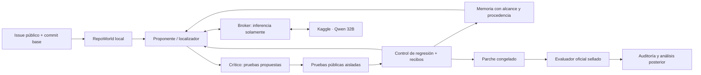

# ECHO-5.1 · RepoWorld / SWE-bench Lite: diseño científico

Fecha: 2026-10-13. Rama: `research/echo-5.1-pcworld1`.
Estado: **diseño y herramientas de análisis; RepoWorld y la campaña no ejecutados**.
Contrato: [SWE-CONTRACT.json](SWE-CONTRACT.json).
Implementación posterior: [plan para Codex](SWE-BENCH-LITE-PLAN-20261013.md).

## 1. Decisión y alcance

Evaluar parches sobre repositorios reales es el siguiente ensayo pertinente.
La pregunta es **si ECHO mejora resolución o coste**, no cómo fabricar una
ventaja frente a S/F. El resultado admisible incluye empate, empeoramiento y
evidencia inconclusa. Un piloto de 24 issues no cierra por sí solo ECHO-5.1.

El informe 32B registra S=F=E=E_shared=12/12 e **I2=10/12**, no un techo
de todos los brazos. E_shared ahorra 5,94% en receptores; incluyendo adquisición
cuesta 46,22% más que E. La evidencia autentica ejecuciones de ese corpus;
no demuestra invulnerabilidad, aprendizaje abstracto ni superioridad general.
Véase [resultado congelado](SCALING32-RESULTS-20261013.md).

La recomendación es **dos entornos con autoridades distintas**:

1. Entorno online RepoWorld, con código en el commit base, issue, tests públicos
   y pruebas propuestas por los agentes. Bubblewrap/cgroups conserva la frontera
   de ejecución local; Qwen se sirve por el broker de inferencia de Kaggle.
2. Evaluador final oficial, en un contenedor nuevo, que recibe únicamente el
   parche congelado y posee `test_patch`, F2P/P2P y el entorno oficial.

Alternativas consideradas: ejecutar todo en Kaggle simplifica la red, pero
mezcla inferencia y entornos pesados y no conserva nuestra frontera local;
reimplementar la calificación oficial solo en Bubblewrap reduce dependencias,
pero obliga a demostrar equivalencia con todos los runners. Elegimos el
harness oficial para el veredicto y Bubblewrap para la interacción.

## 2. Lo que aporta la literatura, sin convertirlo en garantía

- SWE-bench entrega issue y código base al agente y evalúa su parche mediante
  pruebas asociadas al cambio humano. Justifica la separación entre interacción
  y examen; no demuestra tres causas universales de fallo de todo ReAct.
  [Jimenez et al., ICLR 2024, §A.4](https://arxiv.org/html/2310.06770v3).
- SWE-agent estudia interfaces de navegación, edición y ejecución. Su ablación
  de ventanas respalda probar lecturas acotadas; 100 líneas no garantizan caber
  en 4.096 tokens. [Yang et al., 2024](https://arxiv.org/html/2405.15793v3).
- Tran y Kiela comparan razonamiento multihop con presupuesto de pensamiento
  igualado. Sus conclusiones no son una prueba sobre reparación de repositorios
  ni sobre este Qwen cuantizado. [Trabajo, v2](https://arxiv.org/abs/2604.02460v2).
- Kim et al. encuentran dependencia de la estructura de tarea y saturación de
  beneficios de coordinación. Motivan controles fuertes y contabilidad; no
  predicen una victoria de ECHO en Lite.
  [Trabajo, v3](https://arxiv.org/abs/2512.08296v3).

Lite contiene 300 tareas públicas. No aseguramos que ningún sistema pueda
saturarlo, ni ausencia de contaminación del preentrenamiento del 32B. Será un
benchmark externo al generador de ECHO, **no necesariamente nuevo para Qwen**.

## 3. Datos, versiones y muestreo previo a inferencia

Dataset: `princeton-nlp/SWE-bench_Lite`, revisión
`6ec7bb89b9342f664a54a6e0a6ea6501d3437cc2`, split `test`.
SHA256 del Parquet:
`7a21f37b8bc179c7db5beeb14e88ac538ba283455c776e6b2535bbfb6e3551b4`.
La selección leyó únicamente `repo`, `instance_id`, `base_commit`, fecha,
versión y `environment_setup_commit`; no consultó soluciones ni resultados.
El último campo es metadato de preparación y **no se entrega al actor**.
[Dataset oficial](https://huggingface.co/datasets/princeton-nlp/SWE-bench_Lite/tree/6ec7bb89b9342f664a54a6e0a6ea6501d3437cc2).

El censo de esta revisión tiene **12 repositorios**. La página descriptiva de
Lite dice 11: preservamos el censo obtenido de los bytes fijados, no corregimos
la muestra para ajustarla a esa frase. [Página de Lite](https://www.swebench.com/lite.html).

| Repositorio | Población | Panel principal |
|---|---:|---:|
| astropy/astropy | 6 | 1 |
| django/django | 114 | 6 |
| matplotlib/matplotlib | 23 | 2 |
| mwaskom/seaborn | 4 | 1 |
| pallets/flask | 3 | 1 |
| psf/requests | 6 | 1 |
| pydata/xarray | 5 | 1 |
| pylint-dev/pylint | 6 | 1 |
| pytest-dev/pytest | 17 | 2 |
| scikit-learn/scikit-learn | 23 | 2 |
| sphinx-doc/sphinx | 16 | 2 |
| sympy/sympy | 77 | 4 |
| **Total** | **300** | **24** |

No llamaríamos representativo de todo Lite a un panel solo de Flask/Requests:
sumados tienen nueve instancias. El panel de 24 cubre todos los repositorios,
aunque sobrerrepresenta los pequeños y algunos estratos solo tienen un issue.
La tasa principal será **del panel**, sin extrapolación automática a los 300.
Un análisis ponderado posterior usaría pesos N_h/n_h y declararía la gran
incertidumbre de los estratos pequeños; no sustituiría la métrica registrada.

Regla: un puesto por repositorio y reparto Hamilton de los doce restantes,
proporcional al censo. Dentro de cada estrato se ordena por
`SHA256("20261013:primary:" + instance_id)`; desempate por ID.
[Selector ejecutable](../../scripts/select_swebench_subset.py).
Los IDs y commits completos están en [SWE-SAMPLE.json](swebench/SWE-SAMPLE.json).

```bash
python3 scripts/select_swebench_subset.py \
  --metadata ECHO-5.1/docs/swebench/SWE-LITE-PUBLIC-METADATA.json \
  --output /tmp/SWE-SAMPLE.reproduced.json
cmp /tmp/SWE-SAMPLE.reproduced.json ECHO-5.1/docs/swebench/SWE-SAMPLE.json
```

Calibración excluida del panel: `pallets__flask-4992`, `psf__requests-2148`,
`pytest-dev__pytest-7168`, `sympy__sympy-19007`. Fueron elegidos de los
restantes por otra clave hash, no por tasa de éxito. Son desarrollo, no examen.

Antes de inferencia, un curador valida cada entorno con parche vacío y solución
de referencia, sin enviar logs de ese control al agente. No se reemplaza un
issue difícil o cuyo build falle por otro más favorable. Si no se pueden
preparar los 24, la campaña no pasa a confirmación: se publica la cobertura
operativa y se registra prospectivamente otro diseño, manteniendo los IDs
excluidos y la razón. Tras iniciar, errores y agotamientos permanecen en el
denominador. Nunca seleccionar por éxito de E, número de líneas del gold patch
o presencia de una categoría que el router ya sabe explotar.

## 4. Frontera con el harness oficial

Se fija **SWE-bench v4.1.0**, commit
`726c5461e2ef52d83cf1ea2107870a8bb3328d57`.
Su `make_test_spec` admite el esquema de la revisión Lite anterior.
[Código fijado](https://github.com/SWE-bench/SWE-bench/blob/726c5461e2ef52d83cf1ea2107870a8bb3328d57/swebench/harness/test_spec/test_spec.py).

Motivo explícito: el `main` consultado,
`02e7a74ffd0b707aab73d203fe87bdc7c76afc8e`, exige `image`, `eval_script`,
`log_parser`, `eval_type`; faltan en este Parquet. Mezclarlos sin adaptar datos
fallaría. No afirmamos equivalencia con el leaderboard del harness más reciente.
Migrar al formato nuevo requiere otra revisión fijada de datos y controles de
equivalencia, antes de lanzar; no cambiar versiones a mitad del ensayo.
[Interfaz nueva consultada](https://github.com/SWE-bench/SWE-bench/blob/02e7a74ffd0b707aab73d203fe87bdc7c76afc8e/swebench/harness/utils.py).

Se conservarán dos campos: `official_raw_resolved` del harness sin modificar,
y `echo_verified_resolved`, que además exige evidencia y ejecución válidas.
Esto importa porque el código fijado acepta `PASSED` y `XFAIL`; su tratamiento
de tests omitidos requiere comprobar la lista completa fuera del cociente.
Un test `SKIPPED`, ausente o no ejecutado no se certifica como aprobado.
Si ambos campos difieren, se publica la discrepancia y su motivo, sin ocultarla
ni llamar a la puntuación estricta «score oficial».
[Calificador v4.1.0](https://github.com/SWE-bench/SWE-bench/blob/726c5461e2ef52d83cf1ea2107870a8bb3328d57/swebench/harness/grading.py).

La calificación usa el runner específico de cada repositorio: **no todos son
`pytest` intercambiables**. Cada imagen se fija por digest, además del commit
del harness, comandos, paquetes, arquitectura y scripts. Un tag Docker mutable
no basta. No hacen falta entornos conda activos en el host: pueden estar dentro
del rootfs/imagen fijados.

## 5. Arquitectura de RepoWorld



### 5.1 Reutilización y cambios necesarios

| Pieza actual | Reutilizar | Adaptación obligatoria |
|---|---|---|
| `pcworld/snapshots.py` | contenido inmutable, CAS por archivo/base, rechazo de rutas inseguras | Perfil de tamaño y captura por streaming; no copiar repos grandes completos en RAM en cada lectura. |
| `pcworld/runner.py` | Bubblewrap, cgroup, captura acotada, kill del grupo | Perfil RepoWorld: cwd/entorno de proyecto, rootfs con dependencias, scratch, artefactos; conservar defaults de PCWorld. |
| `pcworld/runtime.py` | manifiesto/hash/exportación | El rootfs Python estándar actual excluye site-packages; no es un entorno de Django/SymPy. |
| `pcworld/provider.py` | transporte, plantilla/tokenización exacta, reservas, identidad | Separar generador genérico de los prompts de `solution.py`/JSON I/O. |
| `pcworld/receipts.py` y `accounting.py` | custodia y presupuesto compartido | Guardar logs como blobs acotados por hash; recuperación coordinada con CAS del parche. |
| `pcworld/shared.py` | idea de receta con procedencia | Su publicación exige éxito final PCWorld: **no reutilizar ese predicado con el oráculo reservado SWE**. |
| broker y worker existentes | inferencia 32B en dos T4 | Cancelación/timeout durable; no canal remoto para ejecutar comandos del repositorio. |

El runner actual limita RAM a 2 GiB y scratch a 64 MiB; recaptura con límites
de 64 MiB/10.000 archivos. Aumentar un único constructor no corrige toda la
cadena. Se añade un perfil separado y se mantienen las regresiones PCWorld.
No se crea otro bus de pensamiento ni se enciende el córtex de NEXUS-0.

### 5.2 Tres árboles y autoridad de escritura

- `BASE`: exportación Git del commit exacto, materializada por el curador,
  montada `ro`, sin historial `.git`, referencias futuras, submódulos obtenidos
  en red, secretos ni metadatos finales. También se elimina todo rastro de
  soluciones/fixtures finales del entorno online, incluyendo caches y logs de
  instalación. No basta ocultar un archivo JSON si la imagen conserva su copia.
- `CANDIDATE`: snapshot creado por el supervisor a partir de un diff autorizado.
  Un proceso del candidato **no** posee capacidad de persistir ediciones.
  `stage_patch` crea una versión tentativa; aún no mueve el puntero retenido.
- `SCRATCH`: copia desechable del candidato dentro de tmpfs para build y tests.
  Sus cambios jamás se incorporan automáticamente al parche. Al acabar se
  conservan solo stdout/stderr y artefactos autorizados acotados.

No usar `git worktree` enlazado al almacén de Git del host: su `.git` puede
apuntar fuera del sandbox. Un árbol de trabajo exportado y desechable cumple
la finalidad. El supervisor produce al final el diff contra BASE, no confía
en un `git diff` arbitrario impreso por el LLM.

Montaje conceptual, **no un comando listo para ejecutar en el runner actual**:

```text
runtime independiente -> /                 ro
árbol BASE            -> /repo-base        ro
árbol CANDIDATE       -> /candidate        ro
tmpfs limitado        -> /work             rw (copia de /candidate)
tmpfs limitado        -> /tmp y /out       rw (cuota agregada)
launcher fijado       -> /runner           ro
proc y dev mínimos; cwd=/work; entorno limpio
namespaces user,pid,ipc,uts,net; sin red externa, sockets host ni GPU
cgroup: memoria, CPU, PIDs; kill del grupo completo al vencer
```

Preparar dependencias también ejecuta código no fiable. Un builder aislado,
sin credenciales, recibe solo dependencias previamente descargadas/fijadas;
red de descarga controlada en una fase separada. No importar código del
repositorio en el supervisor. No montar `/var/run/docker.sock`, `$HOME`, `/usr`
del host, autoridades HMAC, la biblioteca completa o la carpeta de evaluación.
El rootfs online se ensambla con dependencias y BASE limpios; no se reutiliza
sin inspección una imagen que contenga el test patch final.

Bubblewrap comparte kernel: protege la frontera definida, no prueba aislamiento
ante toda vulnerabilidad del kernel. La CPU medida incluye hijos/build; RSS y
`memory.peak` no son la misma medida. Nada de esto acredita consumo eléctrico.

### 5.3 Parches atómicos y rollback

1. Validar diff unificado, longitud UTF-8 ≤65.536 bytes, ≤8 archivos y ≤800
   líneas cambiadas; rechazar rutas absolutas, `..`, escapes, enlaces,
   binarios/submódulos y cambios de permisos en el primer perfil.
2. Comprobar `expected_snapshot_id` y hashes de preimagen. Un fallo invalida
   toda la transacción; no `--reject`, fuzzy patching ni rebase silencioso.
3. Aplicar en staging privado con Git configurado sin hooks, filtros,
   fsmonitor, textconv ni configuración global. Comprobar árbol y límites.
4. Crear `candidate_id` por bytes exactos y manifiesto; ejecutar checks públicos.
5. F/E retienen el candidato si no introduce regresión en tests base estables.
   Si regresa, mantienen el candidato anterior y entregan feedback con IDs de
   pruebas, observado/esperado disponible y extractos. Máximo dos reparaciones.
6. Registrar intención y resultado para recuperación tras crash. `CURRENT` del
   almacén no equivale a `retained_candidate`; comparar y cambiar este último
   con CAS solo tras recibos válidos. Un recibo huérfano no acepta un parche.

Tests existentes, configuración del runner, plugins de colección y oráculo son
inmutables online. Tests nuevos del crítico se guardan en espacio separado de
sondeos, nunca reemplazan los tests finales. La política de archivos protegidos
queda registrada: si una tarea necesita una modificación excluida, es una
limitación de cobertura, no se habilita ad hoc para un brazo. Modificaciones
legítimas de código multarchivo sí están permitidas bajo los límites comunes.

### 5.4 Herramientas MCP discretas

[Esquemas JSON](swebench/SWE-TOOLS.schema.json). Ninguna acepta shell libre,
montajes, URL de descarga ni nombres de tests finales. La validación de esquema
se completa con capacidades de filesystem, presupuestos y límites en bytes.

| Herramienta | Entrada | Respuesta pública / límites |
|---|---|---|
| `repo_search` | snapshot, patrón literal, ruta relativa, cursor opaco | rg `-F --line-number`, máximo 30 coincidencias, 8 KiB, 1.000 tokens; cursor vinculado al snapshot; no seguir enlaces. |
| `file_view` | snapshot, ruta, primera línea, 1–100 líneas, cursor nullable | Texto original numerado, hash de archivo, rango real y cursor; máximo 8 KiB/1.000 tokens; líneas enormes se señalan y paginan. |
| `patch_apply` | base esperada, propósito solution/probe, diff | ID tentativo o rechazo estructurado; no ejecuta tests ni declara éxito. |
| `test_run` | candidato, `check_id` público, sondeo opcional | exit/signal/timeout, estados observados, evidencia, costes; ID elegido de un catálogo público, sin comando libre. |

En la primera lectura, `cursor=null`. La continuación identifica snapshot,
hash/ruta de archivo, línea y offset UTF-8 dentro de ella, firmado por el
supervisor. Un cursor de otra versión/ruta se rechaza. Permite terminar una
línea mayor que la ventana sin truncarla silenciosamente ni repetir su inicio.

Un `check_id` público se deriva de colección en BASE y políticas fijadas,
**nunca de los ficheros del test patch reservado**. Selección determinista por
archivos editados más suite de humo común; conservación de la selección para
todos los brazos. El comando de tests puede ser pytest, unittest, Django o
el runner fijado de esa versión. La colección y el lint también van al sandbox.

## 6. Especialistas y controles

El localizador produce referencias a archivos/líneas observadas y una lista
acotada de hipótesis; el sintetizador produce un parche; el crítico propone
una prueba y la razón contractual; el verificador es código externo, no otro
LLM. No se afirma que cuatro roles sean óptimos: se comparan.

| Brazo | Política registrada |
|---|---|
| S | Un agente con búsqueda, edición, tests y autorrevisión; puede reparar y hacer rollback manual, con el mismo presupuesto total. |
| I2 | Dos ramas sin mensajes ni memoria entre sí, cada una con 11k tokens; selector con 3k restantes usando solo evidencia pública. Todo suma 25k, incluidas pruebas/selección. |
| F | Roles localizador→parche→crítico→reparación en ciclo fijo; mismo catálogo, guardarraíl y cuotas que E. Orden fijado antes de observar resultados. |
| E | Mismos roles y guardarraíl; router usa progreso público, fallos comprobados y memoria del episodio para decidir dónde gastar la siguiente llamada. |

S no queda reducido a un único intento débil. I2 nunca selecciona con el score
final ni recibe 25k por rama. No añadir categorías inútiles primero en F para
hacer ganar E. Los perfiles y prompts, incluido selector I2, se congelan tras
la calibración y antes de abrir el panel principal.

Los cuatro reciben observaciones de la **misma suite pública automática** tras
cada parche; se cobra su ejecución. S/I2 deciden cómo responder; F/E añaden la
transacción automática. Un brazo `E_no_guard` sobre los mismos 24 issues cambia
solo esa decisión automática y conserva observaciones, criticidad, modelo y
presupuesto. Este quinto contraste es necesario para atribuir causalmente
efectos al rollback; contar más bloqueos en E no basta.

H1=E−S, H4=E−F. La diferencia E−S incluye varios mecanismos. El contraste de
crítico ausente y controles de memoria falsa/fija siguen siendo confirmación
posterior si se busca cerrar H3/H2 generales; no se confunden con este piloto.

Para cada issue, orden de ejecución rotado por la posición en el panel y
semilla 73; memoria vacía, caché de ejecución vacía y contexto KV nuevo en cada
episodio. El orden de las tareas y el calendario completo se hashean antes de
la primera inferencia. Una semilla del LLM no garantiza igualdad bit a bit en
CUDA; se guardan las respuestas originales para reproducir la auditoría.

## 7. Crítico CEGIS: qué se ha demostrado exactamente

Un test escrito por un LLM **no es un oráculo**. Primero se registra como
`PROPOSED_TEST`. Su fallo solo demuestra incompatibilidad con esa aserción.
Se asciende a `PUBLIC_COUNTEREXAMPLE` cuando hay un test preexistente estable
o un predicado mecánico explícitamente derivado del contrato público, con
testigo ejecutado. Aserciones ambiguas conservan `UNVERIFIED_EXPECTATION` y no
se publican como hechos ni obligan a descartar un parche por sí solas.

Feedback de reparación: input/fixture observada, salida/traceback real,
resultado exigido por el predicado público y casos de regresión que deben
seguir pasando. Nunca completar la terna con una respuesta del gold patch.
Se pausa el crítico durante los dos intentos de reparación. La ausencia de
refutaciones posteriores permite congelar el candidato, **no certificarlo**.

Para detectar regresión, BASE ejecuta dos veces la suite pública seleccionada.
Solo tests aprobados estables forman `PUBLIC_BASELINE_PASS`. Failing/flaky/
skipped se registran por separado. Un patch no puede convertir pass→skip ni
vaciar la colección y llamarlo éxito. Tests aislados y dependencias fijadas
reducen ruido; las discrepancias persistentes producen resultado incierto.

## 8. Memoria compartida y límites de la similitud

Dos cadenas prospectivas, disjuntas del panel/calibración:

- pytest: donante `pytest-dev__pytest-5103`; receptores `7220`, `9359`, `11148`.
- sympy: donante `sympy__sympy-11400`; receptores `18698`, `20590`, `21171`.

Los sufijos corresponden al mismo prefijo de repositorio; commits completos
en el manifiesto. Donante anterior por `created_at`, receptores ordenados por
fecha. Esto **no acredita ancestralidad Git**: comprobar DAG y compatibilidad
de base/API antes de reutilizar una receta. No se cambian los IDs si no sirven.

Cada donante publica evidencia pública: autor, issue, commit/tree, entorno,
diff, prueba/predicado, precondiciones, observado y alcance. Sin `final_cases_passed`.
No se entrega código gold, resultado final ni un test seleccionado del examen.
Si no obtiene una lección válida, la biblioteca queda vacía y su coste se cuenta.

Receptores emparejados `empty`/`shared`, mismo modelo, semilla y presupuesto.
Cada receptor arranca BASE limpio, sin parche persistido del anterior.
La condición compartida mantiene lecciones públicas de su cadena; la vacía
resetea. La selección es determinista por procedencia, compatibilidad de API
y precondiciones, máximo 16 lecciones y 384 tokens de pistas. Hasta demostrar
equivalencia contextual, una similitud AST/CAM solo orienta una comprobación.

Para bloquear duplicación exacta se requiere igualdad de bytes de candidato,
árbol base, entorno, comandos/checks, inputs y política. Una búsqueda hash puede
ser O(1) esperado en una tabla; hashing, recuperación, comprobación de custodia
y AST no son O(1). No se descarta una reparación diferente por parecerse a otra.

Figura 4 incluye adquisición completa (incluso donantes fallidos), publicación,
recuperación y receptores. Se informa éxito inicial, fallos repetidos, tokens,
llamadas de crítica/reparación y daño de transferencia negativa. Dos cadenas
son una demostración de mecanismo pequeña; faltan múltiples adquisiciones y
controles de biblioteca fija/irrelevante para cierre general de H2/T20.

## 9. Kaggle, contexto y estimación de coste

El broker existente separa capacidades cliente/worker. Solo cruza mensajes y
respuestas de `/apply-template`, `/tokenize`, `/completion`, con identidad,
request_id, hash, plazos y tamaños. El modelo no recibe credenciales, rutas host
ni capacidad de mandar comandos a Bubblewrap. El supervisor local es el único
que traduce solicitudes estructuradas a herramientas autorizadas.

Mantener el 32B Q4 y b11577 del piloto, 4.096 tokens, 768 de salida, temperatura
0,2, dos T4 con reparto por capas. Revalidar hash, 65 capas y ambos buffers.
No aumentar contexto/batch suponiendo que 32 GB de dos tarjetas son una sola
memoria contigua. El rootfs de tests no utiliza GPU.

Presupuesto orientativo de prompt: política 320, página de issue 500, ledger
de evidencia 384, diff 600, observación actual 1.000; conjunto **≤3.200 tokens
incluida plantilla**, con 768 de salida y 128 de margen. Lecciones de memoria
sustituyen parte del ledger, no se suman fuera del límite. El tokenizador exacto
tiene la última palabra; si no cabe, devolver cursor/paginar y reducir contexto.
No truncar un JSON, diff o especificación sin anunciarlo. El issue completo
permanece disponible por páginas, todas cobradas. Índices AST son navegación,
no una autorización para borrar líneas cuyo efecto pueda importar.

Guardar un ledger estructurado de hechos observados, errores, snapshots y
referencias; no inventar monólogo ni tratar resumen del modelo como evidencia.
La visibilidad usa el `thought.jsonl` existente con eventos públicos reales.

Presupuesto por episodio propuesto: 25k tokens totales, 24 llamadas LLM,
80 herramientas, 6 críticas, 8 parches, 10 ejecuciones de tests, dos reparaciones
por refutación; 1.200 s CPU de candidato, 1.800 s pared, 4 GiB RAM y 1 GiB de
tmpfs agregado. Cada test ≤180 s pared/240 s CPU; proveedor ≤240 s, inferior
a los plazos del relay. Son límites iniciales **para calibrar y congelar**, no
evidencia de que todos los proyectos caben. No heredar los 300 s de CPU de los
microprogramas sin comprobar el coste de colección/build.

La contabilidad cobra lectura/búsqueda/snapshots, fallos de formato, reintentos,
rollbacks, compilación, tests, críticos, selector I2 y memoria. Se distinguen
preparación compartida, CPU de candidato, supervisor, inferencia y tiempo GPU
inactivo. No duplicar un coste dentro de dos categorías ni omitir el fallido.

### Tiempo: 2–3 horas todavía no está respaldado

| Fase | Episodios nuevos | Tope GPU de planificación |
|---|---:|---:|
| Calibración 4 issues × 4 brazos | 16 | 1 h |
| Principal 24 × 4 | 96 | 6 h |
| E sin rollback, emparejado con E principal | 24 | 4 h |
| Memoria: 2 donantes + 6 receptores × 2 | 14 | 3 h |
| Contingencia registrada | sin replicar selectivamente | 4 h |
| **Total planeado** | **150** | **18 h** |

Última cuota observada: 22,94 h; reconsultar antes de activar. Estos son topes,
no duraciones previstas ni garantía de acabar. El máximo teórico de 150×25k
son **3,75 millones de tokens**, muy distinto de los 179.731 del piloto anterior.

Medir en calibración: tokens entrada/salida, prefilling, decode, tiempo/llamada,
tests por issue, P50/P90 local, reintentos y tiempo ocioso facturado de GPU.
Estimar con `Tprefill + Tdecode + Tesperas + Tsetup`; con pruebas solapadas,
usar una simulación del calendario medido, no sumar CPU a tiempo GPU a ciegas.
Solo entonces afirmar un intervalo para 96 episodios. Parar por presupuesto
produce campaña incompleta, no una selección de los primeros éxitos.

Recursos observados aquí: unos 67 GiB libres en el filesystem, 13 GiB RAM total
y 6,3 GiB disponible. La guía general recomienda ≥120 GB de disco y 16 GB RAM.
No construir todas las imágenes sin prueba de capacidad. Preparar una familia
cada vez, caché con manifiesto y límites, un test local concurrente al inicio;
si no cabe, registrar bloqueo de infraestructura antes de arrancar GPU.
[Requisitos oficiales](https://www.swebench.com/SWE-bench/reference/harness/).

## 10. Aceptación, parada y auditoría

Hay tres niveles que no deben confundirse:

1. `EXECUTED`: recibo de proceso, bytes de entrada/salida, exit y límites.
2. `PUBLIC_CHECKS_PASSED`: propiedad acotada bajo checks públicos identificados.
3. `RESOLVED`: veredicto final oficial; `echo_verified_resolved` añade validez.

Para instancia i, candidato p y manifiesto cerrado L:

```text
official(i,p) = report_of_pinned_harness(i,p).resolved
complete(i,p) = cada test F2P/P2P tiene estado observado permitido por L
valid(i,p) = identidad + custodia + entorno + presupuesto + aislamiento válidos
echo_verified_resolved(i,p) = official(i,p) AND complete(i,p) AND valid(i,p)
```

F2P debe ser no vacío en preflight. P2P vacío no inventa evidencia de ausencia
de regresiones: la conjunción es vacía y esa falta de cobertura se publica.
Se registran XFAIL separados de PASSED, incluso si cuentan según upstream.
El auditor exige todos los IDs y rechaza skips, ausencia de resultados, parser
ambiguo y contradicción exit/log. No reinterpretar stdout sin errores como pase.

La regla es comprobable respecto a pruebas y entorno finitos. **No constituye
demostración matemática de corrección general del programa**, ni impide toda
manipulación posible de un intérprete que ejecuta código del candidato.
Proteger tests/harness, probar falsificación de logs y revisar conflictos
reduce ese riesgo; HMAC acredita procedencia, no convierte contenido en verdad.

Al terminar fuel, críticas o tiempo, todos los brazos congelan su último
candidato autorizado, o un diff vacío. El examen final no se impide por falta
de categorías de crítica. Invariantes rotos producen `invalid_evidence`, jamás
verde. Un timeout de infraestructura se separa de un bug y cuenta como no
resuelto en el panel; se permite como máximo repetir **los mismos bytes** de
evaluación tras clasificar el fallo, conservando ambos intentos. No nueva
inferencia selectiva después de ver el resultado final.

**Barrera global:** no liberar ningún resultado oficial hasta congelar todas
las entregas de principal, ablación y memoria. Ni siquiera usar el booleano
final para decidir qué donante entra en SharedCAM. Si se revisa código tras
abrir el examen, ese panel pasa a desarrollo y la confirmación usa otro.

El [esquema del lock](swebench/SWE-RUN-LOCK.schema.json) obliga a fijar imágenes,
entornos, checks, código, prompts, plantilla, modelo, schedule y autoridades.
No se incluye un lock rellenado ficticiamente: faltan imágenes y preflight.
El contrato está `design` / `launch_enabled=false`.

El futuro auditor deberá comprobar:

- IDs/celdas completas del calendario, sin episodios borrados, duplicados o
  reincorporaciones selectivas; correspondencia brazo/semilla/candidato.
- Cadena HMAC, ancla de autoridad externa, hashes de artefactos y snapshots;
  no fabricar una autoridad ausente durante auditoría.
- Reservas/liquidaciones de todo el gasto, procesos terminados, no paquetes
  de red del candidato, identidad de modelo y rootfs, fuentes sin deriva.
- Diff exacto entregado, reporte oficial y logs completos acotados, estados
  esperados, evidencias de pruebas públicas, decisiones de rollback.
- Origen temporal y alcance de cada lección, sin acceso al oráculo final ni
  persistencia de cambios de código entre receptores.

Evaluación oficial propuesta, ejecutada **por el curador** con dataset local
fijado y un `run_id` derivado del lock/brazo/semilla/hash de parches:

```bash
python -m swebench.harness.run_evaluation \
  --dataset_name /curator/sealed/lite-selected.jsonl \
  --predictions_path /curator/submissions/S.predictions.jsonl \
  --max_workers 1 --timeout 600 --run_id LOCKHASH-S-73-PATCHSETHASH
```

Es un ejemplo de interfaz, no una ejecución realizada. Cada fila de predicción
contiene `instance_id`, `model_name_or_path`, `model_patch`. No reutilizar run_id
para otro parche: el harness puede reutilizar resultados guardados.
[Evaluación y formato oficiales](https://www.swebench.com/SWE-bench/guides/evaluation/).

Comando de auditoría objetivo para Codex, **todavía no implementado**:

```bash
python3 ECHO-5.1/scripts/run_repoworld.py audit \
  --run ECHO-5.1/artifacts/swe-lite-RUN \
  --lock ECHO-5.1/artifacts/swe-lite-RUN/SWE-RUN-LOCK.json \
  --export ECHO-5.1/artifacts/swe-lite-RUN/analysis.json
```

## 11. Figuras y análisis reproducible

Implementado en [`scripts/plot_swebench_results.py`](../../scripts/plot_swebench_results.py).
Dependencias verificadas disponibles: matplotlib 3.10.9, jsonschema 4.23.0.
Versiones directas fijadas en [requirements-analysis.txt](swebench/requirements-analysis.txt).
Esquema estricto: [SWE-RESULTS.schema.json](swebench/SWE-RESULTS.schema.json).

```bash
python3 scripts/plot_swebench_results.py \
  --results ECHO-5.1/artifacts/swe-lite-RUN/analysis.json \
  --contract ECHO-5.1/artifacts/swe-lite-RUN/SWE-CONTRACT.json \
  --sample ECHO-5.1/docs/swebench/SWE-SAMPLE.json \
  --output ECHO-5.1/artifacts/swe-lite-RUN/figures
```

Genera 4 PDF vectoriales, 4 PNG a 300 dpi y `summary.json` con hashes del
input canónico/script/contrato/auditoría, versiones y métricas. No autentica
HMAC: consume el export del auditor y lo declara expresamente. Validar un
JSON con un hash escrito por el usuario no autentica su origen.
Para datos medidos exige además contrato y muestra registrados independientes:
compara IDs, repositorios, semillas, cadenas y SHA256 de los bytes del contrato.
El contrato liga los bytes del manifiesto de muestra. Así, borrar un issue
entero del export no reduce silenciosamente el denominador.

| Figura | Métrica y precaución |
|---|---|
| 1. Resolución | oficial bruto y verificado por ECHO separados, con razón de discrepancia en el export. Denominador: todos los episodios del calendario, incluidos errores. IC Wilson solo descriptivo, no corregido por repositorio/repeticiones. |
| 2. Regresión | parches únicos con regresión pública y bloqueados / regresivos; denominador cero = N/D. Todas las ramas se diagnostican con la misma suite pública. No se afirma que S habría entregado todo parche intermedio. |
| 3. Coste/eficacia | resolución frente a tokens medios y pared media por issue; incluye fallos. Coste por resuelto también en JSON; cero soluciones = null. Ningún gráfico se construye para «demostrar eficiencia» de antemano. |
| 4. Memoria | coste acumulado por posición, compartido marginal y con adquisición frente a vacío, medias por cadena; éxitos también en JSON. Sin datos aparece «no medida». |

Rechaza matrices incompletas/duplicadas, repos diferentes en pares, NaN/Inf,
conteos imposibles y cadenas sin controles. Fixtures inventadas llevan marca
de agua; filas no iniciadas muestran aviso de campaña incompleta. Agotamiento
normal del presupuesto congela el candidato: si este pasa después el examen
y conserva evidencia válida, cuenta como resuelto. Sin entrega evaluable no
se certifica éxito. No se han producido resultados de SWE-bench con datos simulados.

Además, publicar resultados por repositorio/issue, matriz de victorias,
derrotas y empates E−S/E−F; errores por causa; primera propuesta vs reparación;
herramientas, latencias, CPU/RSS, cuota de GPU y todos los costes de adquisición.
El generador actual hace las cuatro figuras y el resumen básico; la inferencia
confirmatoria agrupada y el contraste de rollback corresponden al auditor/
análisis que se implementará con RepoWorld, no a un test de hipótesis ya cerrado.

Para confirmación futura: dimensionar muestra por diferencias emparejadas,
estratificar por repositorio, no contar variantes/semillas como nuevas tareas,
predeclarar E−S/E−F y ajustar multiplicidad (Holm). Mostrar intervalos de
diferencia y sensibilidad a repositorios. Un IC que incluya cero queda
inconcluso. El piloto no tiene potencia garantizada ni umbral «E debe ganar».

## 12. Checklist de esta entrega y de la campaña

- [x] Contrastar el brief con el resultado local 32B.
- [x] Investigar datos, versiones, papers y calificación en fuentes primarias.
- [x] Inventariar interfaces reutilizables y límites concretos de PCWorld.
- [x] Selección de 24 IDs/commits reproducible, más calibración y memoria disjuntas.
- [x] Contrato de diseño, esquemas de lock/herramientas/export y plan técnico.
- [x] Script de cuatro figuras y validaciones de análisis; sin datos científicos inventados.
- [ ] Implementar RepoWorld: preparación, snapshots grandes, herramientas, bucle y prompts.
- [ ] Construir y fijar entornos; medir disco/RAM y probar negativo/gold en curador.
- [ ] Implementar/verificar separación online-final, auditoría, cancelación y reanudación.
- [ ] Calibrar costes reales y congelar el lock prospectivo.
- [ ] Ejecutar principal S/I2/F/E y E_no_guard; después análisis emparejado.
- [ ] Ejecutar cadenas de memoria con adquisición completa y negativos documentados.
- [ ] Confirmación dimensionada, controles adicionales, segunda máquina/reproducción.

ECHO-5.1 sigue abierto. Esta entrega no modifica PCWorld 0.10 ni sus campañas
selladas, no arranca Kaggle, no hace push y no reabre S6.

Verificación de entrega: **255 tests PCWorld** (97,146 s) y **13 tests de
selección/análisis** (5,457 s), todos pasados. Tres JSON Schemas válidos,
muestra reproducida byte a byte, cuatro PDF/PNG probados con fixtures
sintéticas, incluidos 0/24 y 24/24. Revisión independiente completada tras
corregir cuatro hallazgos. Estos checks no ejecutan tareas SWE-bench ni
certifican el runtime RepoWorld pendiente.

## Apéndice · los 24 issues del panel principal

| Repositorio | IDs seleccionados (sufijo tras el prefijo del repositorio) |
|---|---|
| `astropy__astropy` | 14365 |
| `django__django` | 11179, 13925, 12747, 11797, 14016, 15400 |
| `matplotlib__matplotlib` | 18869, 26011 |
| `mwaskom__seaborn` | 3407 |
| `pallets__flask` | 5063 |
| `psf__requests` | 2674 |
| `pydata__xarray` | 4248 |
| `pylint-dev__pylint` | 7080 |
| `pytest-dev__pytest` | 5495, 5413 |
| `scikit-learn__scikit-learn` | 25638, 13241 |
| `sphinx-doc__sphinx` | 7686, 8713 |
| `sympy__sympy` | 20212, 24066, 13146, 15011 |

Ejemplo de reconstrucción: `psf__requests-2674`. La tabla es una vista humana;
los commits, fechas y hashes de referencia proceden del manifiesto JSON.
