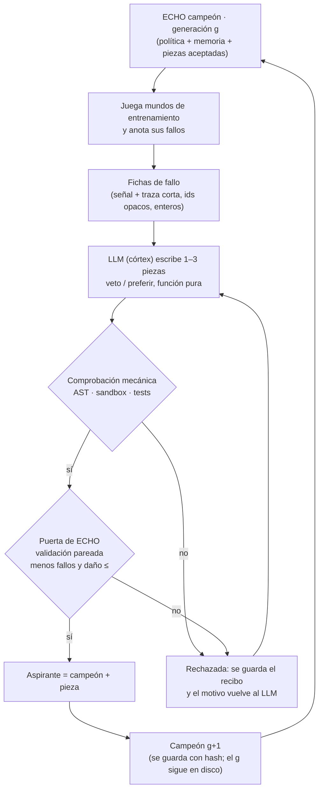

# B v4 · CRECE: cómo un LLM mejora las piezas de ECHO y ECHO crece

21 de octubre de 2026. **PLAN, sin contrato, sin código, sin medida.**
Amplía y ordena `B4-LLM-PIEZAS-PROPUESTA.md` (que sigue valiendo como nota de
investigación). Pensado para que GPT-6 Astra lo revise e implemente; antes de
programar el experimento hace falta un contrato (`B4-CRECE-DESIGN.md`)
aprobado por Nav, como en todas las pistas.

## 0. En una frase

**El LLM propone, una máquina comprueba que es seguro, ECHO mide si funciona,
y solo lo que funciona entra en el ECHO siguiente.** Cada vuelta empieza
desde el ECHO mejorado, así que crece por generaciones; y lo que aprende son
piezas guardadas en disco, que viajan con él a mundos nuevos.

## 1. Las tres preguntas de Nav, contestadas

1. **¿El LLM tiene que programar la pieza?** Sí. Escribe una función corta y
   pura, en un subconjunto de Python entero, a partir de los fallos concretos
   que ECHO le enseña. No toca nada más del código.
2. **¿La revisa otro LLM «con ECHO» antes de meterla?** **No decide un LLM.**
   La revisión tiene dos pasos y ninguno es opinión:
   - una **comprobación mecánica** (AST + sandbox + tests): ¿es segura, entera,
     acotada y respeta la interfaz?;
   - la **puerta de ECHO**: ¿con la pieza, ECHO falla menos en mundos de
     validación sin que suba el daño? Se mide en partidas, no se razona.
   Motivo: cuando un LLM juzgó o eligió (B v1, RSI-1, S6), lo hizo igual que
   el azar. Lo que sí funcionó siempre fue medir consecuencias, y eso es lo
   que ECHO hace bien. Es el firewall epistémico de `CLAUDE.md`: una pieza del
   córtex es una **hipótesis** hasta que ECHO la verifica. Un segundo LLM
   puede, como mucho, escribir una explicación legible de la pieza para
   humanos; no vota.
3. **¿El ECHO mejorado sustituye al anterior para seguir creciendo?** Sí,
   por **campeón y aspirante**: el ECHO actual es el campeón; con una pieza
   nueva aceptada se forma un aspirante; si el aspirante gana en validación
   fresca, pasa a ser el campeón de la generación siguiente. **El anterior no
   se borra** (append-only, con hash): siempre se puede volver atrás y medir
   cuánto aportó cada generación.

## 2. El bucle

Y fuera del bucle, intocable, el **examen**: mundos y familias que nunca vio
ni el LLM ni la puerta, medidos una sola vez al final.

## 3. Las piezas

### 3.1 Qué es una pieza

> **21/10: este apartado queda sustituido por `B4-CRECE-F0-SPEC.md`** (cuatro momentos de enganche y efectos cerrados), tras la revisión `B4-CRECE-REVIEW.md` §1–2. Se conserva abajo como estaba.

Hoy las 5 piezas de B v3 (`commit`, `no_retoggle`, `clear`, `wander`,
`no_repick`) están escritas a mano dentro de `PAgent._decide`
(`echo58/b3/policy.py`). Para que un LLM pueda añadir piezas sin tocar ese
código congelado hace falta un **enchufe** en una clase nueva (en
`echo58/crece/`, heredando de `PAgent`), con dos tipos de pieza:

| Tipo | Firma | Qué hace |
|---|---|---|
| `veto` | `veto(intent, v) -> bool` | Prohíbe una intención (como `no_retoggle`) |
| `prefer` | `prefer(cands, v) -> int` | Elige entre candidatos que la política ya propone (como `wander`) |

`v` es una **vista de solo lectura y entera** del estado del agente: rejilla
de ids opacos, posición, mano, contadores del episodio (visitas por celda,
veces que cogió cada id, celdas cambiadas, pasos ociosos), alcanzable sí/no y
creencias de la memoria (`PASS`/`HURT`/…). Sin nombres de objetos ni de
familias. El orden: primero los vetos (si todas las intenciones quedan
vetadas, se ignoran los vetos de esa jugada), y luego `prefer`.

Las 5 piezas de B v3 se reescriben en este formato como **referencia y
test**: el enchufe tiene que dar exactamente las mismas partidas que
`PAgent` con esas piezas (traza idéntica en semillas de desarrollo). Así se
demuestra que el enchufe no cambia nada por sí mismo.

### 3.2 Comprobación mecánica (no es un LLM)

Una pieza se rechaza sin jugar si:

- no parsea, o usa algo fuera de la lista blanca del AST: sin `import`, sin
  atributos con `_`, sin `eval`/`exec`/`open`/`getattr`, sin floats ni `/`
  (solo `//`), sin `while`, `for` solo sobre rangos o colecciones de `v`;
- en el sandbox (proceso aparte, límite de tiempo y memoria) lanza una
  excepción o supera el límite de operaciones en 200 estados guardados;
- devuelve algo fuera del tipo de la firma;
- es igual (mismo comportamiento en los 200 estados) que una pieza ya
  aceptada o ya rechazada: no se gasta puerta en duplicados.

### 3.3 Puerta de ECHO (la de B v3, ampliada)

Aspirante frente a campeón, **sin aprender durante la medida**, en semillas
de validación que cambian en cada generación (nunca se reutilizan):

- el daño no sube, el éxito no baja, y los fallos de sonda bajan
  estrictamente (pareado por semilla; umbral exacto en el contrato);
- y la pieza no empeora ninguna familia de entrenamiento más que un margen
  fijado (B v3 dejó DynObsRandom5 peor, 91 → 103: esto lo vigila).

### 3.4 Biblioteca de piezas (la «memoria real» de lo aprendido)

Cada pieza aceptada se guarda en `lab/echo58/crece/library/` con su código,
su hash, el prompt y la respuesta del LLM (recibo), la generación, las fichas
de fallo que la originaron y sus números de puerta. Append-only. Un ECHO
**es** su política base + su memoria + la lista de hashes de piezas activas.
Eso es lo que viaja a un mundo nuevo: no hace falta el LLM para usar lo
aprendido, solo para aprender cosas nuevas.

**Poda:** cada 3 generaciones se quita cada pieza de una en una (ablación) en
validación fresca; la que ya no aporta se desactiva (no se borra). Evita que
la biblioteca crezca con piezas que otras dejaron redundantes.

## 4. Lo que ve el LLM

- Una ficha por fallo: la señal (`pickdrop`, `retoggle`, `blockdrop`,
  `idle`, más las nuevas que se definan en el contrato), unos 20 pasos
  alrededor del fallo con ids opacos y acciones, y lo que hizo cada pieza
  activa en esos pasos.
- La API de `v` y los dos tipos de pieza, con dos ejemplos (de las piezas de
  B v3 reescritas).
- Las piezas rechazadas de esa señal con el motivo (no pasa el AST, empeoró
  el daño en tal familia…).
- **Nunca:** semillas o mundos de examen, nombres de entornos («MiniGrid»,
  «lava», «llave»), ni los números de los controles.

Modelo: `gemini-3.5-flash` (elegido por Nav el 20/10), temperatura 0,
caché por hash del prompt; réplica con `gemma-4-31b-it` de pesos abiertos.
Las claves se leen solo dentro del script.

## 5. Cómo sabremos que de verdad crece (controles)

Igual presupuesto de llamadas y de puerta para todos los brazos:

| Brazo | Pregunta que contesta |
|---|---|
| **crece** | el bucle completo |
| `sin_fichas` | el mismo LLM sin las fichas de fallo (solo la API): ¿sirve que ECHO diga dónde falla? |
| `acepta_azar` | piezas del LLM aceptadas al azar con la misma tasa: ¿sirve la puerta de ECHO? |
| `sin_relevo` | el campeón no se actualiza (el LLM siempre ve los fallos del ECHO de la generación 0): ¿sirve crecer por generaciones? |
| `azar_gramática` | piezas aleatorias de la misma gramática restringida: ¿hace falta un LLM? |
| `piezas_b3` | las 5 piezas de B v3 diseñadas por Claude: techo humano |
| `sin_piezas` | solo memoria (generación 0) |

**Predicciones candidatas (los números se fijan en el contrato):**

1. En el examen, `crece` tras G generaciones falla menos que `sin_fichas`,
   `acepta_azar`, `sin_relevo`, `azar_gramática` y `sin_piezas`, pareado por
   macro, Wilcoxon exacto unilateral + Holm α = 0,01 (como B v3 y C v1).
2. La curva de examen por generación mejora en ≥ 3 generaciones seguidas.
3. `crece` ≤ `piezas_b3` + un margen fijado antes de medir. Empatar con las
   piezas diseñadas por un humano/Claude ya es un buen resultado: el mismo
   nivel sin humano.
4. **Transferencia:** la biblioteca final, llevada sin LLM a una familia de
   mundos nueva (p. ej. los mundos propios de ENJAMBRE en modo individual),
   no empeora frente a `sin_piezas` y mejora en algo fijado.

Si `acepta_azar` o `sin_relevo` empatan con `crece`, la parte
correspondiente del método no aporta y se dice así.

## 6. Fases

| Fase | Qué | Regla de parada |
|---|---|---|
| **F0 · enchufe** | `echo58/crece/` con el enchufe de piezas, las 5 piezas de B v3 reescritas y el test de traza idéntica | si no da trazas idénticas, se arregla el enchufe antes de seguir |
| **F1 · prototipo** (solo desarrollo, 1 sesión) | 3 fichas reales → LLM → 3–5 piezas → AST → puerta | si ninguna pieza del LLM pasa la puerta, **no hay contrato**; se publica la nota |
| **F2 · bucle en desarrollo** | 5 generaciones, 2 macros, todos los brazos | si la curva no mejora ≥ 2 generaciones seguidas, se para y se informa |
| **F3 · contrato** | `B4-CRECE-DESIGN.md` con números → revisor → aprobación de Nav | — |
| **F4 · congelación y examen** | `preflight.json` con hashes (código, contrato, tests, prompts) y caché del LLM congelada; examen de una sola pasada; verificador independiente | rojo se publica rojo |

La caché del LLM se congela en el preflight: el examen solo usa respuestas
ya pedidas o las pide con prompt idéntico y temperatura 0, y deja todas en
recibos para repetirlo sin volver a llamar.

## 7. Riesgos y cómo se cubren

| Riesgo | Cobertura |
|---|---|
| El LLM sabe qué es MiniGrid y mete conocimiento previo | ids opacos y sin nombres; transferencia a mundos propios; brazo `sin_fichas` |
| Sobreajuste a la validación tras muchas generaciones | semillas de validación nuevas en cada generación; examen intocable; poda por ablación |
| Piezas que se pisan entre sí | orden fijo (vetos y luego prefer), test de que «todo vetado» no bloquea, ablación |
| Código peligroso | lista blanca de AST, proceso aparte, límites; nunca `exec` sin validar |
| Ruido del LLM | temperatura 0, caché por hash, réplica con otro modelo |
| Cuota gratuita | ~5 generaciones × ~3 piezas × 10 macros × 3 brazos con LLM ≈ 450–900 llamadas; medir la cuota antes de F2 |
| Romper lo congelado | todo nuevo va en `echo58/crece/` y `lab/echo58/crece/`; `memx`, `acumula*`, `b3`, `enjambre` solo se importan |

## 8. Qué no es

- No es que el LLM reescriba a ECHO: solo añade piezas pequeñas por un
  enchufe; la política, la memoria, el WSP y el gate no los toca.
- No es automejora sin límite: ECHO crece solo en lo que mide y en las
  generaciones que el contrato fija.
- No hace falta el LLM para **usar** lo aprendido; solo para aprender piezas
  nuevas. El paso rápido sigue siendo entero y sin córtex.

## 9. Para GPT-6 Astra (revisor/implementador)

1. Lee `../../CLAUDE.md`, `../handoff/HANDOFF-20261021-ECHO58.md`,
   `ACUMULA3-DESIGN.md`, `ACUMULA3-RESULTS.md` y `echo58/b3/policy.py`.
2. Revisa este método: huecos, controles que falten, riesgos no cubiertos.
   Escribe la revisión en `B4-CRECE-REVIEW.md`, no edites este archivo.
3. Si Nav aprueba, empieza por F0 (enchufe + test de traza idéntica), que no
   necesita LLM ni contrato y no toca nada congelado.
4. No pases a F3/F4 sin el sí de Nav.
