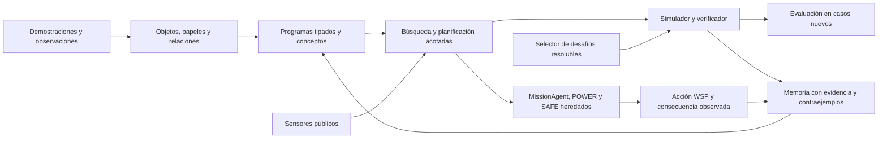

# ECHO-5 · 5.0.0

Integración experimental en CPU: objetos y relaciones, programas compuestos,
conceptos persistentes, aprendizaje por interacción y recuperación del control
robótico anterior. El neocórtex está apagado en este banco. S6 mantiene su
estado abierto; esta versión no declara puntuación ARC ni validación en hardware real.

**Estado oficial: verde dentro del alcance validado.** El cierre r3 pasó sus
criterios, incluida la confirmación Gazebo/PX4 en simulación. Las mejoras de
búsqueda y coste posteriores están auditadas, con seis tareas independientes
sin resolver. [Release y límites](docs/RELEASE-5.0.0.md) ·
[Recibos públicos](../research-archive/20261012/README.md).

Primera ejecución histórica terminada y auditada: **93 pruebas pasaron**. La representación
nueva alcanza 31/32 rejillas sintéticas y la memoria 32/32; las diferencias y
los resultados negativos están en [el informe](docs/RESULTS-20261010.md).

La ampliación de cierre añade transferencia estructural, controles de biblioteca,
búsqueda profunda, MiniGrid/BabyAI, réplica de contraejemplos y MissionAgent con
un ejecutor Gazebo/PX4. Su estado actual se mantiene en el
[checklist de cierre](docs/CLOSURE-CHECKLIST.md); los resultados de la primera
ejecución no certifican automáticamente estos cambios.

La [revisión del 11 de octubre](docs/REMEDIATION-AND-TRANSFER-20261011.md)
contrasta los límites de transferencia y distingue los resultados del sistema
de las ventajas atribuibles a cada módulo. Propone controles con las mismas
habilidades, otro generador de escenas y una referencia semántica independiente.
La revisión experimental posterior a r3 implementa esos instrumentos en
[un protocolo separado](docs/REMEDIATION-IMPLEMENTATION-20261011.md). No hereda
el verde del cierre r3. El primer piloto y la autopsia posterior ya están
[medidos y auditados](docs/REMEDIATION-RESULTS-20261011.md): empate de exploradores,
referencias semánticas concordantes y límites de coste en búsqueda y currículo.
Determinismo
y trazabilidad no acreditan ausencia universal de errores ni generalización.

La [corrección posterior de búsqueda y coste](docs/SEARCH-EFFICIENCY-RESULTS-20261012.md)
ya está implementada y auditada: **12/18 tareas del generador independiente frente
a 0/18, y 9/9 plantillas frente a 0/9**, conservando los 326 operadores y el
presupuesto. El híbrido mantiene 28/28 y el currículo eficiente 64/64, con menor
trabajo que sus referencias anteriores. Persisten seis agotamientos de búsqueda;
la utilidad del disparador informativo y la superioridad general del currículo
siguen abiertas. [Checklist actualizado](docs/REMEDIATION-CHECKLIST.md).

Piloto CPU posterior a r3 (salida nueva, proceso separado y auditorías):

```sh
.venv-sandbox/bin/python -I scripts/remediation.py launch --output artifacts/remediation-mi-piloto
```

El plan fijo está en `docs/REMEDIATION-PILOT.json`. Ejecuta exploración pareada,
referencias semánticas, transferencia independiente, diagnóstico de prefijos y
currículo por demanda. No llama al LLM, no reabre S6 ni publica una versión.

Para el panel y el entorno externo:

```sh
make setup-sandbox
make panel
# Abrir http://127.0.0.1:8765 o http://echoai.localhost:8765
make checks-background
# Después de corregir los fallos de desarrollo:
make development-background
```

El panel permite crear una misión, avanzar paso a paso, continuar o pausar.
Muestra la observación parcial, el mapa recordado, hipótesis, acciones y
consecuencias del diario existente. Su red LIF de diagnóstico ejecuta el módulo
histórico de 256 unidades; no representa 500.000 neuronas ni dirige la política
del sandbox. Los recibos y logs permanecen en `artifacts/`.
[Uso, custodia y reproducción](docs/CLOSURE-RUNBOOK.md).
[Ejemplo de una decisión registrada en simulación](docs/DECISION-EXAMPLE-20261010.md).

```sh
cd ECHO-5
make setup
make check
make test
make bench OUT=artifacts/mi-evaluacion
make audit OUT=artifacts/mi-evaluacion
```

CPython 3.12.13, `.venv` propia y biblioteca estándar. El directorio de salida
debe ser nuevo: las ejecuciones anteriores no se sobrescriben. `thought.jsonl`
registra observaciones, hipótesis comprobadas, acciones y consecuencias. Puede
seguirse con `tail -f`; su contenido nunca vuelve como instrucción al actor.



| Módulo | Implementación | Comprobación |
|---|---|---|
| GROUND-1 | Segmentación anterior, papeles contextuales y relaciones espaciales | Colores/disposiciones nuevos y abstención ante empates |
| HIER-1 | Composición tipada, conceptos, expansión acotada y reutilización de prefijos | Mismos candidatos con/sin reutilización; coste completo |
| CONCEPT-1 | Recuerdos con demostraciones, procedencia, dependencias y cuarentena | Revalidación, persistencia y biblioteca vacía como control |
| ADAPT-1 / RETRO-1 | Hipótesis de consecuencias, pruebas informativas y búsqueda desde la meta | Cambios de mapa, meta y dinámica frente a exploración pasiva |
| Contraejemplos y reparación | Desafíos con testigo, archivo de fallos y nueva comprobación de cada candidato | Selección secuencial, aleatoria y adaptativa con igual límite |
| Robótica | Planificador relacional acotado conectado al MissionAgent completo; POWER/SAFE y gateway independientes | Recibos de ejecución, llegada, colisiones, reserva, sensores, controles convencionales y Gazebo/PX4 |
| Custodia | Juez externo al proponente, límites, hashes, auditoría y replay | Respuestas reservadas fuera del actor |

Para resolver un JSON con demostraciones `train` y entradas `test`:

```sh
.venv/bin/python -I scripts/run.py solve tarea.json --budget 8000000 --trace artifacts/decisiones-nuevas.jsonl
```

`--memory memoria.json` carga conceptos y `--learn-to memoria-nueva.json`
conserva lo aprendido en desarrollo. `solved` significa consenso de los
programas considerados tras comprobar las demostraciones. La consulta sigue
marcada `test_verified: false`; una hipótesis plausible no es una verdad
comprobada. La búsqueda por niveles y los dominios finitos limitan la inferencia.

La integración importa piezas anteriores mediante `legacy.py`; necesita el
checkout completo de echoAI. Esta carpeta todavía no es un paquete autónomo
ni un producto de robótica desplegable. No activa enjambres, entrenamiento
de pesos o automejora recursiva.

- [Diseño e interfaces](docs/IMPLEMENTATION-DESIGN.md).
- [Contrato numérico](docs/BENCHMARK-CONTRACT.json).
- [Resultados y límites de la primera evaluación](docs/RESULTS-20261010.md).
- [Programas y conceptos](docs/GROUNDED-PROGRAMS.md).
- [Interacción y planificación](docs/INTERACTION.md).
- [Integración robótica](docs/ROBOTICS-INTEGRATION.md).
- [Aprendizaje adversarial](docs/ADVERSARIAL-LEARNING-PROPOSAL.md).
- [Inventario previo](docs/MODULE-INVENTORY.md).
- [Desarrollo y reproducción](docs/DEVELOPMENT.md).
- [Búsqueda con reutilización, firmas y verificación prioritaria](docs/SEARCH-EFFICIENCY.md).
- [Exploración híbrida opcional](docs/EXPLORATION-HYBRID.md).
- [Currículo con selección y actualización acotadas](docs/CURRICULUM-EFFICIENT.md).
