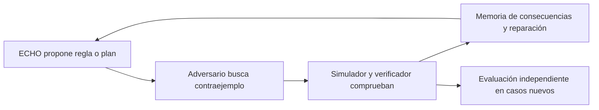

# Aprendizaje adversarial para ECHO-5: propuesta de investigación

Fecha: 10 de octubre de 2026. Propuesta inicial conservada abajo.
La primera adaptación está implementada en `src/echo5/adversarial.py`, con
contrato en [BENCHMARK-CONTRACT.json](BENCHMARK-CONTRACT.json). Se estudia
eliminación empírica de hipótesis mediante contraejemplos en un lenguaje
finito, sin entrenar una GAN ni pesos de modelos. La referencia secuencial
usa la misma reparación que los otros brazos; no representa una medición
del ejecutable histórico ECHO-4.5. El resultado comparativo puede ser negativo.
Esta integración no modifica ECHO-4.5, B24 o S6.

La pregunta es si un componente que busque contraejemplos reproducibles puede
ayudar a ECHO a aprender reglas con mejores condiciones de aplicación y a
transferirlas a situaciones nuevas. El interés proviene del ciclo competitivo
de las Generative Adversarial Networks (GAN), propuesto por Goodfellow y
colaboradores en 2014. Las GAN fueron una contribución a los modelos
generativos; no fueron el comienzo de toda la IA generativa.

En una GAN clásica, G genera muestras y D estima si proceden de los datos de
entrenamiento o de G. Su objetivo original se expresa como:

\[
\min_G\max_D\;\mathbb{E}_{x\sim p_{datos}}[\log D(x)]
+\mathbb{E}_{z\sim p_z}[\log(1-D(G(z)))].
\]

D aprende una distinción estadística entre orígenes. No es por ello un
detector general de verdad o mentira. En el ideal teórico del artículo,
el generador reproduce la distribución de los datos y D vale 1/2. Observar
un discriminador que acierta alrededor de la mitad en una ejecución real
no demuestra ese equilibrio: también podría ser un discriminador deficiente.

El entrenamiento adversarial no garantiza mejora ilimitada, generalización
fuera de sus datos ni automejora recursiva del algoritmo de aprendizaje.
Puede sufrir estancamiento, pérdida de diversidad e inestabilidad. Mescheder
y colaboradores muestran casos de no convergencia y condiciones específicas
que permiten estabilizarla. Esas garantías no se trasladan automáticamente
a un agente simbólico o a una discusión entre LLM.

Para ECHO se propone adaptar la competencia a soluciones y contraejemplos
ejecutables. Sería búsqueda y aprendizaje adversarial inspirado en GAN,
con diferencias explícitas respecto a entrenar dos redes por gradiente.

| Componente propuesto | Responsabilidad | Evidencia que conserva |
|---|---|---|
| ECHO con neocórtex opcional | Proponer una regla, programa o plan con precondiciones, predicción y coste | Propuesta estructurada y versión de la política |
| Adversario | Buscar un caso válido donde una propuesta produzca un resultado incorrecto | Caso reproducible, procedencia y fallo observado |
| Simulador y verificador | Ejecutar el caso, comprobar validez y medir el resultado con criterios fijos durante el ensayo | Estado inicial, acciones, consecuencias y recibo |
| Memoria y reparación | Conservar fallos comprobados y orientar cambios en condiciones o composición | Linaje, dominio de aplicación y resultado propio de cada descendiente |

Ejemplo hipotético: una regla mueve el objeto rojo a la meta. El adversario
introduce un segundo objeto rojo y un obstáculo dentro del dominio permitido.
La ejecución permite distinguir si falta identificar el objeto por su papel,
representar la relación con la meta o planificar una trayectoria viable.
El contraejemplo solo aporta información cuando se comprueban su validez y
el fallo; una crítica lingüística no basta.

El adversario recibiría crédito por descubrir fallos reproducibles en casos
resolubles y por aportar diversidad. Los casos duplicados, inválidos o fuera
de contrato no recibirían ese crédito. La recompensa y sus coeficientes se
fijarían en el contrato antes de medir. La dificultad tendría que crecer
según lo que ECHO pueda aprender; permitir únicamente mundos imposibles
produciría un objetivo inútil.

Un antecedente más cercano a esta aplicación es PAIRED: estudia generar
entornos a partir de la diferencia de retorno entre dos agentes, para
construir tareas difíciles pero resolubles. Sus resultados respaldan estudiar
un currículo adversarial. No prueban que esa adaptación funcione en ECHO.
En un piloto acotado podemos exigir una solución testigo comprobada por el
evaluador. Esa solución no se entrega al actor durante su evaluación.
En robótica, resolubilidad en simulación no certifica viabilidad física.

Hay piezas existentes que deben revisarse antes de integrar:

- `seed/dreams.py` genera tareas mediante programas sobre entradas permitidas
  de desarrollo; conoce el programa generador y ordena la búsqueda. Su
  muestreo aleatorio sería un control útil. No contiene ya este adversario.
- `echo4/tribe_liar.py` registra respuestas incorrectas de otros agentes y
  las contrasta mediante consecuencias en un mundo definido. Es un
  antecedente de verificación acotada, no coentrenamiento GAN.
- `seed/relational_dsl.py`, `seed/relational_solver.py` y la memoria causal
  aportan candidatos para expresar, verificar y recordar reglas. La
  idoneidad y las interfaces siguen pendientes de integración.
- DREAM y los instrumentos de replay permiten estudiar simulaciones bajo
  sus contratos. Una traza almacenada no proporciona por sí sola un
  simulador de acciones que nunca ocurrieron; las alternativas exigen un
  entorno reejecutable o un modelo cuya fidelidad esté medida.

El encaje propuesto es GROUND-1/HIER-1 para expresar las correcciones y
ADAPT-1/CONCEPT-1 para experimentación y transferencia. SITRA-1 conservaría
la custodia del verificador; un crítico que aprende no recibe autoridad para
modificarlo. TIKKUN-1 podría estudiar reparaciones acotadas. ECHO-5.1 podría
comparar varios especialistas; cambiar pesos del neocórtex pertenecería a
una condición posterior de RSI-2. Estos nombres no acreditan módulos nuevos.

El primer microensayo debería comparar tres condiciones:

| Brazo | Selección de experiencias |
|---|---|
| A: referencia | Procedimiento actual, con presupuesto disponible para su propia búsqueda |
| B: aleatorio | Casos válidos generados aleatoriamente en el mismo lenguaje y dominio |
| C: adversarial | Casos válidos seleccionados según fallos comprobados de su propio historial |

Los tres comenzarían desde el mismo estado y se compararían por semillas
emparejadas. Se fijarían límites comunes de partidas, propuestas, llamadas
y tokens; también se informarían tiempo y memoria. El coste del generador,
del crítico, de los replays y de los intentos descartados se contabilizaría.
Cada brazo mantendría su archivo de experiencias separado. El neocórtex,
si participa, permanecería fijo en modelo, cuantización y configuración.

La evaluación usaría tareas nuevas y composiciones reservadas, ajenas a la
selección de contraejemplos. Mediría aciertos exactos, regresiones por caso,
coste por solución, diversidad y retención después de reiniciar. Una ablación
sin la memoria aprendida ayudaría a localizar la causa de una ventaja.
Superar únicamente a un adversario conocido, producir más críticas o
consumir más cómputo no acreditaría transferencia.

Antes de ejecutar habrá que fijar corpus, tamaño de muestra, presupuestos,
umbrales, método estadístico, reglas de parada y límites de promoción. Este
documento no los sustituye ni abre exámenes. Un caso inválido o un replay
inconsistente debe distinguirse de un resultado negativo del agente.
La incertidumbre y los fallos se conservarían en el informe.

Las decisiones visibles serán observaciones, hipótesis, intervenciones y
resultados reales mediante los mecanismos existentes. No se crea otro
thought-bus. El núcleo continúa funcionando sin LLM; las pruebas históricas
de NEXUS-0 mantienen el córtex apagado. No se presupone una tasa universal
de alucinación cero ni una mejora recursiva sin límite.

Fuentes primarias consultadas el 10 de octubre de 2026:

- Goodfellow et al., [Generative Adversarial Networks](https://arxiv.org/abs/1406.2661), 2014.
- Mescheder et al., [Which Training Methods for GANs do actually Converge?](https://proceedings.mlr.press/v80/mescheder18a.html), ICML 2018.
- Dennis et al., [Emergent Complexity and Zero-shot Transfer via Unsupervised Environment Design](https://arxiv.org/abs/2012.02096), 2020, revisión 2021.

Contexto del proyecto: [inventario](MODULE-INVENTORY.md) y
[visión 5/5.1/5.5](../../docs/ECHO5-51-55-RESEARCH-VISION.md).
