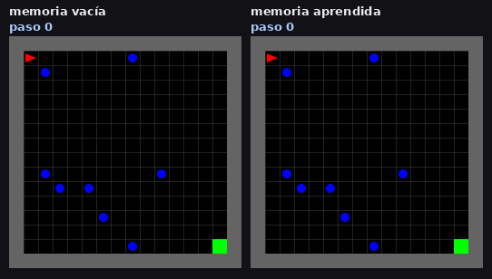
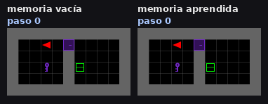
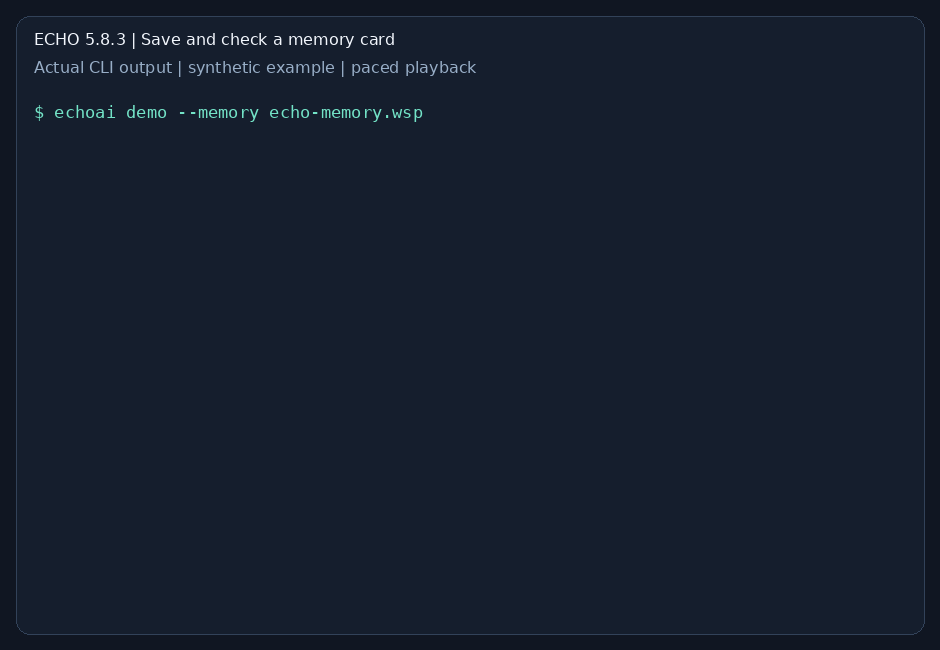

<p align="center"></p>
<h1 align="center"><strong>ECHO 5.8</strong></h1>
<p align="center"><strong>Official release · 5.8.3</strong><br />Learn from consequences. Carry memory forward.</p>
<p align="center"><a href="https://rxlabs.org/echoai">Website</a> · <a href="https://huggingface.co/RxLabs/echoai-5.8">Download</a> · <a href="https://github.com/navywakura/echoai">GitHub</a></p>

ECHO is a cognitive agent for local simulations and agent tooling. It observes
what happens, learns the consequences of actions and reuses that memory to guide
future decisions. Run it on CPU, explore its terminal and carry memory between
sessions in **WSP files**.

## What does this look like in practice?

Imagine an agent exploring a small simulated world. Some objects move on their
own; touching them can end the attempt. Experience with one world can help the
agent recognize that role in another, even when the object has a new identifier.

A **WSP file is like a memory card for a game**: save what the agent has learned,
then load it into another compatible ECHO agent so it can reuse that experience.
The file carries learned records; the receiving agent uses the same memory format
and role representation.

## See it work

### 1. Remember which objects are dangerous



In this recorded MiniGrid example, the agent without memory hits an obstacle at
step 2. With learned memory, it reaches the green goal at step 33. The red triangle
is the agent; the blue circles are moving obstacles. Left: empty memory. Right:
learned memory. This is one illustrative run with new object identifiers.

### 2. Reuse experience with a key and a door



Both agents finish this recorded task: **38 steps without memory, 27 with memory**.
The agent picks up a key, unlocks a door and collects the target object. Left:
empty memory. Right: learned memory. These clips show individual examples;
the evaluation totals below summarize many runs.

### 3. Save the memory and load it again



This is actual output from the installed release, paced for readability. The
small synthetic example records three observations, saves and reloads a WSP file,
and predicts `HURT` for a new object with the same role. `valid: true` confirms the
file passes the format and integrity checks. Try these commands in Getting started.

[Explore the interactive replay and controls](https://rxlabs.org/echo-en-accion).

## What you can build

- **Agents with persistent memory:** record consequences, recall learned roles
  and save or reload the same memory.
- **Interactive simulations:** follow an agent's observations, map and actions
  in the browser panel.
- **Connected tools:** use the terminal with local backends and an optional
  language-model adviser.

One `echoai` installation brings the core, memory tools and terminal together.
The source includes the simulation and repository integrations.

## Getting started

Python **3.12+**, Git and a Linux, macOS or WSL shell:

```bash
git clone https://github.com/navywakura/echoai.git
cd echoai
bash install.sh
export PATH="$HOME/.local/bin:$PATH"
echoai info
echoai demo --memory echo-memory.wsp
echoai memory verify echo-memory.wsp
echoai tui
```

The installer creates a dedicated environment. The small synthetic demo learns
three observations, predicts the same consequence for a new object with the
same role and reloads the saved memory. Expect `new_object_prediction: "HURT"`
and `valid: true`. Choose a new filename when repeating the demo.

In the terminal, `/help` lists commands and `/demo` opens a sample session.
Download the ready-to-install source package from **[Hugging Face](https://huggingface.co/RxLabs/echoai-5.8)**.

[Usage](docs/USAGE.md) · [Memory](docs/memory.md) ·
[Simulation](simulation/README.md) · [Terminal](harness/echo-nexus/README.md)

## What the results mean

Completed evaluations in simulated worlds:

| What improved? | Measured result | In everyday terms |
|---|---|---|
| Remembering danger | Harmful endings **150.0 → 24.2** | Starting with learned memory reduced attempts that ended in hazards such as lava or contact with moving obstacles. |
| Choosing useful improvements | Unfinished tasks **94.3 → 13.8 out of 120**; harmful endings **58.6 → 0** | ECHO selected and combined five available policy improvements, completing more tasks safely. |
| Sharing experience | **160/160 worlds completed**, compared with **119/160** for isolated agents | Four agents used shared memory to help complete worlds, including tasks where agents cooperate on pressure plates. |

A **harmful ending** means a simulated attempt ended in a hazard. An **unfinished
task** means the goal was not reached, whether because of a hazard or because the
step budget ran out. Decimal counts are averages across repeated evaluations.

<details>
<summary>How these numbers were measured</summary>

- **MEMORIA-X:** mean harmful endings per evaluation run, pooled across held-out
  world families in the A1 setting (fixed object identifiers), over 10 runs;
  learned memory compared with empty memory.
- **ACUMULA-3:** means over 10 runs, each with a 120-task evaluation and five rounds
  of selecting and chaining supplied policy pieces.
- **ENJAMBRE-1:** four agents per team, 20 teams and eight worlds per team;
  includes pressure-plate tasks designed for cooperation.

</details>

These measurements describe those tasks. ECHO 5.8.3 packages the components
with common setup and memory commands.

## Built over time

ECHO 4/4.5 established the core and terminal; 5.0/5.1 added simulation,
composition and repository tools; 5.5 developed interactive-world tooling;
5.8 brings role memory, chained improvements and cooperation. The WSP persistence
work from 5.8.2 is included in this release.

<p align="center"><strong>RxLabs / Nav</strong><br /><a href="https://rxlabs.org">rxlabs.org</a> · <a href="https://github.com/navywakura/echoai">Source code</a></p>

GPL-3.0-or-later for the main source; component licenses are included.
