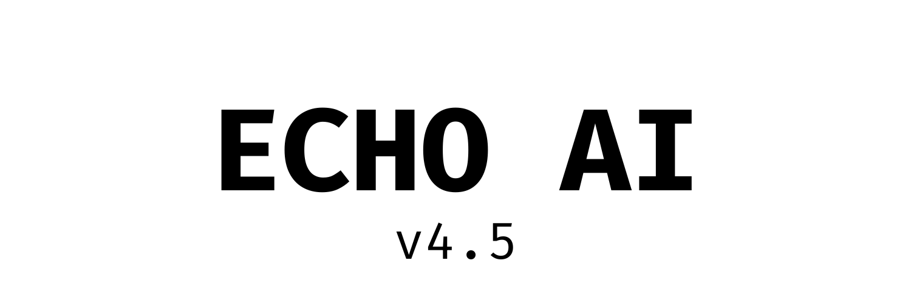

<p align="center"></p>
<p align="center">
  
  
  
  <a href="https://huggingface.co/RxLabs/echoai-4-cognitive-agentic"></a>
</p>
<p align="center">
  
  
  
  
  
  
</p>

ECHO-AI combines an integer cognitive core, causal memory, verified program search and an optional language adviser. This repository contains the **complete current source distribution**: core, research modules, development tests, `echo-dev` and the `echo-nexus` terminal.

**ECHO-4.5 is a development beta. S6 and final release closure remain open.** Installation integrity and development tests are separate from scientific acceptance. The previous ECHO-4.0 artifact is available on [Hugging Face](https://huggingface.co/RxLabs/echoai-4-cognitive-agentic).

The [10 October checkpoint](docs/PROJECT-CHECKPOINT-20261010.md) preserves
the latest B24/ARC work and [research evidence](research-archive/20261010/README.md).
[ECHO-5](ECHO-5/README.md) contains development preparation and a module
inventory only; functional implementation has **not started**. The
[GAN-inspired adversarial learning proposal](ECHO-5/docs/ADVERSARIAL-LEARNING-PROPOSAL.md)
is documented for future investigation and has not been implemented or tested.

## Start

```bash
git clone https://github.com/navywakura/echoai.git
cd echoai
python3 tools/source_setup.py verify
bash install.sh
echoai setup
echoai tui
```

Python 3.12+, Linux or macOS, no administrator access required. The installer verifies every distributed source file, creates a private virtual environment, installs the included TUI and verifies the installed source again. It keeps an installation log and preserves existing non-symlink executables. Private repositories require GitHub authentication to clone. Windows users can run the source with Python; the shell installer requires WSL or a compatible shell.

Downloadable packages and SHA-256 checksums are in [Releases](https://github.com/navywakura/echoai/releases). A release includes the wheel, complete source archive, bundled terminal harness and release evidence.

## Connect the neocortex

Inside `echo-nexus`:

```text
/connect api https://provider.example/v1 MODEL API_KEY_ENV
/connect openrouter free @/absolute/path/key-file
/connect anthropic https://api.anthropic.com/v1 MODEL ANTHROPIC_API_KEY
/connect local /absolute/path/model.gguf
/connect opencode provider/model
/connections save my-neocortex
/connections default my-neocortex
/devtest list
/devtest core-test
/echo
```

API connectors support OpenAI-compatible Chat Completions and Anthropic Messages. OpenRouter uses HTTPS. Local GGUF uses a separately installed `llama-server`; models are not downloaded automatically. OpenCode is a separately installed CLI running in an ephemeral adviser workspace with tools denied. Saved profiles contain credential references, never key contents. MCP stdio servers can be connected and invoked explicitly with `/mcp`; they are not automatically controlled by the adviser.

Model text is a **proposal**, not a verified fact. Connecting a language adviser does not enable the NEXUS-0 core cortex. `/echo` reports recorded observations; `/ask` explicitly shares a summary with the adviser. No fabricated thought stream is presented.

<details>
<summary>Terminal preview</summary>


</details>

## Develop

```bash
echoai verify
echoai doctor
echoai setup list
echoai devrun core-test
echo-dev doctor
echo-dev scan
echo-dev run
```

The setup TUI lists bounded development commands and captures their output in logs. `echo-dev` also supports isolated checks and controlled repair loops; its full profile requires Linux user namespaces, Bubblewrap and the separately managed tools described in [the development harness guide](docs/ECHO-LOCALDEV-HARNESS.md). The setup launcher does not execute sealed S6 exams. Developers may use `--allow-modified` for their own edited checkout; modified source is never reported as a pristine release.

```text
core/        Integer representation, associative memory and plasticity
nexus0/      Perception, policy, world model and epistemic gate
echo4/       Cognitive agent, persistence and causal-memory modules
echo_arc/    ARC perception and action solvers
seed/        Program synthesis, memory and S6 research controllers
harness/     echo-dev, echo-nexus and integration protocols
tests/       Development and regression tests
docs/        Specifications, research reports and current roadmap
tools/       Source verification and terminal setup
```

The former `echoai/` folder is now the repository root. Its required mathematical helpers live in `core/`; no obsolete chatbot or website is shipped. The live laboratory workspace and frozen experiments remain separate. Raw experiment environments and sealed input data are excluded from distribution.

`research-archive/` contains explicitly preserved research snapshots, separate
from live `lab/` directories. Their manifests identify original paths, hashes,
deduplicated files and omitted external build binaries. Installing this source
does not execute those scripts or resume their experiments.

Read [current status](docs/NOW.md), [the roadmap](docs/ECHO45-ECHO5-ROADMAP.md), [distribution notes](docs/DISTRIBUTION.md) and [the terminal guide](harness/echo-nexus/README.md). Historical reports preserve their original paths and hashes.

## Licensing

See [LICENSE](LICENSE) and component notices. The terminal harness is MIT; historical ECHO-4.0 packaging has its own notices under `release1/LICENSES/`. A beta package does not change those terms. Developer: **RxLabs**.
