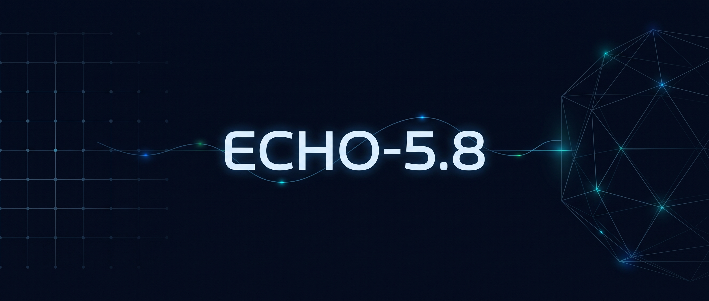

<p align="center"></p>

# ECHO-AI

ECHO is a cognitive agent that observes an environment, remembers the consequences
of its actions and uses that memory to choose what to do next. It runs locally
on CPU and includes a terminal interface, simulated environments and `.wsp`
files for saving and loading memory.

## Start

Requires Python 3.12+, Git and a Linux, macOS or WSL shell.

```bash
git clone https://github.com/navywakura/echoai.git
cd echoai
python3 tools/source_setup.py verify
bash install.sh
echoai tui
```

The installer creates a dedicated Python environment and installs the terminal.
Add `~/.local/bin` to your PATH if needed. In the terminal, use `/help` to see
commands and `/demo` to explore the interface with sample data.

## What you can use

- **Memory:** store observed consequences and reload them from `.wsp` files.
- **Terminal:** view observations, actions and local session records.
- **Simulation:** create a grid-world mission and follow it in a browser.
- **Language adviser:** optionally connect your own API provider or local model.

[Usage guide](docs/USAGE.md) · [WSP memory](ECHO-5.8/README.md) ·
[Simulation](ECHO-5/README.md) · [Terminal](harness/echo-nexus/README.md)

[RxLabs](https://rxlabs.org) · [License](LICENSE) · Maintained by **RxLabs / Nav**.
Component-specific notices are included with their source.
