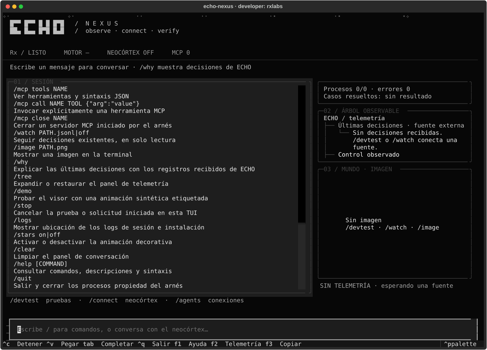

<p align="center"></p>
<p align="center">
  
  
  
  
  <a href="https://huggingface.co/RxLabs/echoai-4-cognitive-agentic"></a>
</p>
<p align="center">
  
  
  
  
  
  
</p>

ECHO-AI studies object and relation representations, causal memory, program composition and planning through interaction. It combines a local cognitive core with an optional language adviser. This repository contains the core, research modules, development tests, `echo-dev`, the `echo-nexus` terminal and the new [ECHO-5 implementation](ECHO-5/README.md).

> **ECHO-5 5.0.0 is officially green within its validated release scope.** The r3 closure verdict passed every declared gate, including Gazebo/PX4 simulation and independent-process audits. Subsequent search and cost experiments are published with their limits. S6 remains open and deferred until after ECHO-5.5; this is not a claim of general intelligence, hardware validation or universal error-free behavior.

The [12 October checkpoint](docs/PROJECT-CHECKPOINT-20261012.md), [release notes](ECHO-5/docs/RELEASE-5.0.0.md) and [selected evidence](research-archive/20261012/README.md) document this release. Earlier [11 October](research-archive/20261011/README.md) and [10 October](research-archive/20261010/README.md) snapshots retain their failures and original provenance.

| Latest controlled experiment | Measured result | Limit |
|---|---|---|
| Full-language synthesis | 12/18 independent tasks versus 0/18; 9/9 templates versus 0/9 | Six independent tasks remain unsolved; 326 operators and 2,000,000 work units per task |
| Hybrid exploration | 28/28, 4.45% less logical work than nearest frontier | Information trigger did not activate in this sample |
| Efficient curriculum | 64/64 versus random 56/64; 49.23% less total work than previous adaptive selector | 21.16% more work than random; eight paired runs do not establish broad statistical superiority |


ECHO-5 now includes typed object and relation programs, concept reuse, hierarchical search, bounded hypothesis testing, an adaptive counterexample curriculum, MiniGrid/BabyAI evaluation, a MissionAgent bridge and a local decision viewer. The curriculum is an empirical adversarial-learning experiment; it is not a trained generative adversarial network.

The separate **[echounity sandbox](https://github.com/navywakura/echounity)** provides an isometric robot world, a first-person camera, an observed map and genuine recordings of its decisions. Its simulation results have their own scope and do not close ECHO-5.

The existing terminal package remains **4.5.0b1**. The previous ECHO-4.0 artifact is available on [Hugging Face](https://huggingface.co/RxLabs/echoai-4-cognitive-agentic). ECHO-5 5.0.0 is distributed as a source workspace in this repository; the terminal installer remains separate.

## Work on ECHO-5

Start with the [ECHO-5 setup](ECHO-5/README.md), [closure checklist](ECHO-5/docs/CLOSURE-CHECKLIST.md) and [module inventory](ECHO-5/docs/MODULE-INVENTORY.md). ECHO-5 has its own Python environment and optional sandbox dependencies. The commands below install the existing terminal distribution.

The viewer presents observations, hypotheses, predictions, actions, consequences and remaining budget from actual records. Its neural diagnostic is separate from the acting policy. No fabricated inner monologue, consciousness claim or guarantee of zero hallucinations is implied.

## Start

```bash
git clone https://github.com/navywakura/echoai.git
cd echoai
python3 tools/source_setup.py verify
bash install.sh
echoai setup
echoai tui
```

Python 3.12+, Linux or macOS, no administrator access required. The installer verifies every distributed source file, creates a private virtual environment, installs the included TUI and verifies the installed source again. It keeps an installation log and preserves existing non-symlink executables. Private repositories require GitHub authentication to clone. Windows users can run the source with Python; the shell installer requires WSL or a compatible shell.

Downloadable packages and SHA-256 checksums are in [Releases](https://github.com/navywakura/echoai/releases). The 4.5 terminal release includes its wheel and harness. The 5.0.0 release provides the ECHO-5 source workspace and its published evidence; it does not introduce a new terminal wheel.

## Connect the neocortex

Inside `echo-nexus`:

```text
/connect api https://provider.example/v1 MODEL API_KEY_ENV
/connect openrouter free @/absolute/path/key-file
/connect anthropic https://api.anthropic.com/v1 MODEL ANTHROPIC_API_KEY
/connect local /absolute/path/model.gguf
/connect opencode provider/model
/connections save my-neocortex
/connections default my-neocortex
/devtest list
/devtest core-test
/echo
```

API connectors support OpenAI-compatible Chat Completions and Anthropic Messages. OpenRouter uses HTTPS. Local GGUF uses a separately installed `llama-server`; models are not downloaded automatically. OpenCode is a separately installed CLI running in an ephemeral adviser workspace with tools denied. Saved profiles contain credential references, never key contents. MCP stdio servers can be connected and invoked explicitly with `/mcp`; they are not automatically controlled by the adviser.

Model text is a **proposal**, not a verified fact. Connecting a language adviser does not enable the NEXUS-0 core cortex. `/echo` reports recorded observations; `/ask` explicitly shares a summary with the adviser. No fabricated thought stream is presented.

<details>
<summary>Terminal preview</summary>



</details>

## Develop

```bash
echoai verify
echoai doctor
echoai setup list
echoai devrun core-test
echo-dev doctor
echo-dev scan
echo-dev run
```

The setup TUI lists bounded development commands and captures their output in logs. `echo-dev` also supports isolated checks and controlled repair loops; its full profile requires Linux user namespaces, Bubblewrap and the separately managed tools described in [the development harness guide](docs/ECHO-LOCALDEV-HARNESS.md). The setup launcher does not execute sealed S6 exams. Developers may use `--allow-modified` for their own edited checkout; modified source is never reported as a pristine release.

```text
core/        Integer representation, associative memory and plasticity
nexus0/      Perception, policy, world model and epistemic gate
echo4/       Cognitive agent, persistence and causal-memory modules
echo_arc/    ARC perception and action solvers
seed/        Program synthesis, memory and S6 research controllers
harness/     echo-dev, echo-nexus and integration protocols
tests/       Development and regression tests
docs/        Specifications, research reports and current roadmap
tools/       Source verification and terminal setup
ECHO-5/      New research runtime, local viewer and controlled evaluations
research-archive/  Preserved experiment receipts and source provenance
```

The former `echoai/` folder is now the repository root. Its required mathematical helpers live in `core/`; no obsolete chatbot or website is shipped. The live laboratory workspace and frozen experiments remain separate. Raw experiment environments and sealed input data are excluded from distribution.

`research-archive/` contains explicitly preserved research snapshots, separate
from live `lab/` directories. Their manifests identify original paths, hashes,
deduplicated files and omitted external build binaries. Installing this source
does not execute those scripts or resume their experiments.

The ECHO-5 publication adapts imports to this repository's `core/` layout. Laboratory receipts identify the original frozen sources; their hashes are not hashes of this portable distribution. See [distribution notes](docs/DISTRIBUTION.md).

Read [current status](docs/NOW.md), [the roadmap](docs/ECHO45-ECHO5-ROADMAP.md), [distribution notes](docs/DISTRIBUTION.md) and [the terminal guide](harness/echo-nexus/README.md). Historical reports preserve their original paths and hashes.

## Licensing

See [LICENSE](LICENSE) and component notices. The terminal harness is MIT; historical ECHO-4.0 packaging has its own notices under `release1/LICENSES/`. A beta package does not change those terms. Developer: **RxLabs**.
