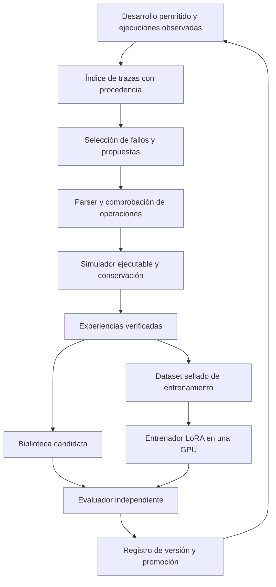

# ECHO-RSI-2: simulación, evolución de pesos y selección de neocórtex

2 de octubre de 2026. **Propuesta de investigación, sin implementación ni entrenamiento iniciado.** Amplía la línea futura [ECHO-RSI-1](ECHO-RSI-1-LAB-PLAN.md). El experimento privado RSI1-R1 ya terminó rojo y conserva sus fuentes, resultados y criterios. Este documento organiza las ideas de Roger sobre dreaming, especialistas y modelos intercambiables; todavía necesita contratos específicos antes de medir. S6 continúa pendiente.

La hipótesis es que ECHO pueda producir experiencias verificadas, aprender de ellas una biblioteca y un adaptador de lenguaje, y usar el sistema actualizado para producir mejores experiencias en un ciclo posterior. Cambiar a un proveedor más potente puede mejorar el producto; atribuir ese cambio a aprendizaje de ECHO requiere controles adicionales. Los vídeos propuestos sirven como motivación narrativa. Las afirmaciones técnicas se apoyan aquí en código, mediciones y fuentes primarias.

Hay dos antecedentes concretos. PROBE2 encontró dos propuestas que pasan V3: 378 → 383 niveles, sin pérdidas por partida en A. Ejecutó 10.048 partidas, incluidas repeticiones, con cero llamadas al modelo. Las trazas de la base sirvieron para identificar las partidas que una guarda podía afectar; los efectos se midieron ejecutando la política modificada en el simulador. Esto se ve en `screen` y `full` de [s6probe2.py](../seed/s6probe2.py), que llaman a los medidores de [s6probe1.py](../seed/s6probe1.py) y su `play_one`. Una revisión de archivos históricos no produce por sí sola resultados contrafactuales.

RSI1-R1 obtuvo 99/144 con ECHO recursivo, 99/144 sin acumulación, 96/144 con la base y 101/144 con propuestas aleatorias. Su investigador no obtuvo nuevas promociones. El análisis posterior de las 57 llamadas encuentra 10 respuestas inválidas, 11 prompts distintos y solo **tres programas válidos distintos** entre las 47 respuestas válidas. Dentro del brazo recursivo fueron dos programas válidos distintos en quince llamadas. Los prompts de desarrollo no incorporan explícitamente el error de la propuesta anterior; toman las primeras dos tareas de la selección. Estos hechos justifican estudiar elección de ejemplos, memoria de rechazos y reparación antes de atribuir el fallo al tamaño del modelo. Son diagnóstico posterior, no una demostración causal de que esos cambios bastarán. [Resultados](ECHO-RSI1-RESULTS.md), [diversidad observada](../lab/research/echo-rsi1-recovery1-20261002-analysis/proposal-diversity.json).

**Dreaming necesita distinguir registro, simulación y aprendizaje.** Si la política original fue a la derecha, la traza contiene la consecuencia de ir a la derecha. Si la candidata va a la izquierda, la siguiente observación histórica deja de ser válida. Se necesita restaurar un estado completo —incluido RNG, temporizadores y estado del actor— y continuar con un simulador de transiciones, o reiniciar la partida. Un grafo de transiciones observadas solo permite ramas cubiertas y suficientemente descritas; una transición ausente queda desconocida. Si se usa un modelo aprendido del mundo, sus predicciones son hipótesis que deben contrastarse en el entorno evaluador.

La continuidad determinista de ECHO-4 aporta mecanismos que se pueden reutilizar. EGO-MEMORIA-3E aporta memoria funcional en su aldea; su 16/16 no acredita un simulador completo de otros mundos. El ejecutor con checkpoints debe demostrar paridad con una ejecución íntegra, incluida la primera acción divergente, antes de usarse para ahorrar cómputo. En juegos oficiales con límites a reinicios, consultas o acceso al estado interno, el método deberá respetar ese protocolo; una evaluación con simulador privilegiado se informa como condición de desarrollo propia.

DreamCoder aporta una referencia especialmente pertinente: alterna resolución, aprendizaje de biblioteca y entrenamiento de un modelo que guía la búsqueda mediante ejemplos de programas. Esa combinación es una hipótesis trasladable al DSL de ECHO; su publicación no valida automáticamente nuestro agente. [DreamCoder, autores originales](https://arxiv.org/abs/2006.08381).

El índice referencia los diarios y artefactos actuales. No añade otro bus de pensamiento ni incorpora un LLM a NEXUS-0. Ningún texto del visor se devuelve al actor como evidencia. El entrenador y el neocórtex permanecen fuera del núcleo rápido entero.

| Módulo propuesto | Trabajo concreto | Solo se acepta cuando |
|---|---|---|
| **DREAM-STORE-1** | Indexar observación, propuesta, resultado, error, versión, coste y procedencia sobre registros existentes | Reconstruye los recibos, distingue datos de desarrollo/reserva y mantiene el límite de almacenamiento |
| **DREAM-EXEC-1** | Ejecutar candidatas desde inicio o checkpoints válidos; usar trazas para priorizar y descartar casos demostrablemente inertes | Coincide con la ejecución completa y detecta transiciones desconocidas; ahorro medido sin perder resultados |
| **PROPOSE-2** | Formato restringido, elección de ejemplos, memoria del objetivo, rechazo de duplicados y reparación con feedback | Mejora propuestas útiles por presupuesto frente al generador congelado; todos los reintentos cuentan |
| **ARENA-1** | Comparar dos a cuatro proponentes; generador de contraejemplos separado del evaluador | Supera un proponente con N muestras y un agente secuencial con igual presupuesto total |
| **CORTEX-MUX-1** | Reutilizar conectores de echo-nexus; seleccionar base, adaptador o API por versión y capacidades declaradas | Selección reproducible, costes registrados, comportamiento válido ante fallo y ventaja sobre ruta fija |
| **WEIGHTS-1** | Construir dataset, entrenar un adaptador y evaluar transferencia y olvido | El adaptador supera a su misma base en datos nuevos con conservación y costes medidos |
| **RSI2-CYCLE-1** | Automatizar dos ciclos de generación, entrenamiento y selección | El sistema evolucionado produce mejoras posteriores más útiles con presupuesto comparable y atribución separada |

Son siete módulos propuestos, todos pendientes. Parser, simulador, registro y contabilidad pueden ser programas ordinarios. Reservar el LLM para síntesis o crítica con utilidad medida reduce llamadas innecesarias. La competencia de propuestas no es automáticamente self-play; un torneo que escoge un ganador tampoco implementa GRPO. La contribución del rol crítico debe compararse con reglas deterministas y con dedicar sus tokens a otra propuesta.

La memoria de rechazos se indexa por programa normalizado, versión base, contexto permitido y perfil de evaluación. Una regla que falla bajo una condición no queda refutada para todas las condiciones futuras. Se conservan las ramas efectivamente exploradas; las no ejecutadas se etiquetan como hipótesis. No existe un árbol completo de alternativas que nunca se calcularon. La retención sería acotada: resúmenes, referencias y hashes para todos los intentos; diarios completos para fallos del instrumento, muestras fijadas y promociones.

**La evolución de pesos empezaría con un adaptador pequeño.** Para una matriz de la base se usaría `W_efectiva = W_base + s·B·A`, donde el rango de `B·A` es pequeño. Se entrenan A y B; la base permanece congelada en LoRA. Hay `r·(d_entrada+d_salida)` parámetros adicionales por matriz adaptada: ocupan memoria. QLoRA reduce la memoria de la base con cuantización y propaga gradientes hacia adaptadores. El artículo mostró un ajuste de 65B en 48 GB bajo su configuración; no garantiza GRPO, contextos largos o cualquier 70B en una GPU. [LoRA](https://arxiv.org/abs/2106.09685), [QLoRA](https://arxiv.org/abs/2305.14314).

El primer entrenamiento propuesto sería SFT de propuestas verificadas y correcciones de formato, con negativos conservados para evaluación. Cuando existan pares comparables para el mismo problema, DPO puede aprender preferencias derivadas de ejecución. GRPO se estudiaría después: genera grupos de respuestas, calcula recompensas y actualiza la política; su coste incluye generación, evaluación y entrenamiento. No se combinan estas etiquetas como si fueran un único método obligatorio. [DPO en TRL](https://huggingface.co/docs/trl/en/dpo_trainer), [GRPO en TRL](https://huggingface.co/docs/trl/en/grpo_trainer).

Cada ejemplo contendría entrada pública permitida → propuesta estructurada → comprobaciones y resultado. Una justificación breve puede acompañarlo, pero no se inventa una cadena de pensamiento ni se exige acceder al razonamiento privado de un proveedor. Un programa aceptado necesita demostraciones y contextos diversos; la única promoción recursiva actual no constituye un corpus suficiente para sostener generalización amplia. Los contraejemplos deben ser válidos y resolubles según un criterio independiente, evitando recompensar rompecabezas imposibles.

Los registros separan descubrimiento autónomo, intervención humana y datos de un profesor externo. Las soluciones de PROBE2 son búsqueda dirigida y no se entregan al modelo para después acreditar que las descubrió. Las reservas, sus respuestas y sus errores quedan fuera del ajuste. Un examen consultado repetidamente deja de ser una reserva nueva; cada ciclo requiere separación por familias o repositorios y una política de consultas prerregistrada. Si datos humanos o de un profesor se incorporan a otra condición, se declara su procedencia y se usa una reserva nueva.

El ciclo conservaría una base publicada compatible y adaptadores versionados. El adaptador A1 es candidato, A0 sigue activo mientras se entrena. Tras el examen se promueve A1 o se conserva A0. El siguiente ciclo puede continuar desde A1 o entrenar desde la base con datos acumulados; esa elección y sus controles se fijan antes de medir. La decisión de entrenar, seleccionar datos y promover debe seguir reglas automatizadas registradas para atribuir autonomía. Un entrenamiento elegido manualmente es ajuste supervisado por el laboratorio.

**Conmutar modelos y mejorar pesos son dos intervenciones distintas.** Un router puede consultar una API y un modelo abierto en diferentes solicitudes. Modificar pesos exige disponer de una base ajustable y de los permisos correspondientes; una conexión API no entrega pesos ni derecho automático de destilación. Un adaptador no es portable entre arquitecturas y versiones arbitrarias. El manifiesto incluye base, revisión, tokenizer, plantilla, adaptador, cuantización, router y herramientas.

vLLM permite seleccionar adaptadores por solicitud y cargarlos dinámicamente en modelos compatibles. Tiene límites de número y rango, y costes de memoria y carga: no hay memoria adicional cero ni latencia universal de milisegundos. Para el piloto bastaría un solo proceso de inferencia y cambios entre trabajos. Las solicitudes en curso quedan fijadas a una versión; se actualiza el puntero para trabajos nuevos, se ejecutan comprobaciones y se conserva rollback. Cambiar el modelo durante un examen requiere que esa política de enrutamiento fuera parte de la condición congelada. [Documentación oficial de vLLM](https://docs.vllm.ai/en/latest/features/lora/).

Un replay determinista del simulador verifica la ejecución de una propuesta registrada. Un nuevo muestreo del LLM o un entrenamiento GPU puede variar por sampling, hardware y operaciones numéricas; se evalúa esa variación con semillas y réplicas. Dos modelos distintos no tienen que producir acciones idénticas. El objetivo de la evolución es cambiar decisiones cuando aportan una mejora; la conservación se verifica en resultados y capacidades definidas, y cada candidato reproduce su propia ejecución bajo el perfil fijado. Un evaluador determinista puede contener bugs o medir una métrica equivocada. Los tests y replays no constituyen una prueba formal de corrección universal.

La comparación mínima separaría cuatro sistemas, usando el mismo router fijo y el mismo presupuesto de inferencia:

| Condición | Biblioteca | Neocórtex | Qué permite atribuir |
|---|---|---|---|
| Base | L0 | W0 | Referencia |
| Biblioteca | L1 | W0 | Efecto de habilidades simbólicas |
| Pesos | L0 | W1 | Efecto del adaptador |
| Combinada | L1 | W1 | Efecto conjunto y posible interacción |

La interacción puede medirse como `S(L1,W1) − S(L1,W0) − S(L0,W1) + S(L0,W0)`; puede ser negativa. Se añade LLM sin núcleo para medir la aportación de ECHO. El router adaptativo y el enjambre se comparan después con ese presupuesto, sin introducir un modelo más caro solo en el brazo favorecido. Se reportan gasto efectivo, techos, fallos, tiempo, CPU/GPU, tokens y coste de entrenamiento amortizado a un volumen de uso explícito.

Las puertas nuevas serían W0 (procedencia y ausencia de contaminación), W1 (mejora de pesos frente a la misma base), W2 (conservación y transferencia), W3 (atribución al núcleo, biblioteca y organización), W4 (productividad superior en un segundo ciclo) y W5 (reproducción, despliegue y rollback). Se proponen al menos tres semillas de ajuste y dos ciclos; tamaños, intervalos, margen de mejora, límites de regresión y multiplicidad deberán fijarse en el contrato. Un ejemplo correcto aislado o un torneo ganado no bastan. Las puertas de S6 mantienen su dominio y contrato propios; su rojo no se borra ni se utiliza su examen como verificador universal de pesos.

**Infraestructura inicial propuesta.** Un portátil puede alojar núcleo, registro y cola mientras esté encendido; un VPS pequeño es opcional para continuidad de la cola. El simulador puede consumir más CPU y RAM que el orquestador, por lo que se mide por separado. Una GPU alquilada de 24 GB serviría para perfilar una base abierta de 3–8B con QLoRA y contexto acotado; 48 GB es una alternativa si memoria o rendimiento lo justifican. Entrenamiento e inferencia pueden turnarse en esa misma instancia. No se necesita un clúster HPC ni servidores en varias regiones para este primer ensayo. [Requisitos de memoria de Unsloth](https://unsloth.ai/docs/get-started/fine-tuning-for-beginners/unsloth-requirements) publica mínimos dependientes del método; se mide el pico real antes de comprometer una corrida.

| Recurso | Primera opción | Motivo y límite |
|---|---|---|
| Control y verificación | CPU local; cola persistente ya utilizada en RSI1 | Cero alquiler inicial; el equipo debe estar activo |
| Ajuste e inferencia por turnos | Un Pod GPU de 24 GB; 48 GB si el perfil lo exige | Arranque, memoria y tokens/s medidos antes del ajuste completo |
| Artefactos | Disco local más copia privada en almacén de objetos o repositorio privado | Pesos, datasets y recibos con hashes; no publicar trazas por defecto |
| Ejecución reproducible | Contenedor con versiones fijadas, checkpoints y límite de coste | Exportar resultados y apagar el recurso al acabar; contemplar interrupciones spot |

Runpod publica, en la consulta del 2 de octubre, RTX A5000 24 GB a **$0,27/h**, A40 48 GB a **$0,49/h** y RTX 4090 24 GB a **$0,74/h** para Pods. Son tarifas consultadas, no una reserva ni presupuesto final en euros. Se deben comprobar disponibilidad, impuestos, almacenamiento y transferencia. El precio por hora no determina el coste por experimento. [Precios del proveedor](https://www.runpod.io/pricing).

Se mantiene el [presupuesto previsto de 180 €](ECHO55-INFRASTRUCTURE-PLAN.md): 120 GPU, 30 API, 15 almacenamiento y 15 reserva. El primer ensayo tendría un techo propuesto de **20–30 € dentro de ese total**, empezando por un perfil corto y conservando fondos si no aparece utilidad. No se garantiza una duración de dos o tres horas ni capacidad frontier. No se ha contratado infraestructura ni consumido API de pago para esta propuesta. El GGUF local sirve para inferencia; el entrenamiento necesita los pesos y el formato soportados por el stack elegido.

Actualización del 7 de octubre: el [plan de familia Alpha/Beta/Theta/Gamma](ECHO-PRODUCT-FAMILY-AND-SAAS-PLAN-20261007.md) registra un techo futuro de **1.300 € de cómputo e infraestructura** para 2027, procedente de la beca esperada, y el uso previo de Colab/Kaggle. El presupuesto de 180 € corresponde al piloto anterior; no se suma automáticamente al nuevo techo. La opción `dream`, los ajustes completos de 7B/14B/32B y el SaaS tienen hitos y perfiles propios en esa ampliación. No se inicia entrenamiento mediante estos documentos.

El orden de trabajo es: analizar diversidad y feedback del rojo RSI1; preparar un piloto de propuestas con memoria y formato restringido; validar el ejecutor de sueños contra ejecuciones completas; comprobar transferencia con el modelo fijo; obtener un dataset suficiente y auditable; perfilar y ajustar el primer adaptador; evaluar las cuatro condiciones; estudiar router y arena; finalmente probar dos ciclos completos. Los preparativos pueden avanzar mientras S6 continúa, pero las promociones y afirmaciones de autonomía siguen condicionadas a sus exámenes. Esta es la ampliación prevista **ECHO-5.5 → ECHO-RSI-1 → ECHO-RSI-2**.
