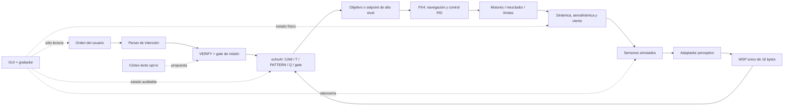

# Después de ECHO-3 — DRONE-METAVERSE y camino a chimpancé

**Estado:** memoria de producto y diseño futuro; no implementado.  
**Cuándo empieza:** sólo después de cerrar en verde la hoja de ruta de
ECHO-3.  
**Objetivo:** ampliar el laboratorio mínimo cerrado por ECHO-3 hasta un entorno
3D de mayor fidelidad, escala y calidad de presentación, con órdenes humanas
libres y pruebas posteriores entre cuerpos.

Este documento guarda una Decisión del 9 de septiembre de 2026 y su
reclasificación del 10 de septiembre. Los tres mundos geométricos mínimos,
sensores esenciales, PX4, composición y transferencia A→B/C se ejecutan dentro
de ECHO-3 según `ECHO-3-ACCEPTANCE.md`. Aquí sólo se escala lo ya cerrado.

## 1. Resultado que debe verse

Una sola aplicación nativa, iniciada desde un ejecutable Python, reunirá:

- el visor neuronal y cognitivo de NEURAL-VIZ-1;
- un mundo tridimensional acelerado por GPU;
- telemetría de vuelo, sensores, actuadores y control PX4;
- una consola donde el usuario pueda escribir una misión;
- mundos ampliados y una reproducción sincronizada de cada ensayo;
- evidencia de aprendizaje, muerte, reinicio, herencia y transferencia, sin
  animaciones que atribuyan al agente decisiones que no tomó.

El usuario podrá observar el dron en cámara libre, cámara de seguimiento y
vista en primera persona. La escena mostrará paredes, obstáculos estáticos,
objetos móviles, ruta recorrida, mapa descubierto, objetivo, zonas prohibidas,
viento y colisiones. Los paneles explicarán qué percibió el agente, qué WSP
produjo, qué recordó CAM, qué predijo T/PATTERN, qué valoró Q, qué permitió el
gate y qué orden recibió PX4.

“Metaverso” significa aquí un laboratorio 3D interactivo y medible. No implica
una red social, realidad virtual ni capacidades cognitivas no demostradas.

## 2. Ampliación de los mundos de ECHO-3

Los mundos A/B/C ya deben existir para cerrar ECHO-3. Esta fase aumenta su
extensión, densidad, variedad visual, perturbaciones y número de entidades sin
cambiar sus reglas de aislamiento. El núcleo del agente y la GUI no contendrán
ramas por nombre, recetas de acciones ni coordenadas especiales.

| Mundo | Uso | Contenido mínimo | Qué puede aprender el agente |
|---|---|---|---|
| **A · desarrollo** | entrenamiento, depuración y demostración | camino, paredes fijas, obstáculos, objetos móviles, zonas de despegue y aterrizaje, viento configurable | puede explorar y actualizar sus memorias |
| **B · transferencia** | examen con geometría nueva | otro camino, paredes y trayectorias móviles no vistas; condiciones dentro del rango fijado antes del ensayo | política y memoria congeladas durante la puntuación |
| **C · reserva** | examen final sellado | tercer trazado, posiciones, movimientos y viento nuevos; sin reutilizar semillas de A o B | ninguna actualización durante la puntuación |

Los mundos B y C deben existir antes de ajustar los umbrales finales, y sus
semillas de examen quedarán registradas. Sus mapas completos no se entregan a
la política. El agente recibe únicamente sensores y señales permitidas. La GUI
sí puede mostrar la verdad del simulador en una vista de operador claramente
marcada.

Cada mundo tendrá al menos:

- una ruta posible y más de una decisión local;
- paredes y obstáculos fijos con geometría física;
- objetos móviles con trayectoria o política independiente;
- despegue, navegación, evitación y aterrizaje;
- condiciones con y sin viento;
- una configuración determinista reproducible y variantes aleatorias
  reservadas.

## 3. Arquitectura: un solo pensamiento, varios transportes físicos



El WSP de 16 bytes continúa siendo el único bus cognitivo. MAVLink, la
telemetría de PX4 y la interfaz del motor son transportes del sistema físico,
no un segundo thought-bus. Un adaptador con sello temporal convierte sensores
en observaciones aptas para WSP. La GUI consume el mismo estado auditable que
el agente y la simulación; no inyecta decisiones.

echoAI emitirá objetivos de misión o setpoints acotados. PX4 cerrará los lazos
de actitud, velocidad y posición. Ni Qwen ni una frase del usuario podrán
escribir directamente el valor de un motor.

## 4. Fases posteriores a ECHO-3

El orden concreto se fijará al terminar ECHO-3. Cada fase amplía una capacidad
ya certificada y necesita su propio banco, control y JSON de informe.

### META-WORLD-2 — escala y fidelidad visual

- Conservar el simulador y contrato cerrados en ECHO-3; evaluar un renderer
  separado sólo si mejora presentación sin alterar física o logs.
- Sustituir el cubo fijo por mapas por bloques o regiones, sin meter el índice
  crudo del mundo en la política.
- Aumentar voxeles y resolución sin romper `seq` de 8 bits: `seq` identifica
  estado local; una jerarquía externa representa región, voxel y orientación.
- Representar orientación continua con cuaternión en la capa de vuelo y
  cuantizar sólo la observación cognitiva necesaria. Los seis rumbos actuales
  se mantienen como compatibilidad, no como límite del simulador.
- Añadir obstáculos estáticos y móviles con identificadores del simulador que
  nunca entren directamente en Q/CAM como respuestas.

**Cierre:** las variantes ampliadas conservan aislamiento A/B/C,
reproducibilidad y ausencia de ramas por mundo; aumentar detalle visual no
cambia trayectorias, eventos ni puntuación bajo el backend físico congelado.

### FLIGHT-2 — dinámica de mayor fidelidad

- Importar masa, inercia, motores, mezclador, colisiones y batería ya medidos
  en FLIGHT-1.
- Añadir curvas de motor calibradas, caída de tensión, efecto suelo y arrastre
  dependiente de la actitud sólo cuando existan medidas de referencia.
- Ampliar viento a campos espaciales, ráfagas y perturbaciones registradas.
- Mantener parámetros del vehículo versionados, sin afinarlos por mundo.

**Cierre:** el modelo ampliado mejora error frente a las referencias elegidas
sin romper hover, aterrizaje, determinismo ni los certificados de ECHO-3.

### SENSOR-2 — más sensores y condiciones

- Importar cámara, IMU y LiDAR con sus timestamps, ruido y fallos ya cerrados.
- Evaluar después cámara de eventos, barómetro, magnetómetro u otros sensores
  únicamente con una tarea que necesite cada señal.
- Ampliar lluvia, niebla, iluminación, vibración, bias y pérdidas correlacionadas.
- Mantener visibles datos crudos, estimación y WSP sin filtrar verdad física.

**Cierre:** cada sensor nuevo supera su ablación en un banco necesario y no
degrada procedencia, caducidad, latencia ni aislamiento del oracle.

### PX4-2 — extensión del control de vuelo

- Importar la cadena SITL/HIL/jaula certificada por PX4-1 y DRONE-3.
- Añadir otros perfiles de vehículo, misiones o envolventes sin cambiar la
  autoridad de PX4 ni el contrato de setpoints.
- Ampliar inyección de fallos y observabilidad de controlador, actuadores y
  estimador de estado.

**Cierre:** cada extensión conserva los failsafes, el timeout de echoAI y la
traza setpoint solicitado → aceptado → respuesta física de ECHO-3.

### COMMAND-1 — órdenes personalizadas

La aplicación tendrá una entrada de misión y una cola visible. El vocabulario
canónico inicial será pequeño y físicamente verificable:

```text
DESPEGAR altura
ATERRIZAR [zona]
IR_A x y z
MANTENER posición segundos
VOLVER_A_CASA
CANCELAR
PARADA_SEGURA
```

Una frase libre, por ejemplo «aterriza» o «ve a las coordenadas 12, 4, 3», se
convierte primero en una estructura de intención. Coordenadas, límites,
permisos, estado del vehículo y zonas prohibidas se verifican antes de llegar
al planificador. El córtex lento puede ayudar con una paráfrasis cuando esté
activado; sólo propone la estructura y el gate conserva la decisión final.

**Cierre:** comandos canónicos y paráfrasis válidas ejecutan la misma misión;
órdenes ambiguas o peligrosas se rechazan de forma visible; cero escrituras
directas del LLM a actuadores o hechos.

### TRANSFER-META-1 — escala y transferencia entre cuerpos

- Conservar el protocolo A/B/C ya cerrado por TRANSFER-3.
- Añadir tamaños de mundo y, en un banco separado, otra morfología corporal.
- Comparar memoria transferida, agente desde cero, política sin aprendizaje y
  un control con orden de mundos permutado.
- Prohibir ramas por nombre, hashes de mapa, semillas de examen y rutas
  precalculadas.
- Evaluar obstáculos móviles con fases iniciales no vistas y viento reservado.

**Cierre:** ventaja causal agregada bajo mayor escala y, para el banco entre
cuerpos, transferencia del protocolo o affordance de alto nivel sin reutilizar
control motor, mapa o parámetros específicos de la primera morfología.

### GUI-METAVERSE-1 — aplicación presentable y auditable

- Una ventana Python nativa, sin servidor web obligatorio.
- Pestañas: Mundo 3D, Red neuronal, Mapa/WSP, Sensores, PX4/PID, Motores,
  Misión, Aprendizaje/herencia, Comparador de mundos y Tutorial.
- Cámaras libre, seguimiento y primera persona; selector A/B/C; controles de
  pausa, paso y velocidad.
- Timeline único para sincronizar percepción, WSP, spikes, memoria, decisión,
  setpoint, motor, pose, viento, recompensa, muerte y nacimiento.
- Grabación y reproducción determinista desde un log, con una marca clara que
  distinga directo de replay.
- Modo presentación con métricas legibles y modo ingeniería con datos crudos.
- Render acelerado por GPU. La física se rotulará CPU o GPU según lo que mida
  el backend real; no se inferirá por la calidad gráfica.

**Cierre:** durante una grabación se puede seguir una decisión completa desde
sensor hasta consecuencia; los datos del panel coinciden con el log y la
reproducción; la GUI mantiene su frecuencia objetivo mientras el córtex lento
trabaja en otro hilo.

## 5. Marcador común para los tres mundos

Los siguientes números deben publicarse por mundo, por semilla y agregados:

- misiones completadas y tiempo hasta completar;
- colisiones, contactos y distancia mínima a obstáculos móviles;
- violaciones de zonas prohibidas y activaciones de failsafe;
- error de waypoint y error horizontal/vertical de aterrizaje;
- energía estimada y saturación de motores;
- estabilidad con viento y tiempo de recuperación tras ráfaga;
- llamadas al córtex, propuestas aceptadas/rechazadas y ganancia causal;
- ocupación y cambios de CAM/T/PATTERN/Q;
- muerte, reinicio, herencia y rendimiento antes/después;
- latencia de simulación, control, inferencia y GUI.

El informe conservará las trayectorias y eventos necesarios para reproducir
un fallo. Un vídeo sirve como demostración; el certificado sale de los logs y
controles.

## 6. De PULPO a chimpancé

El cuerpo puede parecer un dron y seguir siendo PULPO. La etiqueta describe
conducta comprobada, no aspecto, tamaño de la red, número de voxeles ni motor
gráfico.

La progresión de capacidades propuesta sigue vigente:

1. **PULPO:** orientación y aprendizaje espacial con el córtex apagado,
   predicción de consecuencias y desvío cuando cambia el camino.
2. **DELFIN:** modelo operativo de YO/OTRO, planificación futura que gana a Q
   en un banco causal y problemas con varias reglas.
3. **CHIMPANCÉ:** herramientas que tienen física y acciones justificadas por
   esa física, como `ABRIR` o `SUBIR`, y tareas compuestas demostradas fuera
   del escenario de entrenamiento.

DRONE-METAVERSE debe proporcionar el cuerpo, los mundos y la instrumentación
para medir esos saltos. No declarará DELFÍN o CHIMPANCÉ por completar vuelo
autónomo. El futuro corte **CHIMP-1** deberá introducir al menos un objeto que
modifique físicamente el alcance o las posibilidades del dron, exigir una
secuencia causal de varios pasos y demostrar transferencia en B y C. Cada
nueva acción sólo entra cuando existe su física y su ablación demuestra que
es necesaria.

## 7. Invariantes y límites

- Un solo WSP cognitivo de 16 bytes; no crear otro thought-bus.
- El paso rápido sigue siendo entero y funcional sin LLM.
- El córtex propone; VERIFY y el gate verifican y vetan.
- Q/T/CAM no se escriben desde la GUI, el LLM, PX4 ni el renderer.
- El renderer muestra telemetría real o una reproducción marcada.
- Los mundos se configuran fuera del núcleo y no contienen recetas de éxito.
- No afirmar aerodinámica, GPU physics, IMU, PX4, cámara o hardware hasta que
  el backend correspondiente esté conectado y medido.
- AKD1500 M.2 continúa como experimento condicionado a disponer de la tarjeta;
  no forma parte del cierre software de este documento.
- Toda dependencia y versión de motor/PX4 se validará al comenzar la fase; no
  se congela hoy una combinación que aún no se ha probado.

## 8. Checklist de relevo

- [ ] ECHO-3 completo y verde según su propia hoja de ruta.
- [ ] Importar como prerequisito los certificados ECHO-3, incluido COMPOSE-1.
- [ ] META-WORLD-2: mayor escala y fidelidad sin alterar física ni logs.
- [ ] FLIGHT-2: aerodinámica y perturbaciones de mayor fidelidad.
- [ ] SENSOR-2: sensores adicionales y condiciones más difíciles.
- [ ] PX4-2: extensión sobre la integración certificada en ECHO-3.
- [ ] COMMAND-1: órdenes verificadas desde la GUI.
- [ ] TRANSFER-META-1: escala y transferencia entre morfologías.
- [ ] GUI-METAVERSE-1: visor avanzado, timeline, tutorial y replay.
- [ ] CHIMP-1: herramienta con física y tarea compuesta fuera de muestra.
- [ ] Puerta futura AKD1500 M.2 cuando la tarjeta exista en el laboratorio.

Al retomar este plan se importarán primero los artefactos de cierre de ECHO-3.
El primer trabajo será fijar el contrato de escala de META-WORLD-2 sin reabrir
ni contaminar los exámenes B/C ya publicados.
