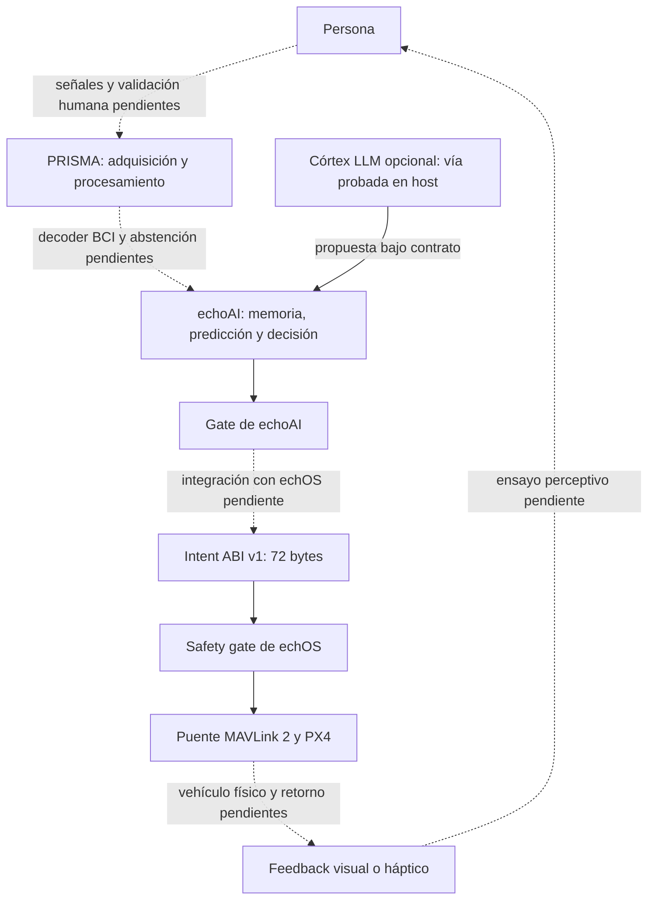

# PRISMA, echoAI y echOS: guía del sistema para usuarios

**Estado contrastado: 18 de septiembre de 2026.** Este paquete explica lo construido, las pruebas que lo respaldan y la integración pendiente. Está pensado para lectores nuevos y para compartir contexto con otras IA. No modifica las campañas ni sustituye sus contratos de aceptación.

**El laboratorio ya tiene una arquitectura híbrida con componentes spiking y un LLM opcional en echoAI, capacidades robóticas probadas en PX4 SITL y un unikernel robótico propio, echOS 3.0.** NEURO-DRON propone incorporar una entrada humana y un retorno sensorial a esas líneas existentes. La cadena completa con señales de una persona y dron físico aún no está validada.

## Qué leer y qué compartir

| Documento | Responde a |
|---|---|
| [Contexto listo para enviar a otra IA](CONTEXTO_PARA_IA.md) | ¿Qué debe saber antes de opinar o proponer trabajo? |
| [PRISMA y NEURO-DRON](NEURODRON_PRISMA_PARA_USUARIOS.md) | ¿Qué procesa PRISMA hoy y qué falta para una interfaz humana de vuelo? |
| [echoAI y ECHO-3](ECHOAI_ECHO3_PARA_USUARIOS.md) | ¿Qué hace el híbrido, dónde está el LLM y qué ha demostrado con un dron simulado? |
| [echOS 3.0](ECHOS_3_PARA_USUARIOS.md) | ¿Qué ejecuta el sistema operativo y qué autoridad conserva PX4? |

Cada guía se puede leer por separado. Para una conversación breve, enviar `CONTEXTO_PARA_IA.md`; para una revisión técnica, adjuntar también las tres guías.

## Vocabulario mínimo

| Término | Significado en estas guías |
|---|---|
| **SNN / spiking** | Red de neuronas artificiales que trabaja con impulsos o eventos |
| **LLM / córtex opcional** | Modelo de lenguaje que puede aportar una interpretación o propuesta |
| **Decoder / decodificador** | Programa que transforma un patrón de señal en una predicción o selección |
| **Gate** | Comprobación que acepta, modifica o bloquea una propuesta |
| **ABI** | Contrato exacto de campos y tamaños con el que dos componentes intercambian datos |
| **SITL** | Simulación con el controlador de vuelo ejecutándose como software en el ordenador |
| **HIL** | Prueba que incorpora hardware real al circuito de simulación |
| **Host** | Ordenador que ejecuta las herramientas, simuladores o modelos externos a echOS |
| **P95 / P99** | Valores bajo los que queda el 95 % / 99 % de las observaciones medidas; no máximos garantizados |

## Las tres responsabilidades

| Línea | Trabajo que ya existe | Aportación prevista a NEURO-DRON |
|---|---|---|
| **PRISMA** | Motor Rust por eventos y suite de análisis EEG sobre MNE-Python | Convertir una señal humana en una propuesta calibrada, con calidad, tiempo y posibilidad de abstenerse |
| **echoAI** | Agente de dos relojes: representación, memoria, predicción, política, aprendizaje y veto; vía opcional hacia Qwen; bancos ECHO-3 con PX4 SITL | Interpretar propuestas en contexto de misión y estado, sin entregar autoridad directa al decoder humano o al LLM |
| **echOS 3.0** | Unikernel con registros y colas acotados, productor simple, safety gate, watchdog y puente MAVLink 2 | Alojar una ejecución acotada de intenciones con procedencia, caducidad y límites |
| **PX4** | Controlador de vuelo utilizado por las pruebas SITL | Estabilización, ejecución de consignas, actuadores y failsafes del vehículo |

«Spiking», «memoria», «política», «LLM» y «controlador de vuelo» nombran funciones distintas. Ninguno de esos términos sustituye por sí solo a los demás.

## Cómo se unirían

El diagrama muestra **el contrato de integración propuesto**. Las flechas discontinuas requieren trabajo específico; no representan una campaña completa ya ejecutada.

WSP es la representación cognitiva de **16 bytes dentro de echoAI**. No se coloca como transporte del Intent ABI: son contratos diferentes. El LLM propone cuando el mecanismo de atención lo solicita; no se invoca en cada muestra del sensor ni sustituye al controlador.

Hay dos conexiones con PX4 ya ensayadas que conviene distinguir:

- **echoAI → adaptadores de sus bancos → PX4 SITL:** decisiones acotadas ejecutadas en simulación. No demuestra que el agente esté embebido en echOS.
- **echOS → su puente MAVLink → PX4 SITL:** runtime y transporte robótico del unikernel. Su productor actual es una política simple de prueba, no el agente completo de echoAI.

La futura costura entre ambas debe conservar los gates y ser validada como integración propia. La existencia de las dos conexiones no acredita automáticamente la cadena conjunta.

## Tres cifras que no son comparables

| Cifra | Qué describe realmente |
|---|---|
| **1,81 µs** | Media publicada de un microbenchmark del camino caliente de PRISMA Engine, con configuración concreta; no decisión cerebral |
| **1,6178 s** | Media del informe Qwen-0 para ocho consultas de lenguaje en host; no cadencia de vuelo |
| **98 / 163 / 1.245 ms** | Escenarios aritméticos propuestos para torso / EMG / EEG en NEURO-DRON; todavía sin medir |

Sus fuentes y límites aparecen en las guías correspondientes. No se suman ni comparan sin definir inicio, final, tarea y entorno.

## Estado que debe mantenerse visible

- **ECHO-1 y ECHO-2:** cerrados en sus bancos publicados.
- **ECHO-3:** 13/15 hitos con certificados software; TRANSFER-3 sigue rojo sin candidato útil confirmado y DRONE-3 conserva pendiente la integración completa.
- **echOS 3.0:** alcance de la versión cerrado mediante pruebas de plataforma/runtime/almacenamiento/PX4; no certificación aeronáutica de un producto físico.
- **NEURO-DRON:** revisión y propuesta de investigación; no decoder humano de vuelo ya validado.
- **Hardware:** no hay dron físico, sensores EEG/EMG ni placa Akida operativos y validados en esta campaña. AKD1500 M.2 es hardware previsto; no hay AKD1000 en el laboratorio.

## Cómo formular preguntas útiles ahora

En lugar de empezar diseñando un híbrido nuevo, preguntar por sus interfaces y evidencia: ¿cómo conservar el tiempo de origen de PRISMA?, ¿cómo caduca una propuesta lenta?, ¿qué prueba conecta el gate de echoAI con el ABI de echOS?, ¿cómo medir abstención entre días?, ¿qué capacidad robótica falta integrar en DRONE-3?

Las analogías con cerebro y médula ayudan a explicar responsabilidades, pero no prueban equivalencia anatómica, consciencia, confianza subjetiva ni incorporación del dron al cuerpo.

## Procedencia y actualización

Estas guías se elaboraron mediante lectura de código, informes JSON y documentos de las tres líneas. **No se volvieron a ejecutar los bancos ni se encendió el LLM para redactarlas.** Los enlaces de evidencia local permiten contrastar cada cifra; las páginas públicas enlazadas sirven de lectura accesible. No se han publicado estos documentos en la web.

Para actualizar el paquete, revisar primero las cabeceras vigentes y resultados de cada fase: los diarios contienen notas históricas que pueden haber quedado superadas. En particular, los documentos antiguos del ecosistema que sólo describen echOS 2.1 y NEXUS-0 no representan este corte.
